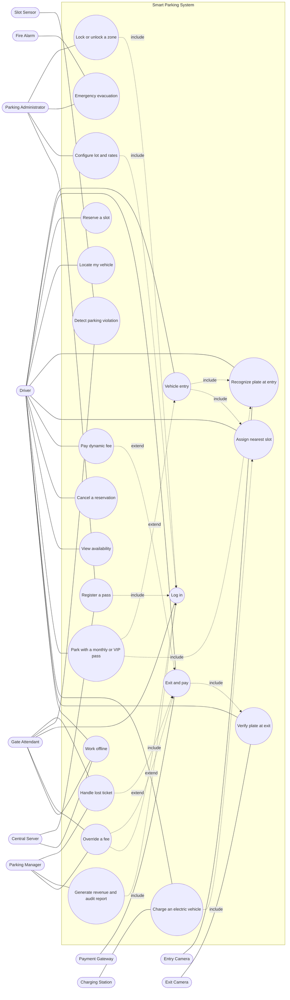
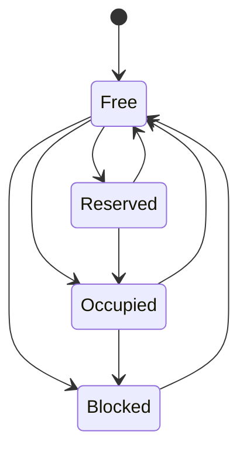
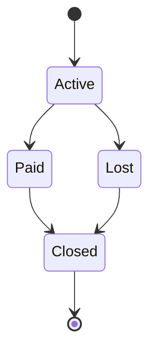
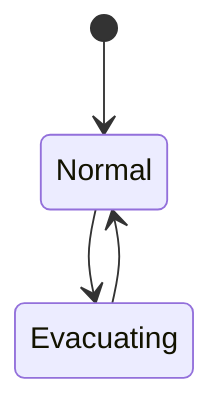
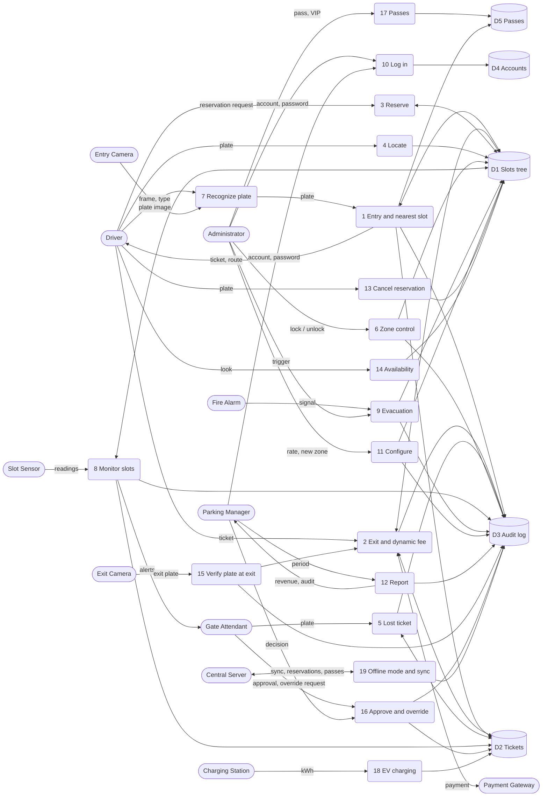
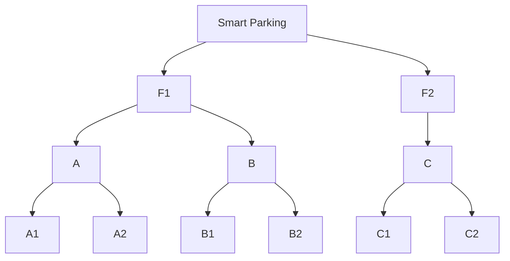
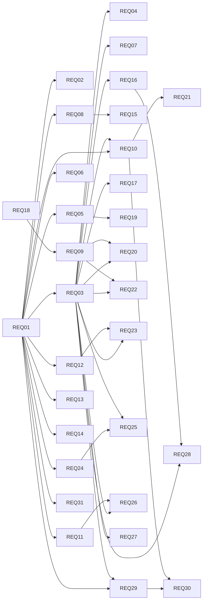

# Smart Parking System - report appendix (generated by parking.py)

## 1.2 Stakeholder analysis

| ID     | Name                  | Role                             | Influence | Interest |
| ------ | --------------------- | -------------------------------- | --------- | -------- |
| STK-01 | Mr. Hung              | Parking Operations Manager       | High      | High     |
| STK-02 | Ms. Mai               | IT Services Manager              | High      | Medium   |
| STK-03 | Driver Representative | Driver / Customer Representative | Low       | High     |
| STK-04 | Mr. Tuan              | Gate Attendant                   | Medium    | High     |
| STK-05 | Fire Safety Inspector | Compliance Inspector             | Medium    | Low      |

Power/interest grid:

| Influence \ Interest | High   | Medium | Low    |
| -------------------- | ------ | ------ | ------ |
| High                 | STK-01 | STK-02 |        |
| Medium               | STK-04 |        | STK-05 |
| Low                  | STK-03 |        |        |

## 2.1 Elicitation techniques applied

| ID    | Technique     | Date       | Participants         | Findings                                                                                                                 | Derived                                   |
| ----- | ------------- | ---------- | -------------------- | ------------------------------------------------------------------------------------------------------------------------ | ----------------------------------------- |
| EL-01 | Interview     | 2026-01-15 | STK-01;STK-04        | Attendants need fast entry (<10s), a clear view of free slots, and a way to handle lost tickets.                         | REQ-01;REQ-02;REQ-03;REQ-04;REQ-07        |
| EL-02 | Workshop      | 2026-01-22 | STK-01;STK-02;STK-05 | Security, availability and audit were rated top concerns.                                                                | REQ-08;REQ-09;REQ-10;REQ-18;NFR-01;NFR-02 |
| EL-03 | Questionnaire | 2026-01-28 | STK-03               | 65% of respondents want to reserve a slot; 50% want to find their car by plate.                                          | REQ-05;REQ-06;REQ-19                      |
| EL-04 | Observation   | 2026-02-05 | STK-04;STK-05        | Camera misreads plates in rain; attendants want alerts for wrong-slot parking; barriers must open within 5 s in a drill. | REQ-11;REQ-13;REQ-14;REQ-15;NFR-06        |
| EL-05 | Workshop      | 2026-02-12 | STK-01;STK-03        | Operator wants peak and occupancy pricing; drivers want the closest slot.                                                | REQ-12;REQ-16;REQ-17;REQ-20;REQ-21        |

## 2.2 Candidate requirements list

| ID     | Title                              | Priority | Status   | Source |
| ------ | ---------------------------------- | -------- | -------- | ------ |
| REQ-01 | Vehicle entry                      | Must     | Approved | STK-04 |
| REQ-02 | Slot availability display          | Must     | Approved | STK-03 |
| REQ-03 | Exit and fee calculation           | Must     | Approved | STK-01 |
| REQ-04 | Payment                            | Should   | Proposed | STK-01 |
| REQ-05 | Slot reservation                   | Should   | Proposed | STK-03 |
| REQ-06 | Locate vehicle                     | Could    | Proposed | STK-03 |
| REQ-07 | Lost ticket handling               | Must     | Proposed | STK-04 |
| REQ-08 | Zone lock                          | Should   | Approved | STK-01 |
| REQ-09 | Role-based access control          | Must     | Approved | STK-02 |
| REQ-10 | Audit log of transactions          | Must     | Proposed | STK-05 |
| REQ-11 | Plate recognition                  | Should   | Proposed | STK-04 |
| REQ-12 | Nearest slot assignment            | Should   | Proposed | STK-03 |
| REQ-13 | Sensor reconciliation              | Should   | Proposed | STK-04 |
| REQ-14 | Overstay alert                     | Could    | Proposed | STK-01 |
| REQ-15 | Emergency evacuation               | Must     | Proposed | STK-05 |
| REQ-16 | Peak-hour pricing                  | Should   | Approved | STK-01 |
| REQ-17 | Occupancy surcharge                | Could    | Approved | STK-01 |
| REQ-18 | Staff authentication               | Should   | Proposed | STK-02 |
| REQ-19 | Reservation cancellation           | Could    | Proposed | STK-03 |
| REQ-20 | Lot and rate configuration         | Should   | Proposed | STK-01 |
| REQ-21 | Revenue report                     | Could    | Proposed | STK-01 |
| REQ-22 | Manual fee override                | Should   | Proposed | STK-01 |
| REQ-23 | Monthly pass and VIP               | Could    | Proposed | STK-01 |
| REQ-24 | EV charging slots                  | Should   | Approved | STK-03 |
| REQ-25 | EV charging fee                    | Should   | Approved | STK-01 |
| REQ-26 | Exit plate verification            | Should   | Proposed | STK-04 |
| REQ-27 | Grace period                       | Could    | Proposed | STK-03 |
| REQ-28 | Daily fee cap                      | Could    | Proposed | STK-03 |
| REQ-29 | Offline gate operation             | Should   | Proposed | STK-02 |
| REQ-30 | Synchronization after offline mode | Should   | Proposed | STK-02 |
| REQ-31 | Barrier interlock                  | Should   | Proposed | STK-05 |

## 3.1 Functional requirements

| ID     | Description                                                                                                                                                                                              | Priority | Acceptance criteria                                                                                                                                                                        | Verification  |
| ------ | -------------------------------------------------------------------------------------------------------------------------------------------------------------------------------------------------------- | -------- | ------------------------------------------------------------------------------------------------------------------------------------------------------------------------------------------ | ------------- |
| REQ-01 | The system shall issue a ticket and assign an available slot of the matching vehicle type when a vehicle enters.                                                                                         | Must     | A ticket with entry time is created and the assigned slot is marked occupied.                                                                                                              | Test          |
| REQ-02 | The system shall display the number of free slots per floor and zone.                                                                                                                                    | Must     | Displayed counts equal the number of free slots in each floor and zone.                                                                                                                    | Test          |
| REQ-03 | The system shall calculate the parking fee as started hours multiplied by the hourly rate of the vehicle type when a vehicle exits.                                                                      | Must     | Outside peak hours and below 80% occupancy, fee equals ceil(hours parked) x hourly rate for the vehicle type.                                                                              | Test          |
| REQ-04 | The system shall accept cash or online payment before the exit barrier opens.                                                                                                                            | Should   | The barrier opens only after the fee is paid.                                                                                                                                              | Demonstration |
| REQ-05 | The system shall allow a driver to reserve a slot in advance and hold it until 15 minutes after the arrival time.                                                                                        | Should   | A reserved slot is never assigned to another vehicle and is released after a 15-minute no-show.                                                                                            | Test          |
| REQ-06 | The system shall allow a driver to find the slot of a parked vehicle by plate number.                                                                                                                    | Could    | Search by plate returns the floor, zone and slot of the vehicle.                                                                                                                           | Test          |
| REQ-07 | The system shall let attendants look up the entry record by plate number, charge the maximum daily fee plus a penalty, record the incident in the audit log, and notify the manager and print a receipt. | Must     |                                                                                                                                                                                            | Inspection    |
| REQ-08 | The system shall allow an administrator to lock or unlock a floor or zone so that no new vehicle is assigned to it.                                                                                      | Should   | Slots of a locked zone are never assigned; vehicles already parked are not affected.                                                                                                       | Test          |
| REQ-09 | The system shall restrict administrative functions to authenticated administrator accounts.                                                                                                              | Must     | An attendant account cannot lock or unlock a zone.                                                                                                                                         | Test          |
| REQ-10 | The system shall log every entry, exit, and payment transaction.                                                                                                                                         | Must     | Each transaction has a log record with a timestamp.                                                                                                                                        | Inspection    |
| REQ-11 | The system shall read the plate number from the entry camera image and fall back to manual entry when the recognition confidence is below 80%.                                                           | Should   | A read with confidence of at least 80% is accepted automatically; below 80% the attendant is asked to enter the plate.                                                                     | Test          |
| REQ-12 | The system shall assign the free slot of the vehicle type with the shortest walking distance to the gate.                                                                                                | Should   | Among free slots of the vehicle type, the one with the smallest distance to the gate is assigned.                                                                                          | Test          |
| REQ-13 | The system shall raise an alert when a slot sensor reading does not match the ticket records.                                                                                                            | Should   | A vehicle detected in a slot without a ticket, or a ticketed slot reported empty, produces an alert; a silent sensor blocks its slot.                                                      | Test          |
| REQ-14 | The system shall alert the attendant when a vehicle has been parked longer than 24 hours.                                                                                                                | Could    | An alert is raised once the stay exceeds 24 hours.                                                                                                                                         | Test          |
| REQ-15 | The system shall open all barriers and stop issuing tickets when an evacuation is triggered.                                                                                                             | Must     | After the trigger all barriers are open, exits are free of charge and no new ticket is issued.                                                                                             | Test          |
| REQ-16 | The system shall multiply the hourly rate by 1.5 for each started hour that begins between 07:00 and 09:00 or between 17:00 and 19:00.                                                                   | Should   | A started hour that begins in a peak period is charged at 1.5 times the hourly rate.                                                                                                       | Test          |
| REQ-17 | The system shall add a 25% surcharge to the fee when the occupancy of the vehicle type exceeds 80% at entry.                                                                                             | Could    | A vehicle entering when occupancy of its type exceeds 80% is charged 125% of the fee.                                                                                                      | Test          |
| REQ-18 | The system shall authenticate staff accounts with a password and lock an account after 3 consecutive failed attempts.                                                                                    | Should   | Valid credentials return the account role; the third consecutive failure locks the account.                                                                                                | Test          |
| REQ-19 | The system shall allow a driver to cancel a reservation and shall release the slot immediately.                                                                                                          | Could    | A cancelled reservation frees its slot for other vehicles at once.                                                                                                                         | Test          |
| REQ-20 | The system shall allow an administrator to change the hourly rate and add a zone while the lot is running.                                                                                               | Should   | A new rate applies only to tickets issued after the change; the slots of a new zone are assignable at once.                                                                                | Test          |
| REQ-21 | The system shall report the revenue per floor and zone for a selected period.                                                                                                                            | Could    | Zone revenues add up to the floor revenues and the floor revenues to the total of the payments in the period.                                                                              | Test          |
| REQ-22 | The system shall apply a manual fee correction only after a manager or an administrator has approved the request of an attendant.                                                                        | Should   | An approved override replaces the fee at exit; a request without a reason, or an approval by an attendant, is refused; request and decision are in the audit log.                          | Test          |
| REQ-23 | The system shall charge no parking fee to a vehicle whose plate holds a valid monthly or VIP pass.                                                                                                       | Could    | A vehicle with a valid pass pays 0 VND for parking; after the end date it pays the normal fee; VIP slots are assigned only to VIP pass holders.                                            | Test          |
| REQ-24 | The system shall assign a vehicle of type EV only to a free EV charging slot, and no other vehicle type to such a slot.                                                                                  | Should   | An EV gets a free EV slot; a car never gets an EV slot; with no free EV slot the entry is rejected.                                                                                        | Test          |
| REQ-25 | The system shall add the charged energy multiplied by the energy price to the fee of an EV.                                                                                                              | Should   | Fee = parking fee + kWh x 3500 VND; a zero or negative reading is rejected.                                                                                                                | Test          |
| REQ-26 | The system shall keep the exit barrier closed when the plate read at the exit differs from the plate of the ticket.                                                                                      | Should   | A mismatch or an unreadable plate keeps the barrier closed, raises an alert and is logged; an attendant approval lets the vehicle leave.                                                   | Test          |
| REQ-27 | The system shall charge no fee for a stay of 15 minutes or less.                                                                                                                                         | Could    | A stay of 15 minutes costs 0 VND; a stay of 16 minutes costs one started hour.                                                                                                             | Test          |
| REQ-28 | The system shall limit the fee of each started 24 hours to 10 times the hourly rate before the occupancy surcharge.                                                                                      | Could    | A 24 hour stay costs at most 10 x the hourly rate; a 25 hour stay costs the capped first day plus the started hours of the second day.                                                     | Test          |
| REQ-29 | The system shall keep the gates working for entry, exit and evacuation when the connection to the central server is lost.                                                                                | Should   | In offline mode vehicles enter and leave with cash or card payment, and evacuation opens the barriers; online payment, reservation and pass registration are refused with a clear message. | Test          |
| REQ-30 | The system shall mark every record made offline and clear the marks when the connection returns.                                                                                                         | Should   | Records made offline carry an offline mark; on reconnection their number is logged and the marks are cleared.                                                                              | Test          |
| REQ-31 | The system shall keep a barrier open while a vehicle is detected in its path or its presence sensor fails.                                                                                               | Should   | A close command is refused and logged when a vehicle is present, the sensor fails or power is lost; otherwise the barrier closes.                                                          | Test          |

## 3.2 Non-functional requirements

| ID     | Category     | Description                                                                            | Metric                                 | Target                                  | Priority |
| ------ | ------------ | -------------------------------------------------------------------------------------- | -------------------------------------- | --------------------------------------- | -------- |
| NFR-01 | Performance  | Slot assignment shall be fast enough not to hold up the entry gate.                    | 95th percentile response time          | <= 1 second                             | Must     |
| NFR-02 | Availability | The gate system shall be available during operating hours.                             | uptime during operating hours          | >= 99.5%                                | Must     |
| NFR-03 | Usability    | New attendants shall be able to process a lost-ticket case without extensive training. | task completion time (new staff)       | <= 2 minutes after 20 min training      | Should   |
| NFR-04 | Security     | Plate numbers and payment data shall be encrypted at rest and in transit.              | encryption coverage                    | 100% of PII fields (AES-256 / TLS 1.2+) | Must     |
| NFR-05 | Scalability  | The system shall support growth in the number of floors and slots.                     |                                        |                                         | Could    |
| NFR-06 | Safety       | All barriers shall open quickly once an evacuation is triggered.                       | time from trigger to all barriers open | <= 5 seconds                            | Must     |

## 4.1 Use case diagram



## 4.2 Detailed scenarios (executed on the simulation)

```
UC-01 Vehicle entry   (actor: Driver, frequency: Very high (daily))
Goal         : Park a vehicle in an available slot
Precondition : A free slot of the vehicle type exists; the lot is not evacuating
Trigger      : Vehicle arrives at the entry gate
Main flow:
  1. Driver arrives at the entry gate
       => 29A-111 (car) at the entry gate
  2. System reads the plate number and vehicle type <<include UC-07>>
       => plate=29A-111, type=car
  3. System finds the nearest available slot of matching type <<include UC-08>> <<extended by UC-18>>
       => nearest free car slot: A1
  4. System issues a ticket with an ID and the entry time
       => ticket TCK-2AAF4439, entry 10:00
  5. System shows the assigned slot and opens the entry barrier, which closes after the vehicle has passed
       => show A1 (Smart Parking > F1 > A > A1); barrier OPEN, then CLOSED after transit
Alternative flows:
  A1. [step 3] If no free slot of the vehicle type exists, system rejects entry and shows 'zone full'
       => 3rd moto: REJECTED 'zone full' (cars unaffected)
  A2. [step 3] If a slot is reserved for this plate, system assigns the reserved slot
       => VIP-1 gets its reserved slot A1
  A3. [step 2, exception] If the plate is already inside the lot, system rejects the entry
       => rejected: 29A-111 is already parked
Postcondition: Ticket created; slot marked occupied; barrier closed again

UC-02 Exit and pay   (actor: Driver, frequency: Very high (daily))
Goal         : Pay the parking fee and leave
Precondition : Vehicle has an active ticket
Trigger      : Driver reaches the exit gate
Main flow:
  1. Driver presents the ticket at the exit gate
       => ticket TCK-2AAF4439 presented
  2. System checks the entry time and the plate <<include UC-21>>
       => entry 10:00, exit 12:30 (2h30)
  3. System calculates the fee by started hours <<extended by UC-11>> <<extended by UC-17>>
       => 3 started hours x 10000 = 30000 VND (off-peak)
  4. Driver pays the fee by cash, card or online via the Payment Gateway
       => paid 30000 VND by card
  5. System prints the receipt, frees the slot and opens the exit barrier
       => receipt printed; slot A1 is Free; exit barrier OPEN
Alternative flows:
  A1. [step 1] If the ticket is not found, system refuses the exit and directs the driver to the attendant <<extended by UC-06>>
       => refused: ticket not found; driver sent to attendant (UC-06)
  A2. [step 4, exception] If payment fails, the barrier stays closed and the driver retries or changes the payment method
       => payment failed: barrier stays closed, slot occupied; retry with card -> open
  A3. [step 4, exception] If the Payment Gateway is unavailable, online payment is refused and the driver pays cash or card at the booth
       => gateway down: online refused, slot occupied; driver pays cash at the booth -> open
Postcondition: Ticket closed; fee and receipt recorded; slot free

UC-03 Reserve a slot   (actor: Driver, frequency: Medium)
Goal         : Reserve a slot before arriving
Precondition : A slot of the requested type is free
Trigger      : Driver plans a visit
Main flow:
  1. Driver selects the vehicle type and the arrival time
       => car, arrival 10:30
  2. System finds a free slot
       => free slot found: A1
  3. System marks the slot reserved for the plate
       => A1 reserved for VIP-1 until 10:45
  4. System confirms the reservation
       => reservation confirmed
Alternative flows:
  A1. [step 2] If no free slot exists, system rejects the reservation
       => 5th reservation: REJECTED (all 4 car slots reserved)
  A2. [step 3, exception] If the driver does not arrive within 15 minutes after the arrival time, system releases the reservation
       => A1 released at 10:46 (no-show over 15 min)
Postcondition: Reservation recorded; slot reserved

UC-04 Locate my vehicle   (actor: Driver, frequency: Medium)
Goal         : Find where the vehicle is parked
Precondition : Vehicle is currently parked
Trigger      : Driver returns to the lot
Main flow:
  1. Driver enters the plate number
       => plate 29A-333 entered
  2. System searches the active tickets
       => searched 3 active tickets
  3. System displays the floor, zone and slot with the distance from the gate
       => display: 50 m from the gate: Smart Parking > F2 > C > C1
Alternative flows:
  A1. [step 2] If the plate is not found, system shows 'vehicle not found'
       => 'vehicle not found'
Postcondition: Location displayed

UC-05 Lock or unlock a zone   (actor: Parking Administrator, frequency: Low)
Goal         : Block a floor or zone from new vehicles, or reopen it
Precondition : Account exists; lot is not evacuating
Trigger      : Maintenance or event planned
Main flow:
  1. Administrator authenticates <<include UC-12>>
       => admin1 logged in, role admin
  2. Administrator selects a floor or zone
       => zone A selected
  3. Administrator chooses lock or unlock
       => action: lock, later unlock
  4. System blocks the free slots (lock) or frees the blocked slots (unlock) of that branch
       => lock: 2 free slots in A set to Blocked (new car went to C1); unlock: 2 slots freed
  5. System confirms and logs the change
       => changes logged (lock, unlock)
Alternative flows:
  A1. [step 4] If occupied slots exist in the branch, they stay occupied until the vehicles leave and then become blocked
       => A1 stays Occupied while A locked; after exit it becomes Blocked
  A2. [step 4] If reserved slots exist in the branch, they keep their reservation
       => A1 reserved for VIP-1 keeps its reservation; VIP-1 still gets A1
  A3. [step 4] On unlock, slots whose sensor is faulty stay blocked
       => unlock: B1 freed, B2 stays Blocked because its sensor is faulty
  A4. [step 1, exception] If the account is not an administrator, system denies access
       => attendant denied: administrator only
Postcondition: Locked branch is not assigned to new vehicles; unlocked branch is assignable

UC-06 Handle lost ticket   (actor: Gate Attendant, frequency: Low)
Goal         : Let a driver without a ticket exit
Precondition : Driver is at the exit gate without a ticket
Trigger      : Driver reports a lost ticket
Main flow:
  1. Attendant enters the plate number
       => plate 29A-111 entered
  2. Attendant checks the identity and proof of ownership of the driver
       => identity and proof of ownership checked: accepted
  3. System looks up the entry record
       => entry record found, entry 10:00
  4. System charges the maximum daily fee plus the penalty
       => fee = 24h x 10000 + 50000 penalty = 290000 VND
  5. System frees the slot and logs the incident
       => slot A1 freed; incident logged
Alternative flows:
  A1. [step 3] If no entry record is found, the attendant escalates to the Parking Manager
       => no entry record: escalate to the Parking Manager
  A2. [step 2, exception] If the driver cannot prove ownership, system refuses the exit and notifies the Parking Manager
       => ownership not proven: exit refused, manager notified
Postcondition: Ticket closed; incident logged

UC-07 Recognize plate at entry   (actor: Driver, frequency: Very high (daily))
Goal         : Identify the vehicle automatically at the entry gate
Precondition : Entry Camera is online; vehicle is stopped at the gate
Trigger      : Vehicle stops at the entry gate
Main flow:
  1. Driver stops at the entry gate
       => car stops at the entry gate
  2. Entry Camera captures the plate image
       => frame captured (image quality 95%)
  3. System reads the plate number with a confidence score
       => plate read: 29A-111, confidence 95%
  4. System accepts the plate when confidence is at least 80%
       => confidence >= 80%: accepted, attendant not needed
  5. System continues with the vehicle entry
       => entry continues: ticket TCK-2AAF4439, slot A1
Alternative flows:
  A1. [step 4] If confidence is below 80%, system asks the attendant to enter the plate manually
       => confidence 55% (read '2?A?2?2'): attendant asked; manual entry '29A-222' accepted
  A2. [step 2, exception] If the Entry Camera is offline, system switches to manual entry and logs the fault
       => camera offline: manual entry used, fault logged
Postcondition: Plate number confirmed (read or manual) and passed to vehicle entry

UC-08 Assign nearest slot   (actor: Driver, frequency: Very high (daily))
Goal         : Park as close to the gate as possible
Precondition : A free slot of the vehicle type exists
Trigger      : Vehicle entry is accepted
Main flow:
  1. System receives the vehicle type from the gate
       => vehicle type: car
  2. System lists the free slots of that type
       => free car slots: A1, A2, B1, B2
  3. System computes the distance of each slot to the gate
       => distances: A1=40 m, A2=43 m, B1=10 m, B2=13 m
  4. System assigns the slot with the shortest distance
       => nearest: B1 (10 m); first in tree order would be A1 (40 m)
  5. System shows the route to the slot
       => route: 10 m from the gate: Smart Parking > F1 > B > B1
Alternative flows:
  A1. [step 4] If the nearest zone is locked or full, system assigns the next nearest slot
       => zone B locked: next nearest is A1 (40 m)
  A2. [step 4] If several slots have equal distance, system assigns the first in tree order
       => A1 and B1 both 10 m: tree order gives A1
Postcondition: Nearest free slot assigned and route shown

UC-09 Detect parking violation   (actor: Gate Attendant, frequency: High (continuous))
Goal         : Be alerted to wrong-slot parking, overstay and sensor faults
Precondition : Slot Sensors are online
Trigger      : Periodic sensor scan
Main flow:
  1. Slot Sensor reports the occupancy of each slot
       => 6 sensors report occupancy
  2. System compares the readings with the ticket records
       => compared with 1 active ticket(s)
  3. System detects a mismatch
       => mismatch: ticket holds A1 but vehicle sits in A2
  4. System raises an alert to the attendant
       => 2 alerts sent to attendant: missing_vehicle, unauthorized_vehicle
  5. Attendant moves the ticket to the slot where the vehicle really is and the system rescans
       => ticket moved A1 -> A2; rescan: 0 alerts
Alternative flows:
  A1. [step 3, exception] If a Slot Sensor sends no heartbeat, system blocks the slot and raises a sensor-fault alert
       => B2 silent: slot Blocked + fault alert; sensor back: slot Free again
  A2. [step 3] If a vehicle has stayed longer than 24 hours, system raises an overstay alert
       => 29A-111 parked 25 h in A1 (limit 24 h)
Postcondition: Alerts raised and logged; ticket matches the sensors; faulty slots blocked

UC-10 Emergency evacuation   (actor: Parking Administrator, frequency: Very low)
Goal         : Let all vehicles leave quickly and stop new entries
Precondition : Administrator is authenticated
Trigger      : Fire Alarm or emergency drill
Main flow:
  1. Administrator triggers the evacuation
       => evacuation triggered by administrator
  2. System opens all entry and exit barriers
       => barriers: open; 29A-111 left, fee 0 VND
  3. System locks the whole lot so that no new ticket is issued and cancels all reservations
       => 4 slots blocked, 1 reservation cancelled; new entry rejected
  4. System shows the evacuation message on all floors
       => message 'EVACUATE' shown on floors F1, F2
  5. System logs the evacuation start and the operator
       => logged: source=operator, role=admin
  6. Administrator ends the evacuation and the system closes the barriers and unlocks the lot
       => evacuation ended: 5 slots unblocked, barriers closed, new entry accepted
Alternative flows:
  A1. [step 1, exception] If the account is not an administrator, system denies access
       => attendant denied: administrator only
  A2. [step 1] If the Fire Alarm sends the signal, system starts the evacuation without operator login
       => fire alarm started the evacuation without operator login; barriers open
  A3. [step 6, exception] If an attendant tries to end the evacuation, system denies access
       => attendant cannot end the evacuation: lot stays evacuating
Postcondition: Barriers open during the evacuation and closed after it; exits free of charge; lot normal again

UC-11 Pay dynamic fee   (actor: Driver, frequency: Very high (daily))
Goal         : Pay a fee that reflects peak hours and lot occupancy
Precondition : Vehicle has an active ticket
Trigger      : Driver reaches the exit gate
Main flow:
  1. Driver presents the ticket at the exit gate
       => ticket TCK-B68C597C presented
  2. System splits the stay into started hours
       => 16:00-19:30 = 4 started hours
  3. System applies the peak-hour multiplier to each hour that starts in a peak period
       => 16:00 10000; 17:00 15000 peak; 18:00 15000 peak; 19:00 10000 = 50000
  4. System applies the occupancy surcharge recorded at entry
       => occupancy at entry car 100% > 80%: x1.25
  5. System shows the fee breakdown and the driver pays
       => fee 62500 VND shown and paid
Alternative flows:
  A1. [step 3] If the stay has no peak hours and occupancy was at most 80% at entry, system charges the base rate
       => off-peak, occupancy 25%: base rate, 2 h = 20000 VND
  A2. [step 3] If the vehicle is a motorbike, the same multipliers apply to the motorbike rate
       => moto 17:00-17:30: 3000 x 1.5 = 4500 VND
  A3. [step 2] If the stay is 15 minutes or less, system charges nothing (grace period)
       => grace period: 15 min = 0 VND, 16 min = 10000 VND
  A4. [step 3] If the fee of a started 24 hours exceeds 10 hourly rates, system charges the daily cap for that day
       => daily cap: 24 h would be 260000, charged 100000 VND; 25 h = 110000 VND
Postcondition: Ticket closed; dynamic fee recorded

UC-12 Log in   (actor: Gate Attendant, frequency: High (daily))
Goal         : Authenticate to use staff functions
Precondition : The account exists and is not locked
Trigger      : Staff member starts a session
Main flow:
  1. User enters the account name and password
       => user enters admin1 and the password
  2. System checks the credentials
       => credentials match
  3. System determines the role of the account
       => role of admin1: admin
  4. System grants the functions of that role and logs the login
       => access granted; event logged: login
Alternative flows:
  A1. [step 2, exception] If the credentials are wrong, system rejects the login and counts the failed attempt
       => invalid credentials; failed attempts: 1
  A2. [step 2, exception] After 3 consecutive failed attempts, system locks the account and logs the incident
       => account locked after 3 failed attempts; correct password now: account locked
Postcondition: Session role set; failures logged

UC-13 Cancel a reservation   (actor: Driver, frequency: Low)
Goal         : Cancel a reservation that is no longer needed
Precondition : A reservation exists for the plate
Trigger      : Driver changes plans
Main flow:
  1. Driver enters the plate number
       => plate VIP-1 entered
  2. System finds the reservation
       => reservation found: A1
  3. Driver confirms the cancellation
       => driver confirms the cancellation
  4. System releases the slot and logs the cancellation
       => A1 released (state Free) and assigned to the next car; cancellation logged
Alternative flows:
  A1. [step 2] If no reservation exists, system shows 'reservation not found'
       => reservation not found
  A2. [step 2] If the reservation already expired after the 15 minute hold, system shows 'reservation expired'
       => reservation expired
Postcondition: Reservation removed; slot free for other vehicles

UC-14 Configure lot and rates   (actor: Parking Administrator, frequency: Low)
Goal         : Change the hourly rate or add a zone while the lot is running
Precondition : Account exists
Trigger      : Operator changes pricing or extends the lot
Main flow:
  1. Administrator authenticates <<include UC-12>>
       => admin1 authenticated, role admin
  2. Administrator chooses to change a rate or add a zone
       => change: car rate 12000 and new zone D (2 car slots) on F2
  3. System validates the input
       => rate > 0 and zone name D unused: input valid
  4. System applies the change
       => rate applied; zone D added; next car assigned D1 (65 m from the gate: Smart Parking > F2 > D > D1)
  5. System logs the change
       => logged: rate_change, zone_added
Alternative flows:
  A1. [step 4] Vehicles already parked keep the rate of their ticket
       => parked 29A-111 keeps 10000/h; new tickets pay 12000/h
  A2. [step 3, exception] If the input is invalid (rate not positive, duplicate zone name), system rejects it
       => rejected: invalid rate input
  A3. [step 1, exception] If the account is not an administrator, system denies access
       => attendant denied: administrator only
Postcondition: New rate applies to new tickets; new zone slots are assignable

UC-15 View availability   (actor: Driver, frequency: Very high (daily))
Goal         : See where free slots are before entering
Precondition : None
Trigger      : Driver approaches the lot
Main flow:
  1. Driver looks at the availability display
       => driver looks at the display
  2. System counts the free slots per floor and zone
       => counted free slots over 6 slots in 5 floors and zones
  3. System displays the counts
       => Smart Parking 4/6, F1 2/4, A 0/2, B 2/2, F2 2/2, C 2/2
Alternative flows:
  A1. [step 2] If a floor or zone is locked or evacuating, system shows 0 free slots for it
       => zone A locked: shows 0/2 free
Postcondition: Counts displayed and equal to the real slot states

UC-16 Generate revenue and audit report   (actor: Parking Manager, frequency: Low)
Goal         : Review revenue and audited transactions of a period
Precondition : Account exists
Trigger      : Manager prepares a review or an audit
Main flow:
  1. Parking Manager authenticates <<include UC-12>>
       => mgr1 authenticated, role manager
  2. Parking Manager selects a period
       => period 10:00-15:00
  3. System collects the payments and lost-ticket charges of the period
       => 3 payments collected
  4. System groups the revenue per floor and zone
       => floors {'F1': 30000, 'F2': 10000}, zones {'A': 30000, 'C': 10000}
  5. System shows the report and the audit log entries of the period
       => total 40000 VND; 9 audit entries listed
Alternative flows:
  A1. [step 3] If no transaction exists in the period, system shows zero revenue
       => empty period: revenue 0, 0 payments
  A2. [step 1, exception] If the account is an attendant, system denies access
       => attendant denied: administrator or manager only
Postcondition: Report displayed; nothing changed

UC-17 Override a fee   (actor: Gate Attendant, frequency: Low)
Goal         : Correct a wrong fee with the approval of a manager
Precondition : Vehicle has an active ticket
Trigger      : Attendant finds a wrong fee
Main flow:
  1. Attendant authenticates <<include UC-12>>
       => attendant authenticated (UC-12)
  2. Attendant enters the plate, the corrected amount and the reason
       => plate 29A-111, amount 5000, reason 'meter fault: driver overcharged'
  3. System validates the input and records a pending override request
       => OV-1 recorded as Pending; fee still 20000 VND
  4. Parking Manager reviews the request and approves it
       => manager approves OV-1
  5. System applies the approved amount to the ticket and logs the request and the decision
       => ticket fee 5000 VND (was 20000); exit charged 5000; logged: override_requested, override_approved
Alternative flows:
  A1. [step 3, exception] If the reason is empty or the amount is negative, system rejects the request
       => rejected: override needs a non-negative amount and a reason
  A2. [step 4] If the Parking Manager rejects the request, system keeps the calculated fee
       => manager rejects OV-1: fee stays 20000 VND
  A3. [step 4, exception] If an attendant tries to approve, system denies access
       => attendant approval denied: manager or admin only
Postcondition: Ticket carries the approved amount; request and decision logged

UC-18 Park with a monthly or VIP pass   (actor: Driver, frequency: High (daily))
Goal         : Park without an hourly fee and, with a VIP pass, in a VIP slot
Precondition : The administrator registered a pass for the plate
Trigger      : Pass holder arrives at the gate
Main flow:
  1. Driver arrives at the entry gate with a registered plate
       => VIP-1 (car) at the entry gate
  2. System identifies the plate <<include UC-07>>
       => plate VIP-1 read (UC-07)
  3. System finds a valid pass for the plate
       => vip pass found, valid until 2026-11-16
  4. System assigns a slot, a VIP slot first for a VIP pass
       => VIP slot V1 (1 m)
  5. System issues a ticket marked with the pass type and opens the entry barrier
       => ticket TCK-CD14500E marked 'vip'; entry barrier OPEN
  6. System charges no parking fee at the exit
       => 5 h stay, parking fee 0 VND
Alternative flows:
  A1. [step 3] If the pass has ended, system logs the expiry and treats the vehicle as a normal visitor
       => pass ended 2026-10-18: expiry logged, 2 h charged 20000 VND
  A2. [step 4] If the pass is a monthly pass, system assigns an ordinary slot and never a VIP slot
       => monthly holder gets A1, not VIP slot V1; parking 0 VND
  A3. [step 6] If the vehicle is an EV, system still bills the charged energy
       => EV with monthly pass: parking 0, energy 10 kWh x 3500 = 35000 VND
Postcondition: Ticket closed; parking free of charge

UC-19 Register a pass   (actor: Parking Administrator, frequency: Low)
Goal         : Give a plate a monthly or VIP pass, or remove it
Precondition : Account exists; central server reachable
Trigger      : Customer buys or ends a pass
Main flow:
  1. Administrator authenticates <<include UC-12>>
       => admin1 authenticated, role admin
  2. Administrator enters the plate, the pass type and the end date
       => plate MON-1, type monthly, end date 2026-11-16
  3. System validates the input
       => type known and end date in the future: valid
  4. System stores the pass and logs the registration
       => pass stored; logged: pass_added (monthly until 2026-11-16)
Alternative flows:
  A1. [step 3, exception] If the pass type is unknown or the end date is in the past, system rejects the input
       => rejected: invalid pass (kind monthly|vip, end date in the future); invalid pass (kind monthly|vip, end date in the future)
  A2. [step 1, exception] If the account is not an administrator, system denies access
       => attendant denied: administrator only
  A3. [step 4, exception] If the Central Server is unreachable, system refuses the registration
       => refused: pass registration needs the central server (offline mode)
  A4. [step 2] If the administrator removes a pass, system deletes it and logs the removal
       => MON-1 removed; removal logged
Postcondition: Pass stored or removed; change logged

UC-20 Charge an electric vehicle   (actor: Driver, frequency: Medium)
Goal         : Park an EV at a charging slot and pay for the energy
Precondition : A free EV slot exists
Trigger      : EV arrives at the gate
Main flow:
  1. Driver arrives at the entry gate with an EV
       => EV-1 (ev) at the entry gate
  2. System assigns the nearest free EV slot <<include UC-08>>
       => nearest free EV slot: E1 (65 m from the gate: Smart Parking > F2 > E > E1)
  3. Charging Station reports the energy charged in kWh
       => charger reports 10 kWh; energy cost 35000 VND
  4. System adds the energy price to the fee at the exit
       => 2 h x 12000 = 24000 VND parking + 35000 VND energy = 59000 VND
  5. Driver pays the total at the exit
       => paid 59000 VND; slot E1 Free
Alternative flows:
  A1. [step 2] If no EV slot is free, system rejects the entry
       => 2nd EV: REJECTED (EV zone full)
  A2. [step 2] If the vehicle is a car, system never assigns an EV slot
       => 5th car: REJECTED although E1 is free (cars never use EV slots)
  A3. [step 3, exception] If the energy reading is zero or negative, system rejects the reading
       => rejected: 0 kWh, -3 kWh and a car reading (charging needs an EV in an EV slot and a positive energy reading)
Postcondition: Ticket closed; parking and energy paid

UC-21 Verify plate at exit   (actor: Driver, frequency: Very high (daily))
Goal         : Leave only with the vehicle that matches the ticket
Precondition : Vehicle has an active ticket
Trigger      : Vehicle stops at the exit gate
Main flow:
  1. Exit Camera reads the plate of the vehicle at the exit gate
       => exit camera reads 29A-111
  2. System finds the ticket presented by the driver
       => ticket of 29A-111 found
  3. System compares the plate read with the plate of the ticket
       => read 29A-111 == ticket 29A-111
  4. System accepts the match and releases the vehicle for payment
       => match: payment 10000 VND, vehicle released
Alternative flows:
  A1. [step 3, exception] If the plates differ, the barrier stays closed and the system logs the mismatch and alerts the attendant
       => camera read 29A-999 but the ticket belongs to 29A-222: barrier closed, attendant alerted; slot A2 still occupied
  A2. [step 3] If an attendant verifies the vehicle and approves, system lets it leave and logs the approval
       => attendant approves: vehicle leaves (10000 VND), approval logged
  A3. [step 1] If the Exit Camera cannot read the plate, system treats it as a mismatch
       => unreadable plate: barrier stays closed; a guest cannot approve
Postcondition: Vehicle released or held; mismatch logged

UC-22 Work offline   (actor: Gate Attendant, frequency: Low)
Goal         : Keep the gates running while the central server is unreachable
Precondition : Gates and local data are available
Trigger      : Network or server failure
Main flow:
  1. Central Server connection is lost
       => central server connection lost at 10:30
  2. System switches the gates to local mode and logs the event
       => logged: network_down; gates in local mode
  3. Drivers enter and leave as usual with cash or card payment
       => 29A-222 enters, 29A-111 exits and pays 20000 VND cash
  4. System marks every record made in local mode
       => 3 records marked offline
  5. Connection returns and the system synchronizes the marked records and logs their number
       => connection back: 3 records synchronized, marks cleared
Alternative flows:
  A1. [step 3] If a driver chooses online payment, system refuses it and asks for cash or card
       => online refused: payment gateway unavailable: pay cash or card at the booth; slot Occupied
  A2. [step 3, exception] If a driver asks for a reservation or the administrator registers a pass, system refuses it until the connection returns
       => refused offline: reservation needs the central server (offline mode); pass registration needs the central server (offline mode)
  A3. [step 3] If an evacuation is triggered in local mode, the barriers open as usual
       => evacuation offline: barriers OPEN, exit free of charge
Postcondition: No record lost; marks cleared after synchronization
```

## 5.1 State machine diagrams

Slot:



Ticket:



Lot:



## 5.2 Data flow diagram



## 5.3 Parking structure tree



## 6.1 ISO/IEC 25010 classification

| ID     | Title                         | Category     | ISO/IEC 25010                     | Metric                                 | Target                                  | Method        | Simulation result      |
| ------ | ----------------------------- | ------------ | --------------------------------- | -------------------------------------- | --------------------------------------- | ------------- | ---------------------- |
| NFR-01 | Slot assignment response time | Performance  | Performance efficiency            | 95th percentile response time          | <= 1 second                             | Test          | manual / not simulated |
| NFR-02 | System availability           | Availability | Reliability (availability)        | uptime during operating hours          | >= 99.5%                                | Analysis      | manual / not simulated |
| NFR-03 | Usability for attendants      | Usability    | Usability                         | task completion time (new staff)       | <= 2 minutes after 20 min training      | Demonstration | manual / not simulated |
| NFR-04 | Data protection               | Security     | Security                          | encryption coverage                    | 100% of PII fields (AES-256 / TLS 1.2+) | Inspection    | manual / not simulated |
| NFR-05 | Scalability                   | Scalability  | Performance efficiency (capacity) | (none)                                 | (none)                                  | Analysis      | manual / not simulated |
| NFR-06 | Evacuation response time      | Safety       | Safety                            | time from trigger to all barriers open | <= 5 seconds                            | Test          | manual / not simulated |

## 6.2 Simulation verification results

| ID     | Title                         | Category     | ISO/IEC 25010                     | Metric                                 | Target                                  | Method        | Simulation result                                                             |
| ------ | ----------------------------- | ------------ | --------------------------------- | -------------------------------------- | --------------------------------------- | ------------- | ----------------------------------------------------------------------------- |
| NFR-01 | Slot assignment response time | Performance  | Performance efficiency            | 95th percentile response time          | <= 1 second                             | Test          | PASS: p95 = 0.606 ms over 1000 requests (target <= 1 second)                  |
| NFR-02 | System availability           | Availability | Reliability (availability)        | uptime during operating hours          | >= 99.5%                                | Analysis      | PASS: 99.98% uptime, 7 min down in 30 days (target >= 99.5%; modeled outages) |
| NFR-03 | Usability for attendants      | Usability    | Usability                         | task completion time (new staff)       | <= 2 minutes after 20 min training      | Demonstration | manual / not simulated                                                        |
| NFR-04 | Data protection               | Security     | Security                          | encryption coverage                    | 100% of PII fields (AES-256 / TLS 1.2+) | Inspection    | manual / not simulated                                                        |
| NFR-05 | Scalability                   | Scalability  | Performance efficiency (capacity) | (none)                                 | (none)                                  | Analysis      | manual / not simulated                                                        |
| NFR-06 | Evacuation response time      | Safety       | Safety                            | time from trigger to all barriers open | <= 5 seconds                            | Test          | PASS: barriers open in 0.299 ms with 500 cars parked (target <= 5 seconds)    |

## 7.1 Requirements traceability matrix

| Item   | Use case                                        | Test case                                       | Hazard       | Change req | Elicitation |
| ------ | ----------------------------------------------- | ----------------------------------------------- | ------------ | ---------- | ----------- |
| REQ-01 | UC-01, UC-07                                    | TC-01, TC-02, TC-04                             | HZ-03        | CR-02      | EL-01       |
| REQ-02 | UC-01, UC-15                                    | TC-41, TC-46                                    | -            | CR-02      | EL-01       |
| REQ-03 | UC-02, UC-17                                    | TC-03, TC-07, TC-26                             | HZ-02        | CR-01      | EL-01       |
| REQ-04 | UC-02                                           | TC-25                                           | -            | -          | EL-01       |
| REQ-05 | UC-03, UC-13                                    | TC-05, TC-27, TC-28                             | -            | CR-02      | EL-03       |
| REQ-06 | UC-04                                           | TC-06, TC-29                                    | -            | -          | EL-03       |
| REQ-07 | UC-06                                           | TC-10, TC-31, TC-32                             | -            | -          | EL-01       |
| REQ-08 | UC-05                                           | TC-09, TC-15, TC-30, TC-46                      | -            | -          | EL-02       |
| REQ-09 | UC-05, UC-10, UC-12, UC-14, UC-16, UC-17, UC-19 | TC-08, TC-20, TC-40, TC-51, TC-55, TC-56        | HZ-05        | -          | EL-02       |
| REQ-10 | UC-16                                           | TC-43                                           | -            | -          | EL-02       |
| REQ-11 | UC-07, UC-21                                    | TC-11, TC-12, TC-13                             | HZ-06        | -          | EL-04       |
| REQ-12 | UC-08, UC-18                                    | TC-14, TC-15                                    | -            | -          | EL-05       |
| REQ-13 | UC-09                                           | TC-16, TC-17                                    | HZ-08        | -          | EL-04       |
| REQ-14 | UC-09                                           | TC-18                                           | -            | -          | EL-04       |
| REQ-15 | UC-10, UC-22                                    | TC-19, TC-20, TC-21, TC-22, TC-44, TC-45, TC-66 | HZ-07        | -          | EL-04       |
| REQ-16 | UC-11                                           | TC-07, TC-23                                    | HZ-09        | CR-01      | EL-05       |
| REQ-17 | UC-11                                           | TC-24                                           | HZ-09        | CR-01      | EL-05       |
| REQ-18 | UC-05, UC-12                                    | TC-33, TC-34, TC-35                             | HZ-05        | -          | EL-02       |
| REQ-19 | UC-13                                           | TC-36, TC-37                                    | -            | -          | EL-03       |
| REQ-20 | UC-14                                           | TC-38, TC-39, TC-40                             | -            | -          | EL-05       |
| REQ-21 | UC-16                                           | TC-42, TC-47                                    | -            | -          | EL-05       |
| REQ-22 | UC-17                                           | TC-50, TC-51                                    | HZ-02, HZ-12 | -          | -           |
| REQ-23 | UC-18, UC-19                                    | TC-52, TC-53, TC-54, TC-55, TC-56               | -            | -          | -           |
| REQ-24 | UC-20                                           | TC-57                                           | -            | CR-02      | -           |
| REQ-25 | UC-20                                           | TC-58, TC-59                                    | -            | CR-02      | -           |
| REQ-26 | UC-02, UC-21                                    | TC-60, TC-61, TC-62                             | HZ-10        | -          | -           |
| REQ-27 | UC-11                                           | TC-48                                           | -            | -          | -           |
| REQ-28 | UC-11                                           | TC-49                                           | HZ-09        | -          | -           |
| REQ-29 | UC-19, UC-22                                    | TC-56, TC-63, TC-64, TC-66                      | HZ-11        | -          | -           |
| REQ-30 | UC-22                                           | TC-65                                           | HZ-11        | -          | -           |
| REQ-31 | UC-01, UC-02                                    | TC-67                                           | HZ-04        | -          | -           |
| NFR-01 | -                                               | TC-04                                           | -            | -          | EL-02       |
| NFR-02 | -                                               | TC-67                                           | HZ-04, HZ-11 | -          | EL-02       |
| NFR-03 | -                                               | -                                               | -            | -          | -           |
| NFR-04 | -                                               | -                                               | HZ-01        | -          | -           |
| NFR-05 | -                                               | -                                               | -            | -          | -           |
| NFR-06 | -                                               | TC-22                                           | HZ-07        | -          | EL-04       |

REQ coverage: use case 100%, test case 100%, elicitation 67%.
REQ without test: none.

Dependency tree:

```
SRS (child depends on parent)
+-- REQ-01 Vehicle entry
|   +-- REQ-02 Slot availability display
|   +-- REQ-03 Exit and fee calculation
|   |   +-- REQ-04 Payment
|   |   +-- REQ-07 Lost ticket handling
|   |   +-- REQ-10 Audit log of transactions
|   |   |   +-- REQ-21 Revenue report
|   |   |   `-- REQ-30 Synchronization after offline mode
|   |   +-- REQ-16 Peak-hour pricing
|   |   |   `-- REQ-28 Daily fee cap
|   |   +-- REQ-17 Occupancy surcharge
|   |   +-- REQ-20 Lot and rate configuration
|   |   +-- REQ-22 Manual fee override
|   |   +-- REQ-23 Monthly pass and VIP
|   |   +-- REQ-25 EV charging fee
|   |   +-- REQ-26 Exit plate verification
|   |   +-- REQ-27 Grace period
|   |   +-- REQ-28 Daily fee cap
|   |   `-- REQ-29 Offline gate operation
|   |       `-- REQ-30 Synchronization after offline mode
|   +-- REQ-05 Slot reservation
|   |   `-- REQ-19 Reservation cancellation
|   +-- REQ-06 Locate vehicle
|   +-- REQ-08 Zone lock
|   |   `-- REQ-15 Emergency evacuation
|   +-- REQ-10 Audit log of transactions
|   |   +-- REQ-21 Revenue report
|   |   `-- REQ-30 Synchronization after offline mode
|   +-- REQ-11 Plate recognition
|   |   `-- REQ-26 Exit plate verification
|   +-- REQ-12 Nearest slot assignment
|   |   `-- REQ-23 Monthly pass and VIP
|   +-- REQ-13 Sensor reconciliation
|   +-- REQ-14 Overstay alert
|   +-- REQ-24 EV charging slots
|   |   `-- REQ-25 EV charging fee
|   +-- REQ-29 Offline gate operation
|   |   `-- REQ-30 Synchronization after offline mode
|   `-- REQ-31 Barrier interlock
`-- REQ-18 Staff authentication
    `-- REQ-09 Role-based access control
        +-- REQ-20 Lot and rate configuration
        `-- REQ-22 Manual fee override
```



## 7.2 Automated test results

| ID    | Title                                                             | Reqs                 | Type           | Prio   | Status | Actual result                                                                                                                                                                                                                        |
| ----- | ----------------------------------------------------------------- | -------------------- | -------------- | ------ | ------ | ------------------------------------------------------------------------------------------------------------------------------------------------------------------------------------------------------------------------------------ |
| TC-01 | Entry assigns the nearest free slot of the matching type          | REQ-01               | Functional     | Must   | Passed | Ticket issued; slot A1 assigned.                                                                                                                                                                                                     |
| TC-02 | Entry is rejected when the zone is full                           | REQ-01               | Functional     | Should | Passed | Entry rejected ('zone full'); rejection logged.                                                                                                                                                                                      |
| TC-03 | Fee is calculated correctly for a 2h30 stay                       | REQ-03               | Functional     | Must   | Passed | Fee = 30000 VND.                                                                                                                                                                                                                     |
| TC-04 | Slot assignment responds within 1 second under normal load        | REQ-01;NFR-01        | Non-functional | Must   | Passed | p95 = 0.688 ms over 1000 requests.                                                                                                                                                                                                   |
| TC-05 | Reserved slot is not given to another vehicle                     | REQ-05               | Functional     | Should | Passed | Other car got A2; VIP-1 got A1.                                                                                                                                                                                                      |
| TC-06 | Vehicle is located by plate number                                | REQ-06               | Functional     | Could  | Passed | Found: Smart Parking > F1 > A > A2.                                                                                                                                                                                                  |
| TC-07 | Peak-hour rate is applied once CR-01 is implemented               | REQ-03;REQ-16        | Integration    | Could  | Passed | CR-01 implemented: 17:00-18:00 charged 15000 VND (1.5 x 10000).                                                                                                                                                                      |
| TC-08 | Attendant account cannot lock a zone                              | REQ-09               | Security       | Must   | Passed | PermissionError raised; denial logged.                                                                                                                                                                                               |
| TC-09 | Locked zone is not assigned to new vehicles                       | REQ-08               | Functional     | Should | Passed | Car assigned C1 (zone A blocked).                                                                                                                                                                                                    |
| TC-10 | Lost ticket is charged the maximum daily fee plus penalty         | REQ-07               | Functional     | Must   | Passed | Charged 290000 VND (24h x 10000 + 50000).                                                                                                                                                                                            |
| TC-11 | Plate with high confidence is accepted automatically              | REQ-11               | Functional     | Should | Passed | Plate 29A-111 accepted at 95% confidence.                                                                                                                                                                                            |
| TC-12 | Plate with low confidence requires manual entry                   | REQ-11               | Functional     | Should | Passed | 55% confidence: manual entry requested and accepted.                                                                                                                                                                                 |
| TC-13 | Camera offline falls back to manual entry                         | REQ-11               | Functional     | Should | Passed | Manual entry required; camera_offline logged.                                                                                                                                                                                        |
| TC-14 | Nearest free slot is assigned                                     | REQ-12               | Functional     | Should | Passed | Assigned B1 (10 m), not A1 (40 m).                                                                                                                                                                                                   |
| TC-15 | Next nearest slot is assigned when the nearest zone is locked     | REQ-12;REQ-08        | Functional     | Should | Passed | Zone B locked: assigned A1.                                                                                                                                                                                                          |
| TC-16 | Sensor mismatch raises alerts                                     | REQ-13               | Functional     | Should | Passed | Alerts: missing_vehicle, unauthorized_vehicle.                                                                                                                                                                                       |
| TC-17 | Silent sensor blocks its slot                                     | REQ-13               | Functional     | Should | Passed | B2 blocked on silence, freed on recovery.                                                                                                                                                                                            |
| TC-18 | Overstay alert after 24 hours                                     | REQ-14               | Functional     | Could  | Passed | 29A-111 parked 25 h in A1 (limit 24 h)                                                                                                                                                                                               |
| TC-19 | Evacuation opens barriers and stops new entries                   | REQ-15               | Functional     | Must   | Passed | Barriers open; entry rejected; exit charged 0 VND.                                                                                                                                                                                   |
| TC-20 | Attendant cannot trigger evacuation                               | REQ-15;REQ-09        | Security       | Must   | Passed | PermissionError raised; denial logged.                                                                                                                                                                                               |
| TC-21 | Fire alarm starts evacuation without login                        | REQ-15               | Integration    | Must   | Passed | Evacuation started by fire alarm; barriers open.                                                                                                                                                                                     |
| TC-22 | Barriers open within 5 seconds of the evacuation trigger          | REQ-15;NFR-06        | Non-functional | Must   | Passed | Barriers open in 0.319 ms (500 cars parked).                                                                                                                                                                                         |
| TC-23 | Peak-hour multiplier applies only to peak hours                   | REQ-16               | Functional     | Should | Passed | Fee = 25000 VND (10000 + 15000).                                                                                                                                                                                                     |
| TC-24 | Occupancy surcharge applies above 80% occupancy                   | REQ-17               | Functional     | Could  | Passed | 3rd car base fee; 4th car (100% occupancy) 12500 VND = 125% of 10000.                                                                                                                                                                |
| TC-25 | Barrier opens only after payment is made                          | REQ-04               | Functional     | Should | Passed | Failed payment: slot stays occupied; after payment the slot is free.                                                                                                                                                                 |
| TC-26 | Exit with an unknown ticket is refused                            | REQ-03               | Functional     | Should | Passed | Exit refused: ticket not found.                                                                                                                                                                                                      |
| TC-27 | Reservation is rejected when no slot is free                      | REQ-05               | Functional     | Should | Passed | 5th reservation rejected (4 car slots reserved).                                                                                                                                                                                     |
| TC-28 | No-show reservation is released after 15 minutes                  | REQ-05               | Functional     | Should | Passed | A1 released at 10:46.                                                                                                                                                                                                                |
| TC-29 | Locate rejects an unknown plate                                   | REQ-06               | Functional     | Could  | Passed | Plate NOPE: vehicle not found.                                                                                                                                                                                                       |
| TC-30 | Occupied slot stays occupied when its zone is locked              | REQ-08               | Functional     | Should | Passed | A1 occupied after lock; blocked after exit.                                                                                                                                                                                          |
| TC-31 | Lost ticket without an entry record is escalated                  | REQ-07               | Functional     | Should | Passed | no entry record: escalate to the Parking Manager.                                                                                                                                                                                    |
| TC-32 | Lost ticket without proof of ownership is refused                 | REQ-07               | Security       | Must   | Passed | Exit refused; refusal logged.                                                                                                                                                                                                        |
| TC-33 | Valid login returns the account role                              | REQ-18               | Security       | Should | Passed | admin1 logged in with role admin.                                                                                                                                                                                                    |
| TC-34 | Wrong password is rejected                                        | REQ-18               | Security       | Should | Passed | Login rejected; failed attempts: 1.                                                                                                                                                                                                  |
| TC-35 | Account is locked after 3 failed attempts                         | REQ-18               | Security       | Must   | Passed | account locked (correct password refused after 3 failures).                                                                                                                                                                          |
| TC-36 | Cancelling a reservation frees the slot                           | REQ-19               | Functional     | Could  | Passed | A1 released and assigned to the next car.                                                                                                                                                                                            |
| TC-37 | Cancelling a missing reservation is reported                      | REQ-19               | Functional     | Could  | Passed | Cancel NOPE: reservation not found.                                                                                                                                                                                                  |
| TC-38 | Rate change applies to new tickets only                           | REQ-20               | Functional     | Should | Passed | Car A pays 10000; car B pays 12000.                                                                                                                                                                                                  |
| TC-39 | Zone added at runtime is assignable at once                       | REQ-20               | Functional     | Should | Passed | Zone D added; the next car got D1.                                                                                                                                                                                                   |
| TC-40 | Attendant cannot change rates or add zones                        | REQ-20;REQ-09        | Security       | Must   | Passed | Both attempts denied.                                                                                                                                                                                                                |
| TC-41 | Availability counts match the slot states                         | REQ-02               | Functional     | Must   | Passed | A 0/2, F1 2/4, lot 4/6 free.                                                                                                                                                                                                         |
| TC-42 | Revenue per zone and floor sums to the total                      | REQ-21               | Functional     | Could  | Passed | Zones {'A': 20000, 'C': 10000} = floors {'F1': 20000, 'F2': 10000} = total 30000.                                                                                                                                                    |
| TC-43 | Audit log records entry, payment and exit                         | REQ-10               | Functional     | Must   | Passed | Audit events: entry, payment, exit.                                                                                                                                                                                                  |
| TC-44 | Ending an evacuation restores normal operation                    | REQ-15               | Functional     | Must   | Passed | Barriers closed, slots unblocked, new entry accepted.                                                                                                                                                                                |
| TC-45 | Evacuation cancels reservations                                   | REQ-15               | Functional     | Should | Passed | Reservation cancelled; A1 blocked.                                                                                                                                                                                                   |
| TC-46 | Locked zone shows zero free slots                                 | REQ-02;REQ-08        | Functional     | Should | Passed | Zone A shows 0 free slots.                                                                                                                                                                                                           |
| TC-47 | Report for a period without payments shows zero                   | REQ-21               | Functional     | Could  | Passed | Revenue 0, 0 payments.                                                                                                                                                                                                               |
| TC-48 | A stay of 15 minutes is free                                      | REQ-27               | Functional     | Could  | Passed | 15 min = 0 VND; 16 min = 10000 VND.                                                                                                                                                                                                  |
| TC-49 | The fee of a started 24 hours is capped                           | REQ-28               | Functional     | Could  | Passed | 24 h = 100000 VND (cap); 25 h = 110000 VND.                                                                                                                                                                                          |
| TC-50 | An approved fee override replaces the calculated fee              | REQ-22               | Functional     | Should | Passed | ticket fee 5000 VND (was 20000); exit charged 5000; logged: override_requested, override_approved                                                                                                                                    |
| TC-51 | Invalid, unapproved or rejected overrides do not change the fee   | REQ-22;REQ-09        | Security       | Must   | Passed | rejected: override needs a non-negative amount and a reason; manager rejects OV-1: fee stays 20000 VND; attendant approval denied: manager or admin only                                                                             |
| TC-52 | A monthly pass parks free of charge                               | REQ-23               | Functional     | Could  | Passed | Monthly pass: 5 h stay costs 0 VND.                                                                                                                                                                                                  |
| TC-53 | Only VIP pass holders get VIP slots                               | REQ-23               | Functional     | Could  | Passed | VIP holder: V1; monthly holder: A1; ordinary car: A2.                                                                                                                                                                                |
| TC-54 | An expired pass pays the normal fee                               | REQ-23               | Functional     | Could  | Passed | Expired pass: expiry logged, fee 20000 VND.                                                                                                                                                                                          |
| TC-55 | Administrator registers and removes a pass                        | REQ-23;REQ-09        | Functional     | Could  | Passed | pass stored; logged: pass_added (monthly until 2026-11-16); MON-1 removed; removal logged                                                                                                                                            |
| TC-56 | Invalid, unauthorized or offline pass registration is refused     | REQ-23;REQ-09;REQ-29 | Security       | Could  | Passed | rejected: invalid pass (kind monthly/vip, end date in the future); invalid pass (kind monthly/vip, end date in the future); attendant denied: administrator only; refused: pass registration needs the central server (offline mode) |
| TC-57 | EVs get EV slots and cars never do                                | REQ-24               | Functional     | Should | Passed | EVs got E1 and E2; third EV rejected; the car got A1.                                                                                                                                                                                |
| TC-58 | The energy price is added to the fee                              | REQ-25               | Functional     | Should | Passed | Fee 59000 VND (24000 parking + 35000 energy).                                                                                                                                                                                        |
| TC-59 | A bad energy reading is rejected                                  | REQ-25               | Negative       | Should | Passed | 0 kWh and a car reading were rejected.                                                                                                                                                                                               |
| TC-60 | A matching exit plate lets the vehicle leave                      | REQ-26               | Functional     | Should | Passed | Matching plate: vehicle left.                                                                                                                                                                                                        |
| TC-61 | A plate mismatch keeps the barrier closed                         | REQ-26               | Security       | Must   | Passed | Mismatch: exit refused, slot still occupied, mismatch logged.                                                                                                                                                                        |
| TC-62 | An attendant can approve a mismatch or an unreadable plate        | REQ-26               | Functional     | Should | Passed | attendant approves: vehicle leaves (10000 VND), approval logged; unreadable plate: barrier stays closed; a guest cannot approve                                                                                                      |
| TC-63 | Gates keep working offline                                        | REQ-29               | Functional     | Should | Passed | Offline: entry and cash exit worked; 3 records marked.                                                                                                                                                                               |
| TC-64 | Online payment and reservations are refused offline               | REQ-29               | Functional     | Should | Passed | online refused: payment gateway unavailable: pay cash or card at the booth; slot Occupied; refused offline: reservation needs the central server (offline mode); pass registration needs the central server (offline mode)           |
| TC-65 | Records are synchronized when the network returns                 | REQ-30               | Functional     | Should | Passed | 1 record synchronized; marks cleared; count logged.                                                                                                                                                                                  |
| TC-66 | Evacuation works offline                                          | REQ-29;REQ-15        | Functional     | Must   | Passed | evacuation offline: barriers OPEN, exit free of charge                                                                                                                                                                               |
| TC-67 | Barrier stays open while a vehicle is present or the sensor fails | REQ-31;NFR-02        | Safety         | Must   | Passed | Barrier stayed open with a vehicle present, a sensor fault, and power loss (3 refusals logged); closed when clear.                                                                                                                   |

Passed 67, Failed 0, Not Run 0 of 67.

## 7.3 Requirements change management

```
CR-01 Add peak-hour pricing [Implemented]
  directly affected : REQ-03, REQ-16, REQ-17
  impacted via deps : REQ-03, REQ-04, REQ-07, REQ-10, REQ-16, REQ-17, REQ-20, REQ-21, REQ-22, REQ-23, REQ-25, REQ-26, REQ-27, REQ-28, REQ-29, REQ-30
  use cases to review: UC-02, UC-06, UC-11, UC-14, UC-16, UC-17, UC-18, UC-19, UC-20, UC-21, UC-22
  tests to re-run    : TC-03, TC-07, TC-10, TC-23, TC-24, TC-25, TC-26, TC-31, TC-32, TC-38, TC-39, TC-40, TC-42, TC-43, TC-47, TC-48, TC-49, TC-50, TC-51, TC-52, TC-53, TC-54, TC-55, TC-56, TC-58, TC-59, TC-60, TC-61, TC-62, TC-63, TC-64, TC-65, TC-66
  hazards to review  : HZ-02, HZ-09, HZ-10, HZ-11, HZ-12
  complexity of impacted requirements: 49
  estimate: cost 5 days, schedule 7 days

CR-02 Add EV charging slots [Implemented]
  directly affected : REQ-01, REQ-02, REQ-05, REQ-24, REQ-25
  impacted via deps : REQ-01, REQ-02, REQ-03, REQ-04, REQ-05, REQ-06, REQ-07, REQ-08, REQ-10, REQ-11, REQ-12, REQ-13, REQ-14, REQ-15, REQ-16, REQ-17, REQ-19, REQ-20, REQ-21, REQ-22, REQ-23, REQ-24, REQ-25, REQ-26, REQ-27, REQ-28, REQ-29, REQ-30, REQ-31
  use cases to review: UC-01, UC-02, UC-03, UC-04, UC-05, UC-06, UC-07, UC-08, UC-09, UC-10, UC-11, UC-13, UC-14, UC-15, UC-16, UC-17, UC-18, UC-19, UC-20, UC-21, UC-22
  tests to re-run    : TC-01, TC-02, TC-03, TC-04, TC-05, TC-06, TC-07, TC-09, TC-10, TC-11, TC-12, TC-13, TC-14, TC-15, TC-16, TC-17, TC-18, TC-19, TC-20, TC-21, TC-22, TC-23, TC-24, TC-25, TC-26, TC-27, TC-28, TC-29, TC-30, TC-31, TC-32, TC-36, TC-37, TC-38, TC-39, TC-40, TC-41, TC-42, TC-43, TC-44, TC-45, TC-46, TC-47, TC-48, TC-49, TC-50, TC-51, TC-52, TC-53, TC-54, TC-55, TC-56, TC-57, TC-58, TC-59, TC-60, TC-61, TC-62, TC-63, TC-64, TC-65, TC-66, TC-67
  hazards to review  : HZ-02, HZ-03, HZ-04, HZ-06, HZ-07, HZ-08, HZ-09, HZ-10, HZ-11, HZ-12
  complexity of impacted requirements: 87
  estimate: cost 3 days, schedule 3 days
```

## 8.1 Safety risk analysis

| Severity \ Likelihood | 1            | 2            | 3                          |
| --------------------- | ------------ | ------------ | -------------------------- |
| 4                     | HZ-04, HZ-07 | HZ-01        |                            |
| 3                     |              | HZ-05, HZ-10 | HZ-06, HZ-11               |
| 2                     |              | HZ-09        | HZ-02, HZ-03, HZ-08, HZ-12 |
| 1                     |              |              |                            |

| ID    | Hazard                                       | Sev | Lik | Score | SIL   | Mitigation                                                                                                                        | Mitigation verified in simulation                                                                              |
| ----- | -------------------------------------------- | --- | --- | ----- | ----- | --------------------------------------------------------------------------------------------------------------------------------- | -------------------------------------------------------------------------------------------------------------- |
| HZ-06 | Plate misread                                | 3   | 3   | 9     | SIL-1 | Accept reads only at confidence >= 80%; below that require manual entry by the attendant.                                         | OK: read at 79% needs manual entry, read at 80% accepted                                                       |
| HZ-11 | Network loss stops the gates                 | 3   | 3   | 9     | SIL-1 | Gates work from local data; online payment refused with a cash/card fallback; records marked and synchronized on recovery.        | OK: entry and cash exit work offline; 3 records synchronized afterwards                                        |
| HZ-01 | Loss of vehicle owner PII                    | 4   | 2   | 8     | SIL-2 | Encrypt backups; restrict backup access; audit access logs.                                                                       | -                                                                                                              |
| HZ-02 | Incorrect fee calculation                    | 2   | 3   | 6     | QM    | Unit tests for date/time edge cases; manual override with attendant approval.                                                     | OK: fee boundaries 0/15/16/60/61 min and mixed UTC offsets correct; manual override only with manager approval |
| HZ-03 | Double allocation of a slot                  | 2   | 3   | 6     | QM    | Assign slots atomically; reject a slot that is already occupied.                                                                  | OK: A1 cannot be assigned twice; next request gets A2                                                          |
| HZ-05 | Unauthorized zone modification               | 3   | 2   | 6     | SIL-1 | Authenticate staff with a password; lock the account after 3 failed attempts; restrict admin functions to the administrator role. | OK: account locked after 3 failed logins; attendant cannot lock zones                                          |
| HZ-08 | Sensor reading wrong or missing              | 2   | 3   | 6     | QM    | Reconcile readings with tickets on every scan; block slots whose sensor is silent.                                                | OK: silent sensor blocks the slot; unticketed vehicle alerted                                                  |
| HZ-10 | Vehicle leaves with another vehicle's ticket | 3   | 2   | 6     | SIL-1 | Compare the exit plate with the ticket plate; keep the barrier closed on a mismatch; attendant approval needed.                   | OK: exit with a different plate stays closed until an attendant approves                                       |
| HZ-12 | Fee override abused                          | 2   | 3   | 6     | QM    | Two-person rule: a manager or administrator approves; a reason is required; request and decision are audited.                     | OK: an attendant cannot approve; the denial is audited and the fee is unchanged                                |
| HZ-04 | Barrier closes on a vehicle                  | 4   | 1   | 4     | SIL-2 | Safety-rated presence sensor; barrier stays open on sensor fault.                                                                 | OK: close_gate keeps the barrier open on sensor fault or vehicle present, closes it otherwise                  |
| HZ-07 | Evacuation barriers do not open              | 4   | 1   | 4     | SIL-2 | Barriers fail open on power loss; evacuation overrides payment; manual release key.                                               | OK: barriers open on evacuation or power loss; exit needs no payment                                           |
| HZ-09 | Dynamic price overcharges the driver         | 2   | 2   | 4     | QM    | Fixed multipliers (1.5 and 1.25) so the maximum is 1.875 times base; show fee breakdown before payment.                           | OK: worst case 1 h peak + surcharge = 18750 VND (< 2 x base)                                                   |

## 8.2 Integrated requirements management tool - quality report

| Level | ID     | Issue                                                                            |
| ----- | ------ | -------------------------------------------------------------------------------- |
| ERROR | REQ-07 | missing acceptance criteria                                                      |
| ERROR | NFR-05 | not measurable: metric or target value missing                                   |
| WARN  | REQ-07 | not atomic: description joins several actions (split into separate requirements) |
| WARN  | REQ-10 | not atomic: description joins several actions (split into separate requirements) |
| INFO  | REQ-07 | Must requirement still Proposed (needs approval)                                 |
| INFO  | REQ-10 | Must requirement still Proposed (needs approval)                                 |
| INFO  | REQ-15 | Must requirement still Proposed (needs approval)                                 |

2 errors, 2 warnings, 3 info.

## 8.3 Simulation and end-to-end testing

One simulated day:

```
10:00  29A-111 identified by camera, enters -> A1
10:10  29B-222 camera confidence 60% -> manual entry -> A2
10:15  M-1 enters -> B1
10:20  VIP-1 reserves for 11:00 -> C1
10:30  admin locks zone B -> 1 slot(s) blocked
10:40  M-2 enters -> rejected (zone B locked)
10:50  sensor scan -> ['missing_vehicle']
11:20  VIP-1 no-show -> released ['C1']
12:00  29A-111 exits, fee 20000 VND
12:30  29B-222 lost ticket, fee 290000 VND
13:00  M-1 exits, fee 9000 VND

LOT Smart Parking  (4/6 free, revenue 319000)
  FLOOR F1  (2/4 free, revenue 319000)
    ZONE A  (2/2 free, revenue 310000)
      [A1] Free 10m
      [A2] Free 13m
    ZONE B  (0/2 free, revenue 9000)
      [B1] Blocked 25m
      [B2] Blocked 28m
  FLOOR F2  (2/2 free, revenue 0)
    ZONE C  (2/2 free, revenue 0)
      [C1] Free 50m
      [C2] Free 53m

Audit log: 16 records (alert_missing_vehicle, anpr_low_confidence, anpr_read, entry, entry_rejected, exit, lock, lost_ticket, manual_entry, payment, reserve, reserve_expired).
```

Live gate scenarios (default answers):

```
--- SCENARIO 1: Vehicle Entry with ALPR ---
Enter vehicle plate [Default: 29A-888.88]: 
[ALPR CAM] Detected Plate: 29A-888.88 (Confidence 86.8%)
[ENTRY GATE] Welcome! Assigned Spot A1 (F1), 10 m from the gate.
[TICKET] Issued TCK-C8BA36F9 | Allocated Spot: A1
[BARRIER] Gate State: OPEN
[BARRIER] Car transit complete. Barrier State: CLOSED

--- SCENARIO 2: Vehicle Exit and Payment ---
Scan ticket ID or plate [Default: 29A-888.88]: 
[EXIT GATE] Ticket TCK-303350E5 scanned. Plate 29A-888.88, spot A1
[EXIT CAM] Plate read: 29A-888.88
[PRICING] Entry 16:20, exit 19:05
[PRICING]   16:20  10000 VND
[PRICING]   17:20  15000 VND (peak x1.5)
[PRICING]   18:20  15000 VND (peak x1.5)
[PRICING]   Parking fee: 40000 VND
[PRICING]   Total due: 40000 VND
Payment method cash/card/online [Default: card]: 
[PAYMENT] CARD APPROVED: 40000 VND
[RECEIPT] RCT-8F8B7F1A | 29A-888.88 | 40000 VND | 2026-10-17 19:05
[BARRIER] Gate State: OPEN
[BARRIER] Car transit complete. Barrier State: CLOSED

--- SCENARIO 3: Reservation to Exit Journey ---
[APP] Driver reserves a car slot for 10:30
[RESERVE] Slot A1 held until 10:45
[GATE] 10:32 the vehicle arrives
[ALPR CAM] Detected Plate: 29A-777.77 (Confidence 91.4%)
[ENTRY GATE] Welcome! Assigned Spot A1 (F1), 10 m from the gate.
[TICKET] Issued TCK-C5014635 | Allocated Spot: A1
[BARRIER] Gate State: OPEN
[BARRIER] Car transit complete. Barrier State: CLOSED
[SENSOR] Scan of 6 slots: 0 alerts
[PARKING] The vehicle stays for 3 hours
Scan ticket ID or plate [Default: 29A-777.77]: 
[EXIT GATE] Ticket TCK-C5014635 scanned. Plate 29A-777.77, spot A1
[EXIT CAM] Plate read: 29A-777.77
[PRICING] Entry 10:32, exit 13:32
[PRICING]   10:32  10000 VND
[PRICING]   11:32  10000 VND
[PRICING]   12:32  10000 VND
[PRICING]   Parking fee: 30000 VND
[PRICING]   Total due: 30000 VND
Payment method cash/card/online [Default: card]: 
[PAYMENT] CARD APPROVED: 30000 VND
[RECEIPT] RCT-039F6BB3 | 29A-777.77 | 30000 VND | 2026-10-17 13:32
[BARRIER] Gate State: OPEN
[BARRIER] Car transit complete. Barrier State: CLOSED

--- SCENARIO 4: Emergency Evacuation Drill ---
[FIRE ALARM] Signal received
[SYSTEM] Evacuation started: 3 slots blocked, reservations cancelled, barriers OPEN
[ENTRY GATE] New vehicle: rejected, evacuation in progress
[EXIT GATE] 29A-111 leaves, fee 0 VND
[EXIT GATE] 29A-222 leaves, fee 0 VND
[EXIT GATE] 29A-333 leaves, fee 0 VND
[SYSTEM] Evacuation ended by administrator: barriers CLOSED, lot normal, 6 slots free

--- SCENARIO 5: Ticket Swap at the Exit ---
[EXIT GATE] Driver of 29A-222 presents the ticket of 29A-111
[EXIT GATE] Ticket TCK-2AAF4439 scanned. Plate 29A-111, spot A1
[EXIT CAM] Plate read: 29A-222 - does NOT match ticket plate 29A-111
[PRICING] Entry 10:00, exit 12:00
[PRICING]   10:00  10000 VND
[PRICING]   11:00  10000 VND
[PRICING]   Parking fee: 20000 VND
[PRICING]   Total due: 20000 VND
[EXIT GATE] HOLD: camera read 29A-222 but the ticket belongs to 29A-111: barrier closed, attendant alerted
[ATTENDANT] Checks the vehicle by eye and approves the exit
[EXIT GATE] Released with attendant approval, fee 20000 VND

--- SCENARIO 6: Network Outage at the Gates ---
[SYSTEM] Central server unreachable: gates switch to local mode
[ALPR CAM] Detected Plate: 29A-222 (Confidence 81.6%)
[ENTRY GATE] Welcome! Assigned Spot A2 (F1), 13 m from the gate.
[TICKET] Issued TCK-48CD088E | Allocated Spot: A2
[BARRIER] Gate State: OPEN
[BARRIER] Car transit complete. Barrier State: CLOSED
[PAYMENT] DECLINED: payment gateway unavailable: pay cash or card at the booth
[EXIT GATE] Ticket TCK-2AAF4439 scanned. Plate 29A-111, spot A1
[EXIT CAM] Plate read: 29A-111
[PRICING] Entry 10:00, exit 11:31
[PRICING]   10:00  10000 VND
[PRICING]   11:00  10000 VND
[PRICING]   Parking fee: 20000 VND
[PRICING]   Total due: 20000 VND
[PAYMENT] CASH APPROVED: 20000 VND
[RECEIPT] RCT-96D9422E | 29A-111 | 20000 VND | 2026-10-17 11:31
[BARRIER] Gate State: OPEN
[BARRIER] Car transit complete. Barrier State: CLOSED
[APP] Reservation refused: reservation needs the central server (offline mode)
[SYSTEM] Connection back: 10 records synchronized

--- SCENARIO 7: EV Charging and Monthly Pass ---
[ALPR CAM] Detected Plate: 51H-888.88 (Confidence 94.0%)
[ENTRY GATE] Welcome! Assigned Spot E1 (F2), 65 m from the gate.
[TICKET] Issued TCK-85AE6A52 | Allocated Spot: E1
[BARRIER] Gate State: OPEN
[BARRIER] Car transit complete. Barrier State: CLOSED
[CHARGER] E1: 43750 VND of energy so far
Scan ticket ID or plate [Default: 51H-888.88]: 
[EXIT GATE] Ticket TCK-85AE6A52 scanned. Plate 51H-888.88, spot E1
[EXIT CAM] Plate read: 51H-888.88
[PRICING] Entry 10:00, exit 12:00
[PRICING]   10:00  12000 VND
[PRICING]   11:00  12000 VND
[PRICING]   Parking fee: 24000 VND
[PRICING]   Energy: 12.5 kWh x 3500 = 43750 VND
[PRICING]   Total due: 67750 VND
Payment method cash/card/online [Default: card]: 
[PAYMENT] CARD APPROVED: 67750 VND
[RECEIPT] RCT-6C2183C3 | 51H-888.88 | 67750 VND | 2026-10-17 12:00
[BARRIER] Gate State: OPEN
[BARRIER] Car transit complete. Barrier State: CLOSED
[ALPR CAM] Detected Plate: 29A-555 (Confidence 83.1%)
[ENTRY GATE] Welcome! Assigned Spot A1 (F1), 10 m from the gate.
[TICKET] Issued TCK-A79DD517 | Allocated Spot: A1
[BARRIER] Gate State: OPEN
[BARRIER] Car transit complete. Barrier State: CLOSED
Scan ticket ID or plate [Default: 29A-555]: 
[EXIT GATE] Ticket TCK-A79DD517 scanned. Plate 29A-555, spot A1
[EXIT CAM] Plate read: 29A-555
[PRICING] Entry 13:00, exit 18:00
[PRICING]   13:00  10000 VND
[PRICING]   14:00  10000 VND
[PRICING]   15:00  10000 VND
[PRICING]   16:00  10000 VND
[PRICING]   17:00  15000 VND (peak x1.5)
[PRICING]   Parking fee: 0 VND (free: monthly pass)
[PRICING]   Total due: 0 VND
Payment method cash/card/online [Default: card]: 
[PAYMENT] CARD APPROVED: 0 VND
[RECEIPT] RCT-7BEE6424 | 29A-555 | 0 VND | 2026-10-17 18:00
[BARRIER] Gate State: OPEN
[BARRIER] Car transit complete. Barrier State: CLOSED
```

## Appendix A: Full dataset

### project

| name                 | code     | organization                                      | author                | version | date       | description                                                                                                                                                                                                                        | standard                | domain               | confidentiality |
| -------------------- | -------- | ------------------------------------------------- | --------------------- | ------- | ---------- | ---------------------------------------------------------------------------------------------------------------------------------------------------------------------------------------------------------------------------------- | ----------------------- | -------------------- | --------------- |
| Smart Parking System | SPS-2026 | Sample University - School of Information Systems | CSE703095 Course Team | 1.0     | 2026-10-17 | A case-study system for managing a multi-floor parking lot: vehicle entry and exit, slot allocation, fees, reservations and zone control, used to illustrate the requirements-engineering lifecycle across CSE703095 chapters 1-8. | ISO/IEC/IEEE 29148:2018 | Parking / Smart City | Internal        |

### stakeholders

| id     | name                  | role                             | organization               | influence | interest | contact                     | notes |
| ------ | --------------------- | -------------------------------- | -------------------------- | --------- | -------- | --------------------------- | ----- |
| STK-01 | Mr. Hung              | Parking Operations Manager       | City Parking Operator      | High      | High     | hung@parking.example.vn     |       |
| STK-02 | Ms. Mai               | IT Services Manager              | Operator IT Department     | High      | Medium   | mai@parking.example.vn      |       |
| STK-03 | Driver Representative | Driver / Customer Representative | Drivers Association        | Low       | High     | drivers@assoc.example.vn    |       |
| STK-04 | Mr. Tuan              | Gate Attendant                   | City Parking Operator      | Medium    | High     | tuan@parking.example.vn     |       |
| STK-05 | Fire Safety Inspector | Compliance Inspector             | Fire Prevention Department | Medium    | Low      | inspect@fire.example.gov.vn |       |

### requirements

| id     | title                              | description                                                                                                                                                                                              | type       | priority | status   | source | rationale                                                                               | acceptance_criteria                                                                                                                                                                        | verification_method | complexity | dependencies  | tags                 |
| ------ | ---------------------------------- | -------------------------------------------------------------------------------------------------------------------------------------------------------------------------------------------------------- | ---------- | -------- | -------- | ------ | --------------------------------------------------------------------------------------- | ------------------------------------------------------------------------------------------------------------------------------------------------------------------------------------------ | ------------------- | ---------- | ------------- | -------------------- |
| REQ-01 | Vehicle entry                      | The system shall issue a ticket and assign an available slot of the matching vehicle type when a vehicle enters.                                                                                         | Functional | Must     | Approved | STK-04 | Core entry workflow.                                                                    | A ticket with entry time is created and the assigned slot is marked occupied.                                                                                                              | Test                | 3          |               | entry                |
| REQ-02 | Slot availability display          | The system shall display the number of free slots per floor and zone.                                                                                                                                    | Functional | Must     | Approved | STK-03 | Drivers need to know where space is.                                                    | Displayed counts equal the number of free slots in each floor and zone.                                                                                                                    | Test                | 2          | REQ-01        | display              |
| REQ-03 | Exit and fee calculation           | The system shall calculate the parking fee as started hours multiplied by the hourly rate of the vehicle type when a vehicle exits.                                                                      | Functional | Must     | Approved | STK-01 | Core revenue function.                                                                  | Outside peak hours and below 80% occupancy, fee equals ceil(hours parked) x hourly rate for the vehicle type.                                                                              | Test                | 3          | REQ-01        | exit;fees            |
| REQ-04 | Payment                            | The system shall accept cash or online payment before the exit barrier opens.                                                                                                                            | Functional | Should   | Proposed | STK-01 | Ensures every stay is paid.                                                             | The barrier opens only after the fee is paid.                                                                                                                                              | Demonstration       | 4          | REQ-03        | payment              |
| REQ-05 | Slot reservation                   | The system shall allow a driver to reserve a slot in advance and hold it until 15 minutes after the arrival time.                                                                                        | Functional | Should   | Proposed | STK-03 | Guarantees space for planned visits.                                                    | A reserved slot is never assigned to another vehicle and is released after a 15-minute no-show.                                                                                            | Test                | 4          | REQ-01        | reservations         |
| REQ-06 | Locate vehicle                     | The system shall allow a driver to find the slot of a parked vehicle by plate number.                                                                                                                    | Functional | Could    | Proposed | STK-03 | Saves time in large lots.                                                               | Search by plate returns the floor, zone and slot of the vehicle.                                                                                                                           | Test                | 2          | REQ-01        | search               |
| REQ-07 | Lost ticket handling               | The system shall let attendants look up the entry record by plate number, charge the maximum daily fee plus a penalty, record the incident in the audit log, and notify the manager and print a receipt. | Functional | Must     | Proposed | STK-04 | Drivers sometimes lose tickets.                                                         |                                                                                                                                                                                            | Inspection          | 3          | REQ-03        | exit;fees            |
| REQ-08 | Zone lock                          | The system shall allow an administrator to lock or unlock a floor or zone so that no new vehicle is assigned to it.                                                                                      | Functional | Should   | Approved | STK-01 | Needed for maintenance and events.                                                      | Slots of a locked zone are never assigned; vehicles already parked are not affected.                                                                                                       | Test                | 3          | REQ-01        | admin                |
| REQ-09 | Role-based access control          | The system shall restrict administrative functions to authenticated administrator accounts.                                                                                                              | Functional | Must     | Approved | STK-02 | Security requirement.                                                                   | An attendant account cannot lock or unlock a zone.                                                                                                                                         | Test                | 3          | REQ-18        | security             |
| REQ-10 | Audit log of transactions          | The system shall log every entry, exit, and payment transaction.                                                                                                                                         | Functional | Must     | Proposed | STK-05 | Required for compliance audits.                                                         | Each transaction has a log record with a timestamp.                                                                                                                                        | Inspection          | 2          | REQ-01;REQ-03 | compliance           |
| REQ-11 | Plate recognition                  | The system shall read the plate number from the entry camera image and fall back to manual entry when the recognition confidence is below 80%.                                                           | Functional | Should   | Proposed | STK-04 | Removes manual typing at the gate.                                                      | A read with confidence of at least 80% is accepted automatically; below 80% the attendant is asked to enter the plate.                                                                     | Test                | 4          | REQ-01        | anpr;entry           |
| REQ-12 | Nearest slot assignment            | The system shall assign the free slot of the vehicle type with the shortest walking distance to the gate.                                                                                                | Functional | Should   | Proposed | STK-03 | Saves drivers time and shortens queues.                                                 | Among free slots of the vehicle type, the one with the smallest distance to the gate is assigned.                                                                                          | Test                | 3          | REQ-01        | entry;guidance       |
| REQ-13 | Sensor reconciliation              | The system shall raise an alert when a slot sensor reading does not match the ticket records.                                                                                                            | Functional | Should   | Proposed | STK-04 | Sensors are the ground truth for slot state.                                            | A vehicle detected in a slot without a ticket, or a ticketed slot reported empty, produces an alert; a silent sensor blocks its slot.                                                      | Test                | 4          | REQ-01        | sensors              |
| REQ-14 | Overstay alert                     | The system shall alert the attendant when a vehicle has been parked longer than 24 hours.                                                                                                                | Functional | Could    | Proposed | STK-01 | Detects abandoned vehicles.                                                             | An alert is raised once the stay exceeds 24 hours.                                                                                                                                         | Test                | 2          | REQ-01        | sensors;alerts       |
| REQ-15 | Emergency evacuation               | The system shall open all barriers and stop issuing tickets when an evacuation is triggered.                                                                                                             | Functional | Must     | Proposed | STK-05 | Life safety requirement from the fire inspector.                                        | After the trigger all barriers are open, exits are free of charge and no new ticket is issued.                                                                                             | Test                | 3          | REQ-08        | safety               |
| REQ-16 | Peak-hour pricing                  | The system shall multiply the hourly rate by 1.5 for each started hour that begins between 07:00 and 09:00 or between 17:00 and 19:00.                                                                   | Functional | Should   | Approved | STK-01 | Raises revenue and spreads demand (CR-01).                                              | A started hour that begins in a peak period is charged at 1.5 times the hourly rate.                                                                                                       | Test                | 3          | REQ-03        | fees;pricing         |
| REQ-17 | Occupancy surcharge                | The system shall add a 25% surcharge to the fee when the occupancy of the vehicle type exceeds 80% at entry.                                                                                             | Functional | Could    | Approved | STK-01 | Discourages entry when the lot is nearly full (CR-01).                                  | A vehicle entering when occupancy of its type exceeds 80% is charged 125% of the fee.                                                                                                      | Test                | 3          | REQ-03        | fees;pricing         |
| REQ-18 | Staff authentication               | The system shall authenticate staff accounts with a password and lock an account after 3 consecutive failed attempts.                                                                                    | Functional | Should   | Proposed | STK-02 | Administrative functions need a verified identity.                                      | Valid credentials return the account role; the third consecutive failure locks the account.                                                                                                | Test                | 3          |               | security;auth        |
| REQ-19 | Reservation cancellation           | The system shall allow a driver to cancel a reservation and shall release the slot immediately.                                                                                                          | Functional | Could    | Proposed | STK-03 | Unused reservations block other drivers.                                                | A cancelled reservation frees its slot for other vehicles at once.                                                                                                                         | Test                | 2          | REQ-05        | reservations         |
| REQ-20 | Lot and rate configuration         | The system shall allow an administrator to change the hourly rate and add a zone while the lot is running.                                                                                               | Functional | Should   | Proposed | STK-01 | The operator must adapt prices and capacity without downtime.                           | A new rate applies only to tickets issued after the change; the slots of a new zone are assignable at once.                                                                                | Test                | 4          | REQ-03;REQ-09 | admin;config         |
| REQ-21 | Revenue report                     | The system shall report the revenue per floor and zone for a selected period.                                                                                                                            | Functional | Could    | Proposed | STK-01 | Management reviews income by area.                                                      | Zone revenues add up to the floor revenues and the floor revenues to the total of the payments in the period.                                                                              | Test                | 3          | REQ-10        | reports              |
| REQ-22 | Manual fee override                | The system shall apply a manual fee correction only after a manager or an administrator has approved the request of an attendant.                                                                        | Functional | Should   | Proposed | STK-01 | A wrong fee must be fixable at the booth without opening a way to fraud (HZ-02, HZ-12). | An approved override replaces the fee at exit; a request without a reason, or an approval by an attendant, is refused; request and decision are in the audit log.                          | Test                | 3          | REQ-03;REQ-09 | fees;security        |
| REQ-23 | Monthly pass and VIP               | The system shall charge no parking fee to a vehicle whose plate holds a valid monthly or VIP pass.                                                                                                       | Functional | Could    | Proposed | STK-01 | Regular customers want a flat contract and VIP customers want a reserved place.         | A vehicle with a valid pass pays 0 VND for parking; after the end date it pays the normal fee; VIP slots are assigned only to VIP pass holders.                                            | Test                | 4          | REQ-03;REQ-12 | fees;pass            |
| REQ-24 | EV charging slots                  | The system shall assign a vehicle of type EV only to a free EV charging slot, and no other vehicle type to such a slot.                                                                                  | Functional | Should   | Approved | STK-03 | Implements CR-02: dedicated charging zones.                                             | An EV gets a free EV slot; a car never gets an EV slot; with no free EV slot the entry is rejected.                                                                                        | Test                | 3          | REQ-01        | entry;ev             |
| REQ-25 | EV charging fee                    | The system shall add the charged energy multiplied by the energy price to the fee of an EV.                                                                                                              | Functional | Should   | Approved | STK-01 | Charging cost must be recovered (CR-02).                                                | Fee = parking fee + kWh x 3500 VND; a zero or negative reading is rejected.                                                                                                                | Test                | 2          | REQ-24;REQ-03 | fees;ev              |
| REQ-26 | Exit plate verification            | The system shall keep the exit barrier closed when the plate read at the exit differs from the plate of the ticket.                                                                                      | Functional | Should   | Proposed | STK-04 | Stops ticket swapping and theft of a parked vehicle (HZ-10).                            | A mismatch or an unreadable plate keeps the barrier closed, raises an alert and is logged; an attendant approval lets the vehicle leave.                                                   | Test                | 3          | REQ-03;REQ-11 | exit;security        |
| REQ-27 | Grace period                       | The system shall charge no fee for a stay of 15 minutes or less.                                                                                                                                         | Functional | Could    | Proposed | STK-03 | Drivers who turn around at once should not pay a full hour.                             | A stay of 15 minutes costs 0 VND; a stay of 16 minutes costs one started hour.                                                                                                             | Test                | 2          | REQ-03        | fees;pricing         |
| REQ-28 | Daily fee cap                      | The system shall limit the fee of each started 24 hours to 10 times the hourly rate before the occupancy surcharge.                                                                                      | Functional | Could    | Proposed | STK-03 | Long stays should have a predictable maximum.                                           | A 24 hour stay costs at most 10 x the hourly rate; a 25 hour stay costs the capped first day plus the started hours of the second day.                                                     | Test                | 3          | REQ-03;REQ-16 | fees;pricing         |
| REQ-29 | Offline gate operation             | The system shall keep the gates working for entry, exit and evacuation when the connection to the central server is lost.                                                                                | Functional | Should   | Proposed | STK-02 | Gates must not stop when the network fails (HZ-11).                                     | In offline mode vehicles enter and leave with cash or card payment, and evacuation opens the barriers; online payment, reservation and pass registration are refused with a clear message. | Test                | 4          | REQ-01;REQ-03 | availability;offline |
| REQ-30 | Synchronization after offline mode | The system shall mark every record made offline and clear the marks when the connection returns.                                                                                                         | Functional | Should   | Proposed | STK-02 | The central records must be complete after an outage.                                   | Records made offline carry an offline mark; on reconnection their number is logged and the marks are cleared.                                                                              | Test                | 3          | REQ-29;REQ-10 | availability;offline |
| REQ-31 | Barrier interlock                  | The system shall keep a barrier open while a vehicle is detected in its path or its presence sensor fails.                                                                                               | Functional | Should   | Proposed | STK-05 | A closing barrier must never strike a vehicle (HZ-04).                                  | A close command is refused and logged when a vehicle is present, the sensor fails or power is lost; otherwise the barrier closes.                                                          | Test                | 3          | REQ-01        | safety               |

### nfrs

| id     | title                         | category     | description                                                                            | metric                                 | target_value                            | priority | rationale | verification_method |
| ------ | ----------------------------- | ------------ | -------------------------------------------------------------------------------------- | -------------------------------------- | --------------------------------------- | -------- | --------- | ------------------- |
| NFR-01 | Slot assignment response time | Performance  | Slot assignment shall be fast enough not to hold up the entry gate.                    | 95th percentile response time          | <= 1 second                             | Must     |           | Test                |
| NFR-02 | System availability           | Availability | The gate system shall be available during operating hours.                             | uptime during operating hours          | >= 99.5%                                | Must     |           | Analysis            |
| NFR-03 | Usability for attendants      | Usability    | New attendants shall be able to process a lost-ticket case without extensive training. | task completion time (new staff)       | <= 2 minutes after 20 min training      | Should   |           | Demonstration       |
| NFR-04 | Data protection               | Security     | Plate numbers and payment data shall be encrypted at rest and in transit.              | encryption coverage                    | 100% of PII fields (AES-256 / TLS 1.2+) | Must     |           | Inspection          |
| NFR-05 | Scalability                   | Scalability  | The system shall support growth in the number of floors and slots.                     |                                        |                                         | Could    |           | Analysis            |
| NFR-06 | Evacuation response time      | Safety       | All barriers shall open quickly once an evacuation is triggered.                       | time from trigger to all barriers open | <= 5 seconds                            | Must     |           | Test                |

### actors

| id     | name                  | description                                                                          | is_primary |
| ------ | --------------------- | ------------------------------------------------------------------------------------ | ---------- |
| ACT-01 | Driver                | A person who parks a vehicle and pays the fee.                                       | True       |
| ACT-02 | Gate Attendant        | Staff who assist drivers at the gates and handle lost tickets.                       | True       |
| ACT-03 | Parking Administrator | Manages lot structure, zones and system configuration.                               | True       |
| ACT-04 | Payment Gateway       | External online payment service.                                                     | False      |
| ACT-05 | Entry Camera          | Camera at the entry gate that captures plate images.                                 | False      |
| ACT-06 | Slot Sensor           | Sensor in each slot that reports whether a vehicle is present.                       | False      |
| ACT-07 | Fire Alarm            | Building fire alarm that can start an evacuation automatically.                      | False      |
| ACT-08 | Parking Manager       | Reviews revenue and audit data and handles escalations.                              | True       |
| ACT-09 | Charging Station      | Charger that reports the energy delivered to an EV.                                  | False      |
| ACT-10 | Central Server        | Back-office server for reservations, passes and online payments; may be unreachable. | False      |
| ACT-11 | Exit Camera           | Camera at the exit gate that captures plate images.                                  | False      |

### use_cases

| id    | title                             | primary_actor         | goal                                                           | preconditions                                                     | main_flow                                                                                                                                                                                                                                                                                                                                                           | alternative_flows                                                                                                                                                                                                                                                                                                                                                                                   | postconditions                                                                                  | trigger                                     | frequency         | related_requirements        |
| ----- | --------------------------------- | --------------------- | -------------------------------------------------------------- | ----------------------------------------------------------------- | ------------------------------------------------------------------------------------------------------------------------------------------------------------------------------------------------------------------------------------------------------------------------------------------------------------------------------------------------------------------- | --------------------------------------------------------------------------------------------------------------------------------------------------------------------------------------------------------------------------------------------------------------------------------------------------------------------------------------------------------------------------------------------------- | ----------------------------------------------------------------------------------------------- | ------------------------------------------- | ----------------- | --------------------------- |
| UC-01 | Vehicle entry                     | Driver                | Park a vehicle in an available slot                            | A free slot of the vehicle type exists; the lot is not evacuating | Driver arrives at the entry gate;System reads the plate number and vehicle type <<include UC-07>>;System finds the nearest available slot of matching type <<include UC-08>> <<extended by UC-18>>;System issues a ticket with an ID and the entry time;System shows the assigned slot and opens the entry barrier, which closes after the vehicle has passed       | [step 3] If no free slot of the vehicle type exists, system rejects entry and shows 'zone full';[step 3] If a slot is reserved for this plate, system assigns the reserved slot;[step 2, exception] If the plate is already inside the lot, system rejects the entry                                                                                                                                | Ticket created; slot marked occupied; barrier closed again                                      | Vehicle arrives at the entry gate           | Very high (daily) | REQ-01;REQ-02;REQ-31        |
| UC-02 | Exit and pay                      | Driver                | Pay the parking fee and leave                                  | Vehicle has an active ticket                                      | Driver presents the ticket at the exit gate;System checks the entry time and the plate <<include UC-21>>;System calculates the fee by started hours <<extended by UC-11>> <<extended by UC-17>>;Driver pays the fee by cash, card or online via the Payment Gateway;System prints the receipt, frees the slot and opens the exit barrier                            | [step 1] If the ticket is not found, system refuses the exit and directs the driver to the attendant <<extended by UC-06>>;[step 4, exception] If payment fails, the barrier stays closed and the driver retries or changes the payment method;[step 4, exception] If the Payment Gateway is unavailable, online payment is refused and the driver pays cash or card at the booth                   | Ticket closed; fee and receipt recorded; slot free                                              | Driver reaches the exit gate                | Very high (daily) | REQ-03;REQ-04;REQ-26;REQ-31 |
| UC-03 | Reserve a slot                    | Driver                | Reserve a slot before arriving                                 | A slot of the requested type is free                              | Driver selects the vehicle type and the arrival time;System finds a free slot;System marks the slot reserved for the plate;System confirms the reservation                                                                                                                                                                                                          | [step 2] If no free slot exists, system rejects the reservation;[step 3, exception] If the driver does not arrive within 15 minutes after the arrival time, system releases the reservation                                                                                                                                                                                                         | Reservation recorded; slot reserved                                                             | Driver plans a visit                        | Medium            | REQ-05                      |
| UC-04 | Locate my vehicle                 | Driver                | Find where the vehicle is parked                               | Vehicle is currently parked                                       | Driver enters the plate number;System searches the active tickets;System displays the floor, zone and slot with the distance from the gate                                                                                                                                                                                                                          | [step 2] If the plate is not found, system shows 'vehicle not found'                                                                                                                                                                                                                                                                                                                                | Location displayed                                                                              | Driver returns to the lot                   | Medium            | REQ-06                      |
| UC-05 | Lock or unlock a zone             | Parking Administrator | Block a floor or zone from new vehicles, or reopen it          | Account exists; lot is not evacuating                             | Administrator authenticates <<include UC-12>>;Administrator selects a floor or zone;Administrator chooses lock or unlock;System blocks the free slots (lock) or frees the blocked slots (unlock) of that branch;System confirms and logs the change                                                                                                                 | [step 4] If occupied slots exist in the branch, they stay occupied until the vehicles leave and then become blocked;[step 4] If reserved slots exist in the branch, they keep their reservation;[step 4] On unlock, slots whose sensor is faulty stay blocked;[step 1, exception] If the account is not an administrator, system denies access                                                      | Locked branch is not assigned to new vehicles; unlocked branch is assignable                    | Maintenance or event planned                | Low               | REQ-08;REQ-09;REQ-18        |
| UC-06 | Handle lost ticket                | Gate Attendant        | Let a driver without a ticket exit                             | Driver is at the exit gate without a ticket                       | Attendant enters the plate number;Attendant checks the identity and proof of ownership of the driver;System looks up the entry record;System charges the maximum daily fee plus the penalty;System frees the slot and logs the incident                                                                                                                             | [step 3] If no entry record is found, the attendant escalates to the Parking Manager;[step 2, exception] If the driver cannot prove ownership, system refuses the exit and notifies the Parking Manager                                                                                                                                                                                             | Ticket closed; incident logged                                                                  | Driver reports a lost ticket                | Low               | REQ-07                      |
| UC-07 | Recognize plate at entry          | Driver                | Identify the vehicle automatically at the entry gate           | Entry Camera is online; vehicle is stopped at the gate            | Driver stops at the entry gate;Entry Camera captures the plate image;System reads the plate number with a confidence score;System accepts the plate when confidence is at least 80%;System continues with the vehicle entry                                                                                                                                         | [step 4] If confidence is below 80%, system asks the attendant to enter the plate manually;[step 2, exception] If the Entry Camera is offline, system switches to manual entry and logs the fault                                                                                                                                                                                                   | Plate number confirmed (read or manual) and passed to vehicle entry                             | Vehicle stops at the entry gate             | Very high (daily) | REQ-11;REQ-01               |
| UC-08 | Assign nearest slot               | Driver                | Park as close to the gate as possible                          | A free slot of the vehicle type exists                            | System receives the vehicle type from the gate;System lists the free slots of that type;System computes the distance of each slot to the gate;System assigns the slot with the shortest distance;System shows the route to the slot                                                                                                                                 | [step 4] If the nearest zone is locked or full, system assigns the next nearest slot;[step 4] If several slots have equal distance, system assigns the first in tree order                                                                                                                                                                                                                          | Nearest free slot assigned and route shown                                                      | Vehicle entry is accepted                   | Very high (daily) | REQ-12                      |
| UC-09 | Detect parking violation          | Gate Attendant        | Be alerted to wrong-slot parking, overstay and sensor faults   | Slot Sensors are online                                           | Slot Sensor reports the occupancy of each slot;System compares the readings with the ticket records;System detects a mismatch;System raises an alert to the attendant;Attendant moves the ticket to the slot where the vehicle really is and the system rescans                                                                                                     | [step 3, exception] If a Slot Sensor sends no heartbeat, system blocks the slot and raises a sensor-fault alert;[step 3] If a vehicle has stayed longer than 24 hours, system raises an overstay alert                                                                                                                                                                                              | Alerts raised and logged; ticket matches the sensors; faulty slots blocked                      | Periodic sensor scan                        | High (continuous) | REQ-13;REQ-14               |
| UC-10 | Emergency evacuation              | Parking Administrator | Let all vehicles leave quickly and stop new entries            | Administrator is authenticated                                    | Administrator triggers the evacuation;System opens all entry and exit barriers;System locks the whole lot so that no new ticket is issued and cancels all reservations;System shows the evacuation message on all floors;System logs the evacuation start and the operator;Administrator ends the evacuation and the system closes the barriers and unlocks the lot | [step 1, exception] If the account is not an administrator, system denies access;[step 1] If the Fire Alarm sends the signal, system starts the evacuation without operator login;[step 6, exception] If an attendant tries to end the evacuation, system denies access                                                                                                                             | Barriers open during the evacuation and closed after it; exits free of charge; lot normal again | Fire Alarm or emergency drill               | Very low          | REQ-15;REQ-09               |
| UC-11 | Pay dynamic fee                   | Driver                | Pay a fee that reflects peak hours and lot occupancy           | Vehicle has an active ticket                                      | Driver presents the ticket at the exit gate;System splits the stay into started hours;System applies the peak-hour multiplier to each hour that starts in a peak period;System applies the occupancy surcharge recorded at entry;System shows the fee breakdown and the driver pays                                                                                 | [step 3] If the stay has no peak hours and occupancy was at most 80% at entry, system charges the base rate;[step 3] If the vehicle is a motorbike, the same multipliers apply to the motorbike rate;[step 2] If the stay is 15 minutes or less, system charges nothing (grace period);[step 3] If the fee of a started 24 hours exceeds 10 hourly rates, system charges the daily cap for that day | Ticket closed; dynamic fee recorded                                                             | Driver reaches the exit gate                | Very high (daily) | REQ-16;REQ-17;REQ-27;REQ-28 |
| UC-12 | Log in                            | Gate Attendant        | Authenticate to use staff functions                            | The account exists and is not locked                              | User enters the account name and password;System checks the credentials;System determines the role of the account;System grants the functions of that role and logs the login                                                                                                                                                                                       | [step 2, exception] If the credentials are wrong, system rejects the login and counts the failed attempt;[step 2, exception] After 3 consecutive failed attempts, system locks the account and logs the incident                                                                                                                                                                                    | Session role set; failures logged                                                               | Staff member starts a session               | High (daily)      | REQ-18;REQ-09               |
| UC-13 | Cancel a reservation              | Driver                | Cancel a reservation that is no longer needed                  | A reservation exists for the plate                                | Driver enters the plate number;System finds the reservation;Driver confirms the cancellation;System releases the slot and logs the cancellation                                                                                                                                                                                                                     | [step 2] If no reservation exists, system shows 'reservation not found';[step 2] If the reservation already expired after the 15 minute hold, system shows 'reservation expired'                                                                                                                                                                                                                    | Reservation removed; slot free for other vehicles                                               | Driver changes plans                        | Low               | REQ-19;REQ-05               |
| UC-14 | Configure lot and rates           | Parking Administrator | Change the hourly rate or add a zone while the lot is running  | Account exists                                                    | Administrator authenticates <<include UC-12>>;Administrator chooses to change a rate or add a zone;System validates the input;System applies the change;System logs the change                                                                                                                                                                                      | [step 4] Vehicles already parked keep the rate of their ticket;[step 3, exception] If the input is invalid (rate not positive, duplicate zone name), system rejects it;[step 1, exception] If the account is not an administrator, system denies access                                                                                                                                             | New rate applies to new tickets; new zone slots are assignable                                  | Operator changes pricing or extends the lot | Low               | REQ-20;REQ-09               |
| UC-15 | View availability                 | Driver                | See where free slots are before entering                       | None                                                              | Driver looks at the availability display;System counts the free slots per floor and zone;System displays the counts                                                                                                                                                                                                                                                 | [step 2] If a floor or zone is locked or evacuating, system shows 0 free slots for it                                                                                                                                                                                                                                                                                                               | Counts displayed and equal to the real slot states                                              | Driver approaches the lot                   | Very high (daily) | REQ-02                      |
| UC-16 | Generate revenue and audit report | Parking Manager       | Review revenue and audited transactions of a period            | Account exists                                                    | Parking Manager authenticates <<include UC-12>>;Parking Manager selects a period;System collects the payments and lost-ticket charges of the period;System groups the revenue per floor and zone;System shows the report and the audit log entries of the period                                                                                                    | [step 3] If no transaction exists in the period, system shows zero revenue;[step 1, exception] If the account is an attendant, system denies access                                                                                                                                                                                                                                                 | Report displayed; nothing changed                                                               | Manager prepares a review or an audit       | Low               | REQ-21;REQ-10;REQ-09        |
| UC-17 | Override a fee                    | Gate Attendant        | Correct a wrong fee with the approval of a manager             | Vehicle has an active ticket                                      | Attendant authenticates <<include UC-12>>;Attendant enters the plate, the corrected amount and the reason;System validates the input and records a pending override request;Parking Manager reviews the request and approves it;System applies the approved amount to the ticket and logs the request and the decision                                              | [step 3, exception] If the reason is empty or the amount is negative, system rejects the request;[step 4] If the Parking Manager rejects the request, system keeps the calculated fee;[step 4, exception] If an attendant tries to approve, system denies access                                                                                                                                    | Ticket carries the approved amount; request and decision logged                                 | Attendant finds a wrong fee                 | Low               | REQ-22;REQ-03;REQ-09        |
| UC-18 | Park with a monthly or VIP pass   | Driver                | Park without an hourly fee and, with a VIP pass, in a VIP slot | The administrator registered a pass for the plate                 | Driver arrives at the entry gate with a registered plate;System identifies the plate <<include UC-07>>;System finds a valid pass for the plate;System assigns a slot, a VIP slot first for a VIP pass;System issues a ticket marked with the pass type and opens the entry barrier;System charges no parking fee at the exit                                        | [step 3] If the pass has ended, system logs the expiry and treats the vehicle as a normal visitor;[step 4] If the pass is a monthly pass, system assigns an ordinary slot and never a VIP slot;[step 6] If the vehicle is an EV, system still bills the charged energy                                                                                                                              | Ticket closed; parking free of charge                                                           | Pass holder arrives at the gate             | High (daily)      | REQ-23;REQ-12               |
| UC-19 | Register a pass                   | Parking Administrator | Give a plate a monthly or VIP pass, or remove it               | Account exists; central server reachable                          | Administrator authenticates <<include UC-12>>;Administrator enters the plate, the pass type and the end date;System validates the input;System stores the pass and logs the registration                                                                                                                                                                            | [step 3, exception] If the pass type is unknown or the end date is in the past, system rejects the input;[step 1, exception] If the account is not an administrator, system denies access;[step 4, exception] If the Central Server is unreachable, system refuses the registration;[step 2] If the administrator removes a pass, system deletes it and logs the removal                            | Pass stored or removed; change logged                                                           | Customer buys or ends a pass                | Low               | REQ-23;REQ-09;REQ-29        |
| UC-20 | Charge an electric vehicle        | Driver                | Park an EV at a charging slot and pay for the energy           | A free EV slot exists                                             | Driver arrives at the entry gate with an EV;System assigns the nearest free EV slot <<include UC-08>>;Charging Station reports the energy charged in kWh;System adds the energy price to the fee at the exit;Driver pays the total at the exit                                                                                                                      | [step 2] If no EV slot is free, system rejects the entry;[step 2] If the vehicle is a car, system never assigns an EV slot;[step 3, exception] If the energy reading is zero or negative, system rejects the reading                                                                                                                                                                                | Ticket closed; parking and energy paid                                                          | EV arrives at the gate                      | Medium            | REQ-24;REQ-25               |
| UC-21 | Verify plate at exit              | Driver                | Leave only with the vehicle that matches the ticket            | Vehicle has an active ticket                                      | Exit Camera reads the plate of the vehicle at the exit gate;System finds the ticket presented by the driver;System compares the plate read with the plate of the ticket;System accepts the match and releases the vehicle for payment                                                                                                                               | [step 3, exception] If the plates differ, the barrier stays closed and the system logs the mismatch and alerts the attendant;[step 3] If an attendant verifies the vehicle and approves, system lets it leave and logs the approval;[step 1] If the Exit Camera cannot read the plate, system treats it as a mismatch                                                                               | Vehicle released or held; mismatch logged                                                       | Vehicle stops at the exit gate              | Very high (daily) | REQ-26;REQ-11               |
| UC-22 | Work offline                      | Gate Attendant        | Keep the gates running while the central server is unreachable | Gates and local data are available                                | Central Server connection is lost;System switches the gates to local mode and logs the event;Drivers enter and leave as usual with cash or card payment;System marks every record made in local mode;Connection returns and the system synchronizes the marked records and logs their number                                                                        | [step 3] If a driver chooses online payment, system refuses it and asks for cash or card;[step 3, exception] If a driver asks for a reservation or the administrator registers a pass, system refuses it until the connection returns;[step 3] If an evacuation is triggered in local mode, the barriers open as usual                                                                              | No record lost; marks cleared after synchronization                                             | Network or server failure                   | Low               | REQ-29;REQ-30;REQ-15        |

### change_requests

| id    | title                 | description                                                   | requested_by | date_submitted | status      | impact_analysis                                         | affected_requirements              | cost_impact_days | schedule_impact_days | decision_rationale                                                                             |
| ----- | --------------------- | ------------------------------------------------------------- | ------------ | -------------- | ----------- | ------------------------------------------------------- | ---------------------------------- | ---------------- | -------------------- | ---------------------------------------------------------------------------------------------- |
| CR-01 | Add peak-hour pricing | Extend REQ-03 so the hourly rate is higher during peak hours. | STK-01       | 2026-03-10     | Implemented | Requires a time-based rate table; moderate cost impact. | REQ-03;REQ-16;REQ-17               | 5                | 7                    | Approved and implemented: peak-hour multiplier (REQ-16) and occupancy surcharge (REQ-17).      |
| CR-02 | Add EV charging slots | Introduce an EV vehicle type with dedicated charging zones.   | STK-03       | 2026-02-18     | Implemented | Requires a new slot type and zone configuration.        | REQ-01;REQ-02;REQ-05;REQ-24;REQ-25 | 3                | 3                    | Approved and implemented: EV vehicle type, EV charging zones (REQ-24) and energy fee (REQ-25). |

### hazards

| id    | hazard                                       | cause                                                         | effect                                         | severity | likelihood | sil   | mitigation                                                                                                                        | related_requirements |
| ----- | -------------------------------------------- | ------------------------------------------------------------- | ---------------------------------------------- | -------- | ---------- | ----- | --------------------------------------------------------------------------------------------------------------------------------- | -------------------- |
| HZ-01 | Loss of vehicle owner PII                    | Unencrypted ticket database backup exposed                    | Privacy breach, regulatory penalty             | 4        | 2          | SIL-2 | Encrypt backups; restrict backup access; audit access logs.                                                                       | NFR-04               |
| HZ-02 | Incorrect fee calculation                    | Rounding or timezone bug in duration logic                    | Driver overcharged, reputational damage        | 2        | 3          | QM    | Unit tests for date/time edge cases; manual override with attendant approval.                                                     | REQ-03;REQ-22        |
| HZ-03 | Double allocation of a slot                  | Two vehicles enter at the same time and receive the same slot | Dispute at the gate, entry delay               | 2        | 3          | QM    | Assign slots atomically; reject a slot that is already occupied.                                                                  | REQ-01               |
| HZ-04 | Barrier closes on a vehicle                  | Exit gate sensor failure                                      | Vehicle damage or injury                       | 4        | 1          | SIL-2 | Safety-rated presence sensor; barrier stays open on sensor fault.                                                                 | NFR-02;REQ-31        |
| HZ-05 | Unauthorized zone modification               | Weak access control on admin functions                        | Data integrity loss, lot capacity wrong        | 3        | 2          | SIL-1 | Authenticate staff with a password; lock the account after 3 failed attempts; restrict admin functions to the administrator role. | REQ-18;REQ-09        |
| HZ-06 | Plate misread                                | Rain or dirt lowers camera image quality                      | Wrong vehicle ticketed or charged              | 3        | 3          | SIL-1 | Accept reads only at confidence >= 80%; below that require manual entry by the attendant.                                         | REQ-11               |
| HZ-07 | Evacuation barriers do not open              | Controller fault or power loss during evacuation              | People and vehicles trapped                    | 4        | 1          | SIL-2 | Barriers fail open on power loss; evacuation overrides payment; manual release key.                                               | REQ-15;NFR-06        |
| HZ-08 | Sensor reading wrong or missing              | Sensor fault or vehicle parked across two slots               | Slot shown free while occupied, or the reverse | 2        | 3          | QM    | Reconcile readings with tickets on every scan; block slots whose sensor is silent.                                                | REQ-13               |
| HZ-09 | Dynamic price overcharges the driver         | Peak multiplier and occupancy surcharge stack                 | Driver complaint, reputational damage          | 2        | 2          | QM    | Fixed multipliers (1.5 and 1.25) so the maximum is 1.875 times base; show fee breakdown before payment.                           | REQ-16;REQ-17;REQ-28 |
| HZ-10 | Vehicle leaves with another vehicle's ticket | Ticket swap or tailgating at the exit                         | Theft of a parked vehicle, revenue loss        | 3        | 2          | SIL-1 | Compare the exit plate with the ticket plate; keep the barrier closed on a mismatch; attendant approval needed.                   | REQ-26               |
| HZ-11 | Network loss stops the gates                 | Network or central server failure                             | Queues at the gates, vehicles blocked          | 3        | 3          | SIL-1 | Gates work from local data; online payment refused with a cash/card fallback; records marked and synchronized on recovery.        | REQ-29;REQ-30;NFR-02 |
| HZ-12 | Fee override abused                          | An attendant lowers fees for acquaintances                    | Revenue loss, unfair treatment                 | 2        | 3          | QM    | Two-person rule: a manager or administrator approves; a reason is required; request and decision are audited.                     | REQ-22               |

### elicitation_sessions

| id    | technique     | date       | participants         | objective                                                       | findings                                                                                                                 | requirements_derived                      |
| ----- | ------------- | ---------- | -------------------- | --------------------------------------------------------------- | ------------------------------------------------------------------------------------------------------------------------ | ----------------------------------------- |
| EL-01 | Interview     | 2026-01-15 | STK-01;STK-04        | Understand day-to-day gate workflow.                            | Attendants need fast entry (<10s), a clear view of free slots, and a way to handle lost tickets.                         | REQ-01;REQ-02;REQ-03;REQ-04;REQ-07        |
| EL-02 | Workshop      | 2026-01-22 | STK-01;STK-02;STK-05 | Prioritize the feature backlog with all stakeholder groups.     | Security, availability and audit were rated top concerns.                                                                | REQ-08;REQ-09;REQ-10;REQ-18;NFR-01;NFR-02 |
| EL-03 | Questionnaire | 2026-01-28 | STK-03               | Gauge driver expectations for reservation and vehicle location. | 65% of respondents want to reserve a slot; 50% want to find their car by plate.                                          | REQ-05;REQ-06;REQ-19                      |
| EL-04 | Observation   | 2026-02-05 | STK-04;STK-05        | Observe the entry gate and an evacuation drill.                 | Camera misreads plates in rain; attendants want alerts for wrong-slot parking; barriers must open within 5 s in a drill. | REQ-11;REQ-13;REQ-14;REQ-15;NFR-06        |
| EL-05 | Workshop      | 2026-02-12 | STK-01;STK-03        | Discuss pricing and driver guidance.                            | Operator wants peak and occupancy pricing; drivers want the closest slot.                                                | REQ-12;REQ-16;REQ-17;REQ-20;REQ-21        |

### tools

| id    | name                           | category      | purpose                                                                  | strengths                                  | limitations                                   |
| ----- | ------------------------------ | ------------- | ------------------------------------------------------------------------ | ------------------------------------------ | --------------------------------------------- |
| TL-01 | Jira                           | RM tool       | Track requirements as backlog items.                                     | Widely adopted, good traceability plugins. | Requires discipline to keep in sync with SRS. |
| TL-02 | PlantUML / Mermaid             | Modeling tool | Render use-case, state and data-flow diagrams from text.                 | Diagrams as code, versionable.             | Limited layout control for large diagrams.    |
| TL-03 | SPS terminal tool (parking.py) | RM tool       | Load this dataset, check quality, trace, simulate and test requirements. | Single script, data kept in one xlsx file. | Terminal only; not multi-user.                |

### process_activities

| id    | phase         | activity                             | inputs                   | outputs             | roles                          | duration_days |
| ----- | ------------- | ------------------------------------ | ------------------------ | ------------------- | ------------------------------ | ------------- |
| PA-01 | Elicitation   | Conduct stakeholder interviews       | Stakeholder register     | Raw needs list      | Business Analyst               | 5             |
| PA-02 | Elicitation   | Run prioritization workshop          | Raw needs list           | Prioritized backlog | Business Analyst, Stakeholders | 2             |
| PA-03 | Analysis      | Model use cases and actors           | Prioritized backlog      | Use case model      | Systems Analyst                | 4             |
| PA-04 | Specification | Draft SRS per ISO 29148              | Use case model, NFR list | SRS v0.1            | Requirements Engineer          | 6             |
| PA-05 | Validation    | Peer review and stakeholder sign-off | SRS v0.1                 | Approved SRS v1.0   | QA Lead, Stakeholders          | 3             |
| PA-06 | Management    | Set up change-control board          | Approved SRS v1.0        | Change log          | Project Manager                | 1             |

### test_cases

| id    | title                                                             | related_requirements | type           | priority | preconditions                                                                   | steps                                                                                                                | expected_result                                                                                                                 | status | actual_result                                                                                                                                                                                                                        | executed_by       | executed_date |
| ----- | ----------------------------------------------------------------- | -------------------- | -------------- | -------- | ------------------------------------------------------------------------------- | -------------------------------------------------------------------------------------------------------------------- | ------------------------------------------------------------------------------------------------------------------------------- | ------ | ------------------------------------------------------------------------------------------------------------------------------------------------------------------------------------------------------------------------------------ | ----------------- | ------------- |
| TC-01 | Entry assigns the nearest free slot of the matching type          | REQ-01               | Functional     | Must     | Lot has a free car slot.                                                        | Vehicle arrives at gate;System reads plate and type;System assigns slot                                              | Ticket created and the nearest free car slot is assigned.                                                                       | Passed | Ticket issued; slot A1 assigned.                                                                                                                                                                                                     | SPS terminal tool | 2026-10-22    |
| TC-02 | Entry is rejected when the zone is full                           | REQ-01               | Functional     | Should   | All moto slots are occupied.                                                    | Moto arrives at gate;Observe system response                                                                         | System rejects entry with a 'zone full' message.                                                                                | Passed | Entry rejected ('zone full'); rejection logged.                                                                                                                                                                                      | SPS terminal tool | 2026-10-22    |
| TC-03 | Fee is calculated correctly for a 2h30 stay                       | REQ-03               | Functional     | Must     | Car ticket with entry time 08:00.                                               | Present ticket at 10:30;System calculates fee                                                                        | Fee equals 3 started hours x 10000 = 30000 VND.                                                                                 | Passed | Fee = 30000 VND.                                                                                                                                                                                                                     | SPS terminal tool | 2026-10-22    |
| TC-04 | Slot assignment responds within 1 second under normal load        | REQ-01;NFR-01        | Non-functional | Must     | Lot contains the standard simulated slot set.                                   | Run 1000 entry requests;Measure response times;Compute 95th percentile                                               | 95th percentile response time is <= 1 second (NFR-01 target).                                                                   | Passed | p95 = 0.688 ms over 1000 requests.                                                                                                                                                                                                   | SPS terminal tool | 2026-10-22    |
| TC-05 | Reserved slot is not given to another vehicle                     | REQ-05               | Functional     | Should   | Slot A1 is reserved for plate VIP-1.                                            | Another car enters;System assigns slot;VIP-1 enters                                                                  | Other car does not get A1; VIP-1 gets A1.                                                                                       | Passed | Other car got A2; VIP-1 got A1.                                                                                                                                                                                                      | SPS terminal tool | 2026-10-22    |
| TC-06 | Vehicle is located by plate number                                | REQ-06               | Functional     | Could    | Three vehicles are parked.                                                      | Enter plate number;System searches active tickets                                                                    | System returns floor, zone and slot of the vehicle.                                                                             | Passed | Found: Smart Parking > F1 > A > A2.                                                                                                                                                                                                  | SPS terminal tool | 2026-10-22    |
| TC-07 | Peak-hour rate is applied once CR-01 is implemented               | REQ-03;REQ-16        | Integration    | Could    | CR-01 (peak-hour pricing) is implemented; vehicle exits after a peak-hour stay. | Set clock to peak hour;Present ticket;System calculates fee                                                          | Fee uses the peak-hour rate.                                                                                                    | Passed | CR-01 implemented: 17:00-18:00 charged 15000 VND (1.5 x 10000).                                                                                                                                                                      | SPS terminal tool | 2026-10-22    |
| TC-08 | Attendant account cannot lock a zone                              | REQ-09               | Security       | Must     | An attendant account is logged in.                                              | Attempt to lock zone A                                                                                               | Access is denied with an authorization error.                                                                                   | Passed | PermissionError raised; denial logged.                                                                                                                                                                                               | SPS terminal tool | 2026-10-22    |
| TC-09 | Locked zone is not assigned to new vehicles                       | REQ-08               | Functional     | Should   | Zone A is locked.                                                               | Car arrives at gate;System assigns slot                                                                              | System assigns a slot outside zone A.                                                                                           | Passed | Car assigned C1 (zone A blocked).                                                                                                                                                                                                    | SPS terminal tool | 2026-10-22    |
| TC-10 | Lost ticket is charged the maximum daily fee plus penalty         | REQ-07               | Functional     | Must     | Car is parked; driver has no ticket.                                            | Enter plate number;System looks up entry record;System charges fee                                                   | System charges the maximum daily fee plus the penalty.                                                                          | Passed | Charged 290000 VND (24h x 10000 + 50000).                                                                                                                                                                                            | SPS terminal tool | 2026-10-22    |
| TC-11 | Plate with high confidence is accepted automatically              | REQ-11               | Functional     | Should   | Entry camera is online.                                                         | Capture plate image at 95% quality;System reads plate                                                                | Plate is accepted without attendant input.                                                                                      | Passed | Plate 29A-111 accepted at 95% confidence.                                                                                                                                                                                            | SPS terminal tool | 2026-10-22    |
| TC-12 | Plate with low confidence requires manual entry                   | REQ-11               | Functional     | Should   | Entry camera is online.                                                         | Capture plate image at 55% quality;System reads plate;Attendant enters plate                                         | System asks for manual entry and accepts the typed plate.                                                                       | Passed | 55% confidence: manual entry requested and accepted.                                                                                                                                                                                 | SPS terminal tool | 2026-10-22    |
| TC-13 | Camera offline falls back to manual entry                         | REQ-11               | Functional     | Should   | Entry camera is offline.                                                        | Vehicle stops at gate;System requests the image                                                                      | Manual entry is required and the fault is logged.                                                                               | Passed | Manual entry required; camera_offline logged.                                                                                                                                                                                        | SPS terminal tool | 2026-10-22    |
| TC-14 | Nearest free slot is assigned                                     | REQ-12               | Functional     | Should   | Zone B is closer to the gate than zone A.                                       | Car arrives at gate;System assigns slot                                                                              | Car is assigned the slot with the shortest distance (B1), not the first in tree order.                                          | Passed | Assigned B1 (10 m), not A1 (40 m).                                                                                                                                                                                                   | SPS terminal tool | 2026-10-22    |
| TC-15 | Next nearest slot is assigned when the nearest zone is locked     | REQ-12;REQ-08        | Functional     | Should   | Nearest zone B is locked.                                                       | Car arrives at gate;System assigns slot                                                                              | Car is assigned the nearest slot outside zone B.                                                                                | Passed | Zone B locked: assigned A1.                                                                                                                                                                                                          | SPS terminal tool | 2026-10-22    |
| TC-16 | Sensor mismatch raises alerts                                     | REQ-13               | Functional     | Should   | Ticketed car in A1; sensors show A1 empty and A2 occupied.                      | Run sensor scan;Read alerts                                                                                          | Alerts for the missing ticketed vehicle in A1 and the unauthorized vehicle in A2.                                               | Passed | Alerts: missing_vehicle, unauthorized_vehicle.                                                                                                                                                                                       | SPS terminal tool | 2026-10-22    |
| TC-17 | Silent sensor blocks its slot                                     | REQ-13               | Functional     | Should   | Slot B2 is free.                                                                | Sensor of B2 sends no heartbeat;Run sensor scan;Sensor recovers;Run sensor scan                                      | B2 is blocked with a fault alert, then freed when the sensor recovers.                                                          | Passed | B2 blocked on silence, freed on recovery.                                                                                                                                                                                            | SPS terminal tool | 2026-10-22    |
| TC-18 | Overstay alert after 24 hours                                     | REQ-14               | Functional     | Could    | A car has been parked for 25 hours.                                             | Run sensor scan;Read alerts                                                                                          | An overstay alert is raised for the car.                                                                                        | Passed | 29A-111 parked 25 h in A1 (limit 24 h)                                                                                                                                                                                               | SPS terminal tool | 2026-10-22    |
| TC-19 | Evacuation opens barriers and stops new entries                   | REQ-15               | Functional     | Must     | Cars are parked; administrator is logged in.                                    | Trigger evacuation;Try a new entry;Exit a parked car                                                                 | Barriers open, new entry rejected, exit free of charge.                                                                         | Passed | Barriers open; entry rejected; exit charged 0 VND.                                                                                                                                                                                   | SPS terminal tool | 2026-10-22    |
| TC-20 | Attendant cannot trigger evacuation                               | REQ-15;REQ-09        | Security       | Must     | An attendant account is logged in.                                              | Attempt to trigger evacuation                                                                                        | Access is denied with an authorization error.                                                                                   | Passed | PermissionError raised; denial logged.                                                                                                                                                                                               | SPS terminal tool | 2026-10-22    |
| TC-21 | Fire alarm starts evacuation without login                        | REQ-15               | Integration    | Must     | No operator is logged in.                                                       | Fire alarm sends the signal                                                                                          | Evacuation starts and barriers open.                                                                                            | Passed | Evacuation started by fire alarm; barriers open.                                                                                                                                                                                     | SPS terminal tool | 2026-10-22    |
| TC-22 | Barriers open within 5 seconds of the evacuation trigger          | REQ-15;NFR-06        | Non-functional | Must     | Lot with 1000 slots and 500 parked cars.                                        | Trigger evacuation;Measure time until all barriers are open                                                          | Time is <= 5 seconds (NFR-06 target).                                                                                           | Passed | Barriers open in 0.319 ms (500 cars parked).                                                                                                                                                                                         | SPS terminal tool | 2026-10-22    |
| TC-23 | Peak-hour multiplier applies only to peak hours                   | REQ-16               | Functional     | Should   | Car enters at 16:30 local time.                                                 | Exit at 18:30;System calculates fee                                                                                  | Hour starting 16:30 costs 10000 and hour starting 17:30 costs 15000: total 25000 VND.                                           | Passed | Fee = 25000 VND (10000 + 15000).                                                                                                                                                                                                     | SPS terminal tool | 2026-10-22    |
| TC-24 | Occupancy surcharge applies above 80% occupancy                   | REQ-17               | Functional     | Could    | Three of four car slots are occupied.                                           | Fourth car enters;Fourth car exits after 1 hour off-peak                                                             | Fee is 125% of the base fee: 12500 VND.                                                                                         | Passed | 3rd car base fee; 4th car (100% occupancy) 12500 VND = 125% of 10000.                                                                                                                                                                | SPS terminal tool | 2026-10-22    |
| TC-25 | Barrier opens only after payment is made                          | REQ-04               | Functional     | Should   | A car is parked with an active ticket.                                          | Present the ticket at exit;Payment fails;Observe the barrier and the slot;Pay again;Observe the barrier and the slot | After the failed payment the barrier stays closed and the slot occupied; after payment the slot is freed and the barrier opens. | Passed | Failed payment: slot stays occupied; after payment the slot is free.                                                                                                                                                                 | SPS terminal tool | 2026-10-22    |
| TC-26 | Exit with an unknown ticket is refused                            | REQ-03               | Functional     | Should   | No ticket exists for plate NOPE.                                                | Present ticket NOPE at the exit gate                                                                                 | Exit refused; the driver is directed to the attendant.                                                                          | Passed | Exit refused: ticket not found.                                                                                                                                                                                                      | SPS terminal tool | 2026-10-22    |
| TC-27 | Reservation is rejected when no slot is free                      | REQ-05               | Functional     | Should   | All car slots are reserved.                                                     | Request a reservation for another car                                                                                | Reservation rejected.                                                                                                           | Passed | 5th reservation rejected (4 car slots reserved).                                                                                                                                                                                     | SPS terminal tool | 2026-10-22    |
| TC-28 | No-show reservation is released after 15 minutes                  | REQ-05               | Functional     | Should   | A slot is reserved for a 10:30 arrival.                                         | Advance the clock to 10:46;Run reservation expiry                                                                    | The slot is free again.                                                                                                         | Passed | A1 released at 10:46.                                                                                                                                                                                                                | SPS terminal tool | 2026-10-22    |
| TC-29 | Locate rejects an unknown plate                                   | REQ-06               | Functional     | Could    | No vehicle with plate NOPE is parked.                                           | Search plate NOPE                                                                                                    | System reports 'vehicle not found'.                                                                                             | Passed | Plate NOPE: vehicle not found.                                                                                                                                                                                                       | SPS terminal tool | 2026-10-22    |
| TC-30 | Occupied slot stays occupied when its zone is locked              | REQ-08               | Functional     | Should   | A car is parked in A1.                                                          | Lock zone A;Check A1;Car exits;Check A1                                                                              | A1 stays occupied after the lock and becomes blocked after the exit.                                                            | Passed | A1 occupied after lock; blocked after exit.                                                                                                                                                                                          | SPS terminal tool | 2026-10-22    |
| TC-31 | Lost ticket without an entry record is escalated                  | REQ-07               | Functional     | Should   | No entry record exists for the plate.                                           | Enter the plate at the lost-ticket function                                                                          | System reports 'no entry record' so that the attendant escalates to the Parking Manager.                                        | Passed | no entry record: escalate to the Parking Manager.                                                                                                                                                                                    | SPS terminal tool | 2026-10-22    |
| TC-32 | Lost ticket without proof of ownership is refused                 | REQ-07               | Security       | Must     | A car is parked; the driver cannot prove ownership.                             | Enter the plate;Ownership check fails                                                                                | Exit refused and the refusal is logged.                                                                                         | Passed | Exit refused; refusal logged.                                                                                                                                                                                                        | SPS terminal tool | 2026-10-22    |
| TC-33 | Valid login returns the account role                              | REQ-18               | Security       | Should   | Account admin1 exists.                                                          | Enter account admin1 and its password                                                                                | Login succeeds with role admin.                                                                                                 | Passed | admin1 logged in with role admin.                                                                                                                                                                                                    | SPS terminal tool | 2026-10-22    |
| TC-34 | Wrong password is rejected                                        | REQ-18               | Security       | Should   | Account admin1 exists.                                                          | Enter account admin1 with a wrong password                                                                           | Login rejected and the failed attempt counted.                                                                                  | Passed | Login rejected; failed attempts: 1.                                                                                                                                                                                                  | SPS terminal tool | 2026-10-22    |
| TC-35 | Account is locked after 3 failed attempts                         | REQ-18               | Security       | Must     | Account admin1 exists.                                                          | Fail the login three times;Log in with the correct password                                                          | Account is locked; even the correct password is refused.                                                                        | Passed | account locked (correct password refused after 3 failures).                                                                                                                                                                          | SPS terminal tool | 2026-10-22    |
| TC-36 | Cancelling a reservation frees the slot                           | REQ-19               | Functional     | Could    | Slot A1 is reserved for VIP-1.                                                  | Cancel the reservation of VIP-1;Another car enters                                                                   | The slot is released and assigned to the other car.                                                                             | Passed | A1 released and assigned to the next car.                                                                                                                                                                                            | SPS terminal tool | 2026-10-22    |
| TC-37 | Cancelling a missing reservation is reported                      | REQ-19               | Functional     | Could    | No reservation exists for plate NOPE.                                           | Cancel the reservation of NOPE                                                                                       | System reports 'reservation not found'.                                                                                         | Passed | Cancel NOPE: reservation not found.                                                                                                                                                                                                  | SPS terminal tool | 2026-10-22    |
| TC-38 | Rate change applies to new tickets only                           | REQ-20               | Functional     | Should   | Car A is parked at 10000 per hour.                                              | Administrator sets the car rate to 12000;Car B enters;Both exit after one hour                                       | Car A pays 10000 and car B pays 12000.                                                                                          | Passed | Car A pays 10000; car B pays 12000.                                                                                                                                                                                                  | SPS terminal tool | 2026-10-22    |
| TC-39 | Zone added at runtime is assignable at once                       | REQ-20               | Functional     | Should   | All car slots are occupied.                                                     | Administrator adds zone D with 2 car slots on floor F2;A car enters                                                  | The car is assigned a slot of the new zone D.                                                                                   | Passed | Zone D added; the next car got D1.                                                                                                                                                                                                   | SPS terminal tool | 2026-10-22    |
| TC-40 | Attendant cannot change rates or add zones                        | REQ-20;REQ-09        | Security       | Must     | An attendant account is logged in.                                              | Attempt to change the car rate;Attempt to add a zone                                                                 | Both attempts are denied.                                                                                                       | Passed | Both attempts denied.                                                                                                                                                                                                                | SPS terminal tool | 2026-10-22    |
| TC-41 | Availability counts match the slot states                         | REQ-02               | Functional     | Must     | A car is parked in A1 and A2 is reserved.                                       | Read the availability display                                                                                        | Zone A shows 0/2 free, floor F1 shows 2/4 free and the lot shows 4/6 free.                                                      | Passed | A 0/2, F1 2/4, lot 4/6 free.                                                                                                                                                                                                         | SPS terminal tool | 2026-10-22    |
| TC-42 | Revenue per zone and floor sums to the total                      | REQ-21               | Functional     | Could    | Cars have paid when leaving zones A and C.                                      | Generate the report for the period                                                                                   | Zone revenues add up to the floor revenues and to the total.                                                                    | Passed | Zones {'A': 20000, 'C': 10000} = floors {'F1': 20000, 'F2': 10000} = total 30000.                                                                                                                                                    | SPS terminal tool | 2026-10-22    |
| TC-43 | Audit log records entry, payment and exit                         | REQ-10               | Functional     | Must     | The lot is empty.                                                               | A car enters;The car pays and exits;Read the audit log                                                               | The log holds entry, payment and exit records with timestamps.                                                                  | Passed | Audit events: entry, payment, exit.                                                                                                                                                                                                  | SPS terminal tool | 2026-10-22    |
| TC-44 | Ending an evacuation restores normal operation                    | REQ-15               | Functional     | Must     | An evacuation is in progress.                                                   | Administrator ends the evacuation;A car enters                                                                       | Barriers are closed, slots unblocked and the new entry accepted.                                                                | Passed | Barriers closed, slots unblocked, new entry accepted.                                                                                                                                                                                | SPS terminal tool | 2026-10-22    |
| TC-45 | Evacuation cancels reservations                                   | REQ-15               | Functional     | Should   | A slot is reserved.                                                             | Trigger the evacuation                                                                                               | The reservation is cancelled and the slot blocked.                                                                              | Passed | Reservation cancelled; A1 blocked.                                                                                                                                                                                                   | SPS terminal tool | 2026-10-22    |
| TC-46 | Locked zone shows zero free slots                                 | REQ-02;REQ-08        | Functional     | Should   | Zone A has free slots.                                                          | Lock zone A;Read the availability display                                                                            | Zone A shows 0 free slots.                                                                                                      | Passed | Zone A shows 0 free slots.                                                                                                                                                                                                           | SPS terminal tool | 2026-10-22    |
| TC-47 | Report for a period without payments shows zero                   | REQ-21               | Functional     | Could    | No payment happened in the chosen period.                                       | Generate the report for that period                                                                                  | Revenue is 0 and the transaction count is 0.                                                                                    | Passed | Revenue 0, 0 payments.                                                                                                                                                                                                               | SPS terminal tool | 2026-10-22    |
| TC-48 | A stay of 15 minutes is free                                      | REQ-27               | Functional     | Could    | Car ticket with entry time 10:00.                                               | Present the ticket at 10:15;Present another ticket at 10:16                                                          | 10:15 costs 0 VND; 10:16 costs one started hour (10000 VND).                                                                    | Passed | 15 min = 0 VND; 16 min = 10000 VND.                                                                                                                                                                                                  | SPS terminal tool | 2026-10-22    |
| TC-49 | The fee of a started 24 hours is capped                           | REQ-28               | Functional     | Could    | Car ticket with entry time 10:00.                                               | Present the ticket after 24 hours;Present another ticket after 25 hours                                              | 24 hours cost 100000 VND (cap); 25 hours cost 110000 VND.                                                                       | Passed | 24 h = 100000 VND (cap); 25 h = 110000 VND.                                                                                                                                                                                          | SPS terminal tool | 2026-10-22    |
| TC-50 | An approved fee override replaces the calculated fee              | REQ-22               | Functional     | Should   | Car parked for 2 hours; attendant and manager logged in.                        | Attendant requests 5000 VND with a reason;Manager approves;Car exits                                                 | Fee is 5000 VND; request and approval are logged.                                                                               | Passed | ticket fee 5000 VND (was 20000); exit charged 5000; logged: override_requested, override_approved                                                                                                                                    | SPS terminal tool | 2026-10-22    |
| TC-51 | Invalid, unapproved or rejected overrides do not change the fee   | REQ-22;REQ-09        | Security       | Must     | Car parked for 2 hours.                                                         | Request without a reason;Attendant approves;Manager rejects;Car exits                                                | The calculated fee 20000 VND is charged; the denial is logged.                                                                  | Passed | rejected: override needs a non-negative amount and a reason; manager rejects OV-1: fee stays 20000 VND; attendant approval denied: manager or admin only                                                                             | SPS terminal tool | 2026-10-22    |
| TC-52 | A monthly pass parks free of charge                               | REQ-23               | Functional     | Could    | Plate 29A-111 holds a monthly pass valid until 2026-12-31.                      | Car enters;Car exits after 5 hours                                                                                   | Fee is 0 VND for parking.                                                                                                       | Passed | Monthly pass: 5 h stay costs 0 VND.                                                                                                                                                                                                  | SPS terminal tool | 2026-10-22    |
| TC-53 | Only VIP pass holders get VIP slots                               | REQ-23               | Functional     | Could    | Zone V (VIP) is closest to the gate; one VIP and one monthly holder.            | VIP holder enters;Monthly holder enters;Ordinary car enters                                                          | VIP holder gets V1; the others get ordinary slots.                                                                              | Passed | VIP holder: V1; monthly holder: A1; ordinary car: A2.                                                                                                                                                                                | SPS terminal tool | 2026-10-22    |
| TC-54 | An expired pass pays the normal fee                               | REQ-23               | Functional     | Could    | Pass ended on 2026-10-10.                                                       | Car enters;Car exits after 2 hours                                                                                   | Expiry logged; fee is 20000 VND.                                                                                                | Passed | Expired pass: expiry logged, fee 20000 VND.                                                                                                                                                                                          | SPS terminal tool | 2026-10-22    |
| TC-55 | Administrator registers and removes a pass                        | REQ-23;REQ-09        | Functional     | Could    | Administrator logged in; central server reachable.                              | Register a monthly pass;Remove the pass                                                                              | Pass stored then deleted; both logged.                                                                                          | Passed | pass stored; logged: pass_added (monthly until 2026-11-16); MON-1 removed; removal logged                                                                                                                                            | SPS terminal tool | 2026-10-22    |
| TC-56 | Invalid, unauthorized or offline pass registration is refused     | REQ-23;REQ-09;REQ-29 | Security       | Could    | Attendant logged in; central server reachable.                                  | Register with a wrong type;Register with a past date;Attendant registers;Register while offline                      | All four attempts are refused.                                                                                                  | Passed | rejected: invalid pass (kind monthly/vip, end date in the future); invalid pass (kind monthly/vip, end date in the future); attendant denied: administrator only; refused: pass registration needs the central server (offline mode) | SPS terminal tool | 2026-10-22    |
| TC-57 | EVs get EV slots and cars never do                                | REQ-24               | Functional     | Should   | Zone E has 2 EV slots.                                                          | EV enters;Second EV enters;Third EV enters;Car enters                                                                | EVs get E1 and E2; the third EV is rejected; the car gets an ordinary slot.                                                     | Passed | EVs got E1 and E2; third EV rejected; the car got A1.                                                                                                                                                                                | SPS terminal tool | 2026-10-22    |
| TC-58 | The energy price is added to the fee                              | REQ-25               | Functional     | Should   | EV parked for 2 hours in E1.                                                    | Charger reports 10 kWh;EV exits                                                                                      | Fee is 2 x 12000 + 10 x 3500 = 59000 VND.                                                                                       | Passed | Fee 59000 VND (24000 parking + 35000 energy).                                                                                                                                                                                        | SPS terminal tool | 2026-10-22    |
| TC-59 | A bad energy reading is rejected                                  | REQ-25               | Negative       | Should   | EV and car parked.                                                              | Report 0 kWh for the EV;Report 5 kWh for the car                                                                     | Both readings are rejected.                                                                                                     | Passed | 0 kWh and a car reading were rejected.                                                                                                                                                                                               | SPS terminal tool | 2026-10-22    |
| TC-60 | A matching exit plate lets the vehicle leave                      | REQ-26               | Functional     | Should   | Car parked with an active ticket.                                               | Exit camera reads the same plate;Pay                                                                                 | The vehicle leaves.                                                                                                             | Passed | Matching plate: vehicle left.                                                                                                                                                                                                        | SPS terminal tool | 2026-10-22    |
| TC-61 | A plate mismatch keeps the barrier closed                         | REQ-26               | Security       | Must     | Cars 29A-111 and 29A-222 parked.                                                | Present the ticket of 29A-111 while the camera reads 29A-222                                                         | Exit refused; mismatch logged; slot still occupied.                                                                             | Passed | Mismatch: exit refused, slot still occupied, mismatch logged.                                                                                                                                                                        | SPS terminal tool | 2026-10-22    |
| TC-62 | An attendant can approve a mismatch or an unreadable plate        | REQ-26               | Functional     | Should   | A mismatch is pending.                                                          | Attendant approves;Camera cannot read the plate;Guest tries to approve                                               | Attendant approval lets the vehicle leave and is logged; a guest approval is refused.                                           | Passed | attendant approves: vehicle leaves (10000 VND), approval logged; unreadable plate: barrier stays closed; a guest cannot approve                                                                                                      | SPS terminal tool | 2026-10-22    |
| TC-63 | Gates keep working offline                                        | REQ-29               | Functional     | Should   | Network is down.                                                                | Car enters;Car exits paying cash                                                                                     | Entry and exit succeed; records carry an offline mark.                                                                          | Passed | Offline: entry and cash exit worked; 3 records marked.                                                                                                                                                                               | SPS terminal tool | 2026-10-22    |
| TC-64 | Online payment and reservations are refused offline               | REQ-29               | Functional     | Should   | Network is down.                                                                | Pay online;Reserve a slot                                                                                            | Both are refused with a clear message; cash still works.                                                                        | Passed | online refused: payment gateway unavailable: pay cash or card at the booth; slot Occupied; refused offline: reservation needs the central server (offline mode); pass registration needs the central server (offline mode)           | SPS terminal tool | 2026-10-22    |
| TC-65 | Records are synchronized when the network returns                 | REQ-30               | Functional     | Should   | Records were made offline.                                                      | Network returns                                                                                                      | Marks are cleared and the number of records is logged.                                                                          | Passed | 1 record synchronized; marks cleared; count logged.                                                                                                                                                                                  | SPS terminal tool | 2026-10-22    |
| TC-66 | Evacuation works offline                                          | REQ-29;REQ-15        | Functional     | Must     | Network is down; cars parked.                                                   | Fire alarm starts the evacuation;A car exits                                                                         | Barriers open and the exit is free.                                                                                             | Passed | evacuation offline: barriers OPEN, exit free of charge                                                                                                                                                                               | SPS terminal tool | 2026-10-22    |
| TC-67 | Barrier stays open while a vehicle is present or the sensor fails | REQ-31;NFR-02        | Safety         | Must     | Entry barrier is open.                                                          | Close with a vehicle present;Close with a sensor fault;Close with power lost;Close with the way clear                | Barrier stays open and the refusal is logged in the first three cases; it closes in the fourth.                                 | Passed | Barrier stayed open with a vehicle present, a sensor fault, and power loss (3 refusals logged); closed when clear.                                                                                                                   | SPS terminal tool | 2026-10-22    |

### test_case_analysis

| id      | test_case_id | source_type | source_id  | coverage_type | notes                                                        |
| ------- | ------------ | ----------- | ---------- | ------------- | ------------------------------------------------------------ |
| TCA-01  | TC-01        | FR          | REQ-01     | Positive      | Normal entry path.                                           |
| TCA-02  | TC-01        | UseCase     | UC-01      | Positive      | Exercises the 'Vehicle entry' use case.                      |
| TCA-03  | TC-01        | Flow        | UC-01-MAIN | Positive      | Covers the main flow of UC-01.                               |
| TCA-04  | TC-02        | FR          | REQ-01     | Negative      | Zone-full rejection path.                                    |
| TCA-05  | TC-02        | Flow        | UC-01-ALT  | Negative      | Covers the zone-full alternative flow of UC-01.              |
| TCA-06  | TC-03        | FR          | REQ-03     | Positive      | Normal fee calculation.                                      |
| TCA-07  | TC-03        | Flow        | UC-02-MAIN | Positive      | Covers the main flow of UC-02.                               |
| TCA-08  | TC-04        | NFR         | NFR-01     | Boundary      | Verifies the <=1s assignment time target.                    |
| TCA-09  | TC-04        | UseCase     | UC-01      | Positive      | Exercises 'Vehicle entry' under load.                        |
| TCA-10  | TC-05        | FR          | REQ-05     | Positive      | Reserved slot honoured.                                      |
| TCA-11  | TC-05        | UseCase     | UC-03      | Positive      | Exercises the 'Reserve a slot' use case.                     |
| TCA-12  | TC-06        | FR          | REQ-06     | Positive      | Locate by plate.                                             |
| TCA-13  | TC-06        | UseCase     | UC-04      | Positive      | Exercises the 'Locate my vehicle' use case.                  |
| TCA-14  | TC-07        | CR          | CR-01      | Positive      | Verifies the peak-hour change once CR-01 is implemented.     |
| TCA-15  | TC-08        | FR          | REQ-09     | Negative      | Confirms unauthorized access is blocked.                     |
| TCA-16  | TC-09        | FR          | REQ-08     | Positive      | Locked zone skipped.                                         |
| TCA-17  | TC-09        | UseCase     | UC-05      | Positive      | Exercises the 'Lock or unlock a zone' use case.              |
| TCA-18  | TC-10        | FR          | REQ-07     | Positive      | Lost-ticket charge.                                          |
| TCA-19  | TC-10        | UseCase     | UC-06      | Positive      | Exercises the 'Handle lost ticket' use case.                 |
| TCA-20  | TC-11        | FR          | REQ-11     | Positive      | High-confidence read.                                        |
| TCA-21  | TC-11        | UseCase     | UC-07      | Positive      | Exercises 'Recognize plate at entry'.                        |
| TCA-22  | TC-11        | Flow        | UC-07-MAIN | Positive      | Covers the main flow of UC-07.                               |
| TCA-23  | TC-12        | FR          | REQ-11     | Negative      | Low-confidence path.                                         |
| TCA-24  | TC-12        | Flow        | UC-07-ALT  | Negative      | Covers the low-confidence alternative flow.                  |
| TCA-25  | TC-13        | Flow        | UC-07-ALT  | Negative      | Covers the camera-offline alternative flow.                  |
| TCA-26  | TC-14        | FR          | REQ-12     | Positive      | Nearest slot chosen.                                         |
| TCA-27  | TC-14        | UseCase     | UC-08      | Positive      | Exercises 'Assign nearest slot'.                             |
| TCA-28  | TC-14        | Flow        | UC-08-MAIN | Positive      | Covers the main flow of UC-08.                               |
| TCA-29  | TC-15        | FR          | REQ-08     | Positive      | Locked zone skipped.                                         |
| TCA-30  | TC-15        | Flow        | UC-08-ALT  | Negative      | Covers the locked-zone alternative flow.                     |
| TCA-31  | TC-16        | FR          | REQ-13     | Positive      | Mismatch detected.                                           |
| TCA-32  | TC-16        | UseCase     | UC-09      | Positive      | Exercises 'Detect parking violation'.                        |
| TCA-33  | TC-16        | Flow        | UC-09-MAIN | Positive      | Covers the main flow of UC-09.                               |
| TCA-34  | TC-17        | Flow        | UC-09-ALT  | Negative      | Covers the sensor-fault alternative flow.                    |
| TCA-35  | TC-18        | FR          | REQ-14     | Boundary      | 24-hour limit.                                               |
| TCA-36  | TC-18        | Flow        | UC-09-ALT  | Negative      | Covers the overstay alternative flow.                        |
| TCA-37  | TC-19        | FR          | REQ-15     | Positive      | Evacuation effects.                                          |
| TCA-38  | TC-19        | UseCase     | UC-10      | Positive      | Exercises 'Emergency evacuation'.                            |
| TCA-39  | TC-19        | Flow        | UC-10-MAIN | Positive      | Covers the main flow of UC-10.                               |
| TCA-40  | TC-20        | FR          | REQ-09     | Negative      | Unauthorized trigger blocked.                                |
| TCA-41  | TC-20        | Flow        | UC-10-ALT  | Negative      | Covers the access-denied alternative flow.                   |
| TCA-42  | TC-21        | Flow        | UC-10-ALT  | Positive      | Covers the fire-alarm alternative flow.                      |
| TCA-43  | TC-22        | NFR         | NFR-06     | Boundary      | Verifies the <=5s evacuation target.                         |
| TCA-44  | TC-23        | FR          | REQ-16     | Boundary      | Peak window boundaries.                                      |
| TCA-45  | TC-23        | UseCase     | UC-11      | Positive      | Exercises 'Pay dynamic fee'.                                 |
| TCA-46  | TC-23        | Flow        | UC-11-MAIN | Positive      | Covers the main flow of UC-11.                               |
| TCA-47  | TC-24        | FR          | REQ-17     | Boundary      | 80% occupancy threshold.                                     |
| TCA-48  | TC-24        | Flow        | UC-11-ALT  | Positive      | Covers the base-rate alternative flow.                       |
| TCA-49  | TC-07        | FR          | REQ-16     | Positive      | Peak-hour rate once CR-01 is implemented.                    |
| TCA-50  | TC-05        | Flow        | UC-03-MAIN | Positive      | Covers the main flow of UC-03.                               |
| TCA-51  | TC-06        | Flow        | UC-04-MAIN | Positive      | Covers the main flow of UC-04.                               |
| TCA-52  | TC-09        | Flow        | UC-05-MAIN | Positive      | Covers the lock path of UC-05.                               |
| TCA-53  | TC-08        | Flow        | UC-05-ALT  | Negative      | Covers the access-denied alternative flow of UC-05.          |
| TCA-54  | TC-10        | Flow        | UC-06-MAIN | Positive      | Covers the main flow of UC-06.                               |
| TCA-55  | TC-25        | FR          | REQ-04     | Positive      | Barrier opens only after payment.                            |
| TCA-56  | TC-25        | Flow        | UC-02-ALT  | Negative      | Covers the payment-failure alternative flow.                 |
| TCA-57  | TC-26        | FR          | REQ-03     | Negative      | Unknown ticket.                                              |
| TCA-58  | TC-26        | Flow        | UC-02-ALT  | Negative      | Covers the ticket-not-found alternative flow.                |
| TCA-59  | TC-27        | FR          | REQ-05     | Negative      | No slot to reserve.                                          |
| TCA-60  | TC-27        | Flow        | UC-03-ALT  | Negative      | Covers the no-slot alternative flow.                         |
| TCA-61  | TC-28        | FR          | REQ-05     | Boundary      | 15-minute hold.                                              |
| TCA-62  | TC-28        | Flow        | UC-03-ALT  | Negative      | Covers the no-show alternative flow.                         |
| TCA-63  | TC-29        | FR          | REQ-06     | Negative      | Unknown plate.                                               |
| TCA-64  | TC-29        | Flow        | UC-04-ALT  | Negative      | Covers the plate-not-found alternative flow.                 |
| TCA-65  | TC-30        | FR          | REQ-08     | Positive      | Occupied slots are not evicted.                              |
| TCA-66  | TC-30        | Flow        | UC-05-ALT  | Positive      | Covers the occupied-slot alternative flow.                   |
| TCA-67  | TC-31        | FR          | REQ-07     | Negative      | No entry record.                                             |
| TCA-68  | TC-31        | Flow        | UC-06-ALT  | Negative      | Covers the no-record alternative flow.                       |
| TCA-69  | TC-32        | FR          | REQ-07     | Negative      | No ownership proof.                                          |
| TCA-70  | TC-32        | Flow        | UC-06-ALT  | Negative      | Covers the no-proof alternative flow.                        |
| TCA-71  | TC-33        | FR          | REQ-18     | Positive      | Valid login.                                                 |
| TCA-72  | TC-33        | UseCase     | UC-12      | Positive      | Exercises 'Log in'.                                          |
| TCA-73  | TC-33        | Flow        | UC-12-MAIN | Positive      | Covers the main flow of UC-12.                               |
| TCA-74  | TC-34        | FR          | REQ-18     | Negative      | Wrong password.                                              |
| TCA-75  | TC-34        | Flow        | UC-12-ALT  | Negative      | Covers the wrong-credentials alternative flow.               |
| TCA-76  | TC-35        | FR          | REQ-18     | Boundary      | Third failure locks.                                         |
| TCA-77  | TC-35        | Flow        | UC-12-ALT  | Negative      | Covers the lockout alternative flow.                         |
| TCA-78  | TC-36        | FR          | REQ-19     | Positive      | Cancel releases slot.                                        |
| TCA-79  | TC-36        | UseCase     | UC-13      | Positive      | Exercises 'Cancel a reservation'.                            |
| TCA-80  | TC-36        | Flow        | UC-13-MAIN | Positive      | Covers the main flow of UC-13.                               |
| TCA-81  | TC-37        | FR          | REQ-19     | Negative      | No reservation.                                              |
| TCA-82  | TC-37        | Flow        | UC-13-ALT  | Negative      | Covers the not-found alternative flow.                       |
| TCA-83  | TC-38        | FR          | REQ-20     | Positive      | Rate change.                                                 |
| TCA-84  | TC-38        | UseCase     | UC-14      | Positive      | Exercises 'Configure lot and rates'.                         |
| TCA-85  | TC-38        | Flow        | UC-14-MAIN | Positive      | Covers the main flow of UC-14.                               |
| TCA-86  | TC-39        | FR          | REQ-20     | Positive      | Zone added at runtime.                                       |
| TCA-87  | TC-39        | Flow        | UC-14-MAIN | Positive      | Covers the add-zone path of UC-14.                           |
| TCA-88  | TC-40        | FR          | REQ-09     | Negative      | Attendant denied.                                            |
| TCA-89  | TC-40        | Flow        | UC-14-ALT  | Negative      | Covers the access-denied alternative flow.                   |
| TCA-90  | TC-41        | FR          | REQ-02     | Positive      | Counts match.                                                |
| TCA-91  | TC-41        | UseCase     | UC-15      | Positive      | Exercises 'View availability'.                               |
| TCA-92  | TC-41        | Flow        | UC-15-MAIN | Positive      | Covers the main flow of UC-15.                               |
| TCA-93  | TC-42        | FR          | REQ-21     | Positive      | Revenue totals.                                              |
| TCA-94  | TC-42        | UseCase     | UC-16      | Positive      | Exercises 'Generate revenue and audit report'.               |
| TCA-95  | TC-42        | Flow        | UC-16-MAIN | Positive      | Covers the main flow of UC-16.                               |
| TCA-96  | TC-43        | FR          | REQ-10     | Positive      | Audit records.                                               |
| TCA-97  | TC-43        | Flow        | UC-16-MAIN | Positive      | Covers the audit part of UC-16.                              |
| TCA-98  | TC-44        | FR          | REQ-15     | Positive      | End of evacuation.                                           |
| TCA-99  | TC-44        | Flow        | UC-10-MAIN | Positive      | Covers step 6 of UC-10.                                      |
| TCA-100 | TC-45        | FR          | REQ-15     | Positive      | Reservations cancelled.                                      |
| TCA-101 | TC-45        | Flow        | UC-10-MAIN | Positive      | Covers the reservation rule of UC-10.                        |
| TCA-102 | TC-46        | FR          | REQ-02     | Negative      | Locked zone.                                                 |
| TCA-103 | TC-46        | Flow        | UC-15-ALT  | Negative      | Covers the locked-zone alternative flow.                     |
| TCA-104 | TC-47        | FR          | REQ-21     | Boundary      | Empty period.                                                |
| TCA-105 | TC-47        | Flow        | UC-16-ALT  | Negative      | Covers the empty-period alternative flow.                    |
| TCA-106 | TC-48        | FR          | REQ-27     | Boundary      | 15-minute grace boundary.                                    |
| TCA-107 | TC-48        | Flow        | UC-11-ALT  | Boundary      | Covers the grace-period alternative flow.                    |
| TCA-108 | TC-49        | FR          | REQ-28     | Boundary      | Daily cap boundary.                                          |
| TCA-109 | TC-49        | Flow        | UC-11-ALT  | Boundary      | Covers the daily-cap alternative flow.                       |
| TCA-110 | TC-50        | FR          | REQ-22     | Positive      | Approved override.                                           |
| TCA-111 | TC-50        | UseCase     | UC-17      | Positive      | Exercises 'Override a fee'.                                  |
| TCA-112 | TC-50        | Flow        | UC-17-MAIN | Positive      | Covers the main flow of UC-17.                               |
| TCA-113 | TC-51        | FR          | REQ-22     | Negative      | Refused overrides.                                           |
| TCA-114 | TC-51        | FR          | REQ-09     | Negative      | Attendant cannot approve.                                    |
| TCA-115 | TC-51        | Flow        | UC-17-ALT  | Negative      | Covers the alternative flows of UC-17.                       |
| TCA-116 | TC-52        | FR          | REQ-23     | Positive      | Free parking with a pass.                                    |
| TCA-117 | TC-52        | UseCase     | UC-18      | Positive      | Exercises 'Park with a monthly or VIP pass'.                 |
| TCA-118 | TC-52        | Flow        | UC-18-MAIN | Positive      | Covers the main flow of UC-18.                               |
| TCA-119 | TC-53        | FR          | REQ-23     | Positive      | VIP slots for VIP only.                                      |
| TCA-120 | TC-53        | Flow        | UC-18-ALT  | Negative      | Covers the monthly-pass alternative flow.                    |
| TCA-121 | TC-54        | FR          | REQ-23     | Boundary      | Pass end date.                                               |
| TCA-122 | TC-54        | Flow        | UC-18-ALT  | Negative      | Covers the expired-pass alternative flow.                    |
| TCA-123 | TC-55        | FR          | REQ-23     | Positive      | Pass registration.                                           |
| TCA-124 | TC-55        | UseCase     | UC-19      | Positive      | Exercises 'Register a pass'.                                 |
| TCA-125 | TC-55        | Flow        | UC-19-MAIN | Positive      | Covers the main flow of UC-19.                               |
| TCA-126 | TC-56        | FR          | REQ-09     | Negative      | Attendant denied.                                            |
| TCA-127 | TC-56        | FR          | REQ-29     | Negative      | Registration needs the central server.                       |
| TCA-128 | TC-56        | Flow        | UC-19-ALT  | Negative      | Covers the alternative flows of UC-19.                       |
| TCA-129 | TC-57        | FR          | REQ-24     | Positive      | EV slot allocation.                                          |
| TCA-130 | TC-57        | UseCase     | UC-20      | Positive      | Exercises 'Charge an electric vehicle'.                      |
| TCA-131 | TC-57        | Flow        | UC-20-MAIN | Positive      | Covers the main flow of UC-20.                               |
| TCA-132 | TC-57        | Flow        | UC-20-ALT  | Negative      | Covers the no-EV-slot and car-in-EV-slot alternative flows.  |
| TCA-133 | TC-57        | CR          | CR-02      | Positive      | Verifies CR-02 (EV charging slots).                          |
| TCA-134 | TC-58        | FR          | REQ-25     | Positive      | Energy fee.                                                  |
| TCA-135 | TC-58        | Flow        | UC-20-MAIN | Positive      | Covers the energy fee step of UC-20.                         |
| TCA-136 | TC-59        | FR          | REQ-25     | Negative      | Bad energy reading.                                          |
| TCA-137 | TC-59        | Flow        | UC-20-ALT  | Negative      | Covers the bad-reading alternative flow.                     |
| TCA-138 | TC-60        | FR          | REQ-26     | Positive      | Matching plate.                                              |
| TCA-139 | TC-60        | UseCase     | UC-21      | Positive      | Exercises 'Verify plate at exit'.                            |
| TCA-140 | TC-60        | Flow        | UC-21-MAIN | Positive      | Covers the main flow of UC-21.                               |
| TCA-141 | TC-61        | FR          | REQ-26     | Negative      | Mismatch blocks the exit.                                    |
| TCA-142 | TC-61        | Flow        | UC-21-ALT  | Negative      | Covers the mismatch alternative flow.                        |
| TCA-143 | TC-62        | FR          | REQ-26     | Positive      | Attendant approval.                                          |
| TCA-144 | TC-62        | Flow        | UC-21-ALT  | Negative      | Covers the approval and unreadable-plate alternative flows.  |
| TCA-145 | TC-63        | FR          | REQ-29     | Positive      | Local operation.                                             |
| TCA-146 | TC-63        | UseCase     | UC-22      | Positive      | Exercises 'Work offline'.                                    |
| TCA-147 | TC-63        | Flow        | UC-22-MAIN | Positive      | Covers the main flow of UC-22.                               |
| TCA-148 | TC-64        | FR          | REQ-29     | Negative      | Central functions refused.                                   |
| TCA-149 | TC-64        | Flow        | UC-22-ALT  | Negative      | Covers the online-payment and reservation alternative flows. |
| TCA-150 | TC-65        | FR          | REQ-30     | Positive      | Synchronization.                                             |
| TCA-151 | TC-65        | Flow        | UC-22-MAIN | Positive      | Covers the synchronization step of UC-22.                    |
| TCA-152 | TC-66        | FR          | REQ-15     | Positive      | Evacuation offline.                                          |
| TCA-153 | TC-66        | Flow        | UC-22-ALT  | Positive      | Covers the evacuation alternative flow.                      |
| TCA-154 | TC-67        | FR          | REQ-31     | Negative      | Barrier is never closed on a vehicle.                        |
| TCA-155 | TC-67        | Flow        | UC-01-MAIN | Negative      | Covers the barrier step of UC-01.                            |
| TCA-156 | TC-67        | NFR         | NFR-02     | Positive      | Safety part of the availability target.                      |

## Appendix B: Source code

### sim.py

```python
"""Parking simulation. Tree: Lot > Floor > Zone > Slot. State machines, pricing, plate recognition, sensors, evacuation, accounts."""
import zlib
from datetime import datetime, timedelta, timezone
from math import ceil

RATE = {"car": 10000, "moto": 3000, "ev": 12000}  # default VND per started hour (REQ-03); each Lot keeps its own editable copy
CHARGE_RATE = 3500                    # VND per kWh charged by an EV (REQ-25)
GRACE = timedelta(minutes=15)         # stays up to this long are free (REQ-27)
DAILY_CAP_HOURS = 10                  # each started 24 h costs at most this many hourly rates (REQ-28)
PENALTY = 50000                       # lost-ticket penalty (REQ-07)
HOLD = timedelta(minutes=15)          # reservation hold after arrival time (REQ-05)
LOCAL = timezone(timedelta(hours=7))  # lot time zone; peak hours are local time
PEAK = ((7, 9), (17, 19))             # peak periods [start, end) in local hours (REQ-16)
PEAK_PCT = 150                        # peak multiplier in percent
FULL_PCT, SURCHARGE_PCT = 80, 125     # occupancy above 80% at entry -> 125% of fee (REQ-17)
MIN_CONF = 0.8                        # plate recognition threshold (REQ-11)
MAX_STAY = timedelta(hours=24)        # overstay limit (REQ-14)
PAY_METHODS = ("cash", "card", "online")

FREE, RESERVED, OCCUPIED, BLOCKED = "Free", "Reserved", "Occupied", "Blocked"
SLOT_FLOW = {FREE: {RESERVED, OCCUPIED, BLOCKED}, RESERVED: {OCCUPIED, FREE},
             OCCUPIED: {FREE, BLOCKED}, BLOCKED: {FREE}}
ACTIVE, PAID, LOST, CLOSED = "Active", "Paid", "Lost", "Closed"
TICKET_FLOW = {ACTIVE: {PAID, LOST}, PAID: {CLOSED}, LOST: {CLOSED}, CLOSED: set()}
NORMAL, EVACUATING = "Normal", "Evacuating"
LOT_FLOW = {NORMAL: {EVACUATING}, EVACUATING: {NORMAL}}

# floors -> zones (name, vehicle type, slots[, distance of the zone's first slot to the gate in metres])
STANDARD = [[("A", "car", 2), ("B", "moto", 2)], [("C", "car", 2)]]


def move(cur, new, flow):
    if new not in flow[cur]:
        raise ValueError(f"illegal transition {cur} -> {new}")
    return new


class PaymentFailed(Exception):
    pass


class CameraOffline(Exception):
    pass


class ManualEntryRequired(Exception):
    pass


class PlateMismatch(Exception):
    pass


class OfflineError(Exception):
    pass


class Node:
    def __init__(self, name, kind, vtype=None):
        self.name, self.kind, self.vtype = name, kind, vtype  # kind: lot|floor|zone|slot (or any, for other trees)
        self.children = []
        self.state, self.plate, self.since = FREE, None, None  # slot-only fields below
        self.reserved_for = self.reserved_until = None
        self.locked, self.fault, self.revenue, self.dist, self.vip = False, False, 0, 0, False

    def add(self, *kids):
        self.children += kids
        return self

    def slots(self):  # DFS over leaves
        if self.kind == "slot":
            yield self
        for c in self.children:
            yield from c.slots()

    def get(self, name):
        if self.name == name:
            return self
        for c in self.children:
            r = c.get(name)
            if r:
                return r

    def to(self, new):
        self.state = move(self.state, new, SLOT_FLOW)


def make_zone(floor_no, zi, name, vtype, n, base=None, vip=False):  # base: distance of the first slot to the gate (default: by zone order)
    zone = Node(name, "zone", vtype)
    for i in range(1, n + 1):
        s = Node(f"{name}{i}", "slot", vtype)
        s.vip = vip
        s.dist = (floor_no - 1) * 40 + (10 + 15 * zi if base is None else base) + 3 * (i - 1)
        zone.add(s)
    return zone


def build_tree(spec=STANDARD):
    root = Node("Smart Parking", "lot")
    for f, zones in enumerate(spec, 1):
        root.add(Node(f"F{f}", "floor").add(*[make_zone(f, zi, z, vtype, n, *base) for zi, (z, vtype, n, *base) in enumerate(zones)]))
    return root


def anpr(frame):  # simulated recogniser: returns (plate text, confidence); low quality garbles the text
    if frame is None:
        raise CameraOffline("entry camera offline")
    q = frame["quality"]
    p = frame["plate"]
    return (p if q >= MIN_CONF else "".join(c if i % 2 == 0 else "?" for i, c in enumerate(p))), q


def ticket_id(plate, t):
    return "TCK-" + format(zlib.crc32(f"{plate}|{t.isoformat()}".encode()), "08X")


class Ticket:
    def __init__(self, plate, vtype, slot, since, surcharge=100, rate=None, id=None):
        self.plate, self.vtype, self.slot, self.since, self.surcharge, self.state = plate, vtype, slot, since, surcharge, ACTIVE
        self.rate = RATE[vtype] if rate is None else rate  # rate at the time of entry
        self.id = id or ticket_id(plate, since)
        self.kwh, self.pass_kind, self.override = 0.0, None, None  # energy charged (EV, REQ-25); pass seen at entry (REQ-23); approved fee override (REQ-22)

    def to(self, new):
        self.state = move(self.state, new, TICKET_FLOW)


class Accounts:  # REQ-18. ponytail: plaintext passwords in memory, demo only; hash + persist for real use
    MAX_FAILS = 3

    def __init__(self):
        self.users = {"admin1": ("admin123", "admin"), "att1": ("att123", "attendant"), "mgr1": ("mgr123", "manager")}
        self.fails, self.locked, self.events = {}, set(), []

    def login(self, user, password):
        if user in self.locked:
            self.events.append(("login_refused_locked", user))
            raise PermissionError("account locked")
        known = self.users.get(user)
        if known is None or known[0] != password:
            if known is not None:
                self.fails[user] = self.fails.get(user, 0) + 1
                self.events.append(("login_failed", user))
                if self.fails[user] >= self.MAX_FAILS:
                    self.locked.add(user)
                    self.events.append(("account_locked", user))
                    raise PermissionError(f"account locked after {self.MAX_FAILS} failed attempts")
            raise PermissionError("invalid credentials")
        self.fails[user] = 0
        self.events.append(("login", user))
        return known[1]


class Lot:
    def __init__(self, spec=STANDARD):
        self.root = build_tree(spec)
        self.tickets = {}  # plate -> active Ticket
        self.audit = []    # REQ-10
        self.evac = False
        self.rates = dict(RATE)
        self.gates = {"entry": "CLOSED", "exit": "CLOSED"}
        self.gateway_up = True
        self.network_up = True  # REQ-29: False = offline mode
        self.expired = set()  # plates whose reservation lapsed (for a clear message on cancel)
        self.passes = {}      # plate -> (kind, valid_until)   REQ-23
        self.overrides = {}   # id -> request dict            REQ-22

    @property
    def barriers(self):
        return "open" if all(g == "OPEN" for g in self.gates.values()) else "closed"

    def open_gate(self, which, t):
        self.gates[which] = "OPEN"
        self.log(t, "gate_open", "", which)

    def close_gate(self, which, t, sensor_ok=True, vehicle_present=False, power_ok=True):  # REQ-31: never close on a vehicle or a faulty presence sensor
        if self.close_barrier(sensor_ok, vehicle_present, power_ok) == "open":
            self.log(t, "gate_close_refused", "", f"{which}: vehicle present or sensor/power fault; barrier stays open")
            return False
        self.gates[which] = "CLOSED"
        self.log(t, "gate_close", "", which)
        return True

    def log(self, t, event, plate="", detail="", **extra):
        if not self.network_up:
            extra["offline"] = True  # kept locally until synchronized
        self.audit.append({"t": t.isoformat(), "event": event, "plate": plate, "detail": detail, **extra})

    def _central(self, what, t):  # functions that need the central server
        if not self.network_up:
            self.log(t, "central_refused", "", what)
            raise OfflineError(f"{what} needs the central server (offline mode)")

    # ---- plate recognition (REQ-11) ----
    def identify(self, frame, t, manual=None):
        reason = None
        try:
            plate, conf = anpr(frame)
            if conf >= MIN_CONF:
                self.log(t, "anpr_read", plate, f"confidence {conf:.0%}")
                return plate
            reason = f"confidence {conf:.0%} below {MIN_CONF:.0%} (read '{plate}')"
            self.log(t, "anpr_low_confidence", "", reason)
        except CameraOffline:
            reason = "camera offline"
            self.log(t, "camera_offline", "", "switched to manual entry")
        if manual is None:
            raise ManualEntryRequired(reason)
        self.log(t, "manual_entry", manual, reason)
        return manual

    # ---- slot choice (REQ-12) ----
    def nearest(self, vtype, vip=False):  # free slot with the smallest distance; ties keep DFS (tree) order. VIP slots: VIP holders first, nobody else
        free = [s for s in self.root.slots() if s.vtype == vtype and s.state == FREE and (vip or not s.vip)]
        return min(free, key=lambda s: (not (vip and s.vip), s.dist), default=None)

    def pick(self, plate, vtype, vip=False):  # reserved-for-me first, else nearest free
        for s in self.root.slots():
            if s.vtype == vtype and s.state == RESERVED and s.reserved_for == plate:
                return s
        return self.nearest(vtype, vip)

    def occupancy(self, vtype):  # percent of slots of this type that are occupied or reserved
        ss = [s for s in self.root.slots() if s.vtype == vtype]
        return 100 * sum(s.state in (OCCUPIED, RESERVED) for s in ss) // len(ss)

    def route(self, slot):
        return f"{slot.dist} m from the gate: {self.path_of(slot)}"

    def availability(self):  # (kind, name, free, total, depth) for lot, floors and zones (REQ-02)
        out = []

        def walk(n, depth):
            if n.kind in ("lot", "floor", "zone"):
                ss = list(n.slots())
                out.append((n.kind, n.name, sum(s.state == FREE for s in ss), len(ss), depth))
            for c in n.children:
                walk(c, depth + 1)
        walk(self.root, 0)
        return out

    # ---- entry / exit / pricing ----
    def enter(self, plate, vtype, t):
        if plate in self.tickets:
            raise ValueError(f"{plate} is already parked")
        if self.evac:
            self.log(t, "entry_rejected", plate, "evacuation in progress")
            return None
        kind, until = self.passes.get(plate, (None, None))
        if kind and t > until:
            self.log(t, "pass_expired", plate, f"{kind} pass ended {until:%Y-%m-%d}")
            kind = None
        s = self.pick(plate, vtype, kind == "vip")
        if s is None:
            self.log(t, "entry_rejected", plate, f"no free {vtype} slot")
            return None
        s.to(OCCUPIED)  # atomic: an occupied slot can never be assigned twice (HZ-03)
        s.plate, s.since, s.reserved_for, s.reserved_until = plate, t, None, None
        tk = self.tickets[plate] = Ticket(plate, vtype, s, t, SURCHARGE_PCT if self.occupancy(vtype) > FULL_PCT else 100, self.rates[vtype])
        tk.pass_kind = kind
        self.log(t, "entry", plate, f"{s.name} {tk.id}" + (f" {kind} pass" if kind else ""))
        return tk

    @staticmethod
    def fee_lines(ticket, t):  # one line per started hour: (local start time, amount, is_peak). Aware datetimes: timezone-safe (HZ-02)
        secs = (t - ticket.since).total_seconds()
        if secs < 0:
            raise ValueError("exit time before entry time")
        lines = []
        for k in range(max(1, ceil(secs / 3600))):
            start = (ticket.since + timedelta(hours=k)).astimezone(LOCAL)
            peak = any(a <= start.hour < b for a, b in PEAK)
            lines.append((f"{start:%H:%M}", ticket.rate * PEAK_PCT // 100 if peak else ticket.rate, peak))
        return lines

    @classmethod
    def parking_fee(cls, ticket, t):  # hourly part: free inside the grace period (REQ-27), capped per started day (REQ-28), free for pass holders (REQ-23)
        if ticket.pass_kind or t - ticket.since <= GRACE:
            return 0
        a = [x for _, x, _ in cls.fee_lines(ticket, t)]
        cap = DAILY_CAP_HOURS * ticket.rate
        return sum(min(cap, sum(a[d:d + 24])) for d in range(0, len(a), 24)) * ticket.surcharge // 100

    @classmethod
    def breakdown(cls, ticket, t):  # text lines for the gate display, the quote command and the live scenarios
        L = [f"{h}  {a} VND{' (peak x1.5)' if pk else ''}" for h, a, pk in cls.fee_lines(ticket, t)]
        if ticket.surcharge != 100:
            L.append(f"Occupancy surcharge {ticket.surcharge}% applied")
        pf = cls.parking_fee(ticket, t)
        why = (f"free: {ticket.pass_kind} pass" if ticket.pass_kind else "free: grace period" if t - ticket.since <= GRACE
               else "daily cap applied" if pf < sum(a for _, a, _ in cls.fee_lines(ticket, t)) * ticket.surcharge // 100 else "")
        L.append(f"Parking fee: {pf} VND" + (f" ({why})" if why else ""))
        if ticket.kwh:
            L.append(f"Energy: {ticket.kwh:g} kWh x {CHARGE_RATE} = {round(ticket.kwh * CHARGE_RATE)} VND")
        if ticket.override is not None:
            L.append(f"Approved manual override: {ticket.override} VND replaces the calculated fee")
        L.append(f"Total due: {cls.fee(ticket, t)} VND")
        return L

    @classmethod
    def fee(cls, ticket, t):  # an approved manual override replaces the whole amount (REQ-22)
        if ticket.override is not None:
            return ticket.override
        return cls.parking_fee(ticket, t) + round(ticket.kwh * CHARGE_RATE)

    def _release(self, ticket, fee):
        s = ticket.slot
        s.plate = s.since = None
        s.to(BLOCKED if s.locked else FREE)
        s.revenue += fee
        del self.tickets[ticket.plate]

    def exit(self, plate, t, paid=True, method="cash", seen=None, approver=None):  # seen: plate read by the exit camera (REQ-26)
        if method not in PAY_METHODS:
            raise ValueError(f"unknown payment method {method}")
        tk = self.tickets.get(plate)
        if tk is None:
            raise LookupError("ticket not found")
        fee = 0 if self.evac else self.fee(tk, t)  # evacuation: exits are free
        if not self.evac:
            if seen is not None and seen != plate:
                if approver not in ("attendant", "manager", "admin"):
                    self.log(t, "exit_plate_mismatch", plate, f"camera read {seen or "no plate"}, ticket belongs to {plate}; barrier stays closed")
                    raise PlateMismatch(f"camera read {seen or "no plate"} but the ticket belongs to {plate}: barrier closed, attendant alerted")
                self.log(t, "exit_plate_override", plate, f"camera read {seen or "no plate"}, approved by {approver}")
            if method == "online" and not (self.gateway_up and self.network_up):
                self.log(t, "payment_failed", plate, "payment gateway unavailable" if self.network_up else "network down")
                raise PaymentFailed("payment gateway unavailable: pay cash or card at the booth")
            if not paid:
                self.log(t, "payment_failed", plate, str(fee))
                raise PaymentFailed(f"payment of {fee} VND failed, barrier stays closed")
        tk.to(PAID)
        self.log(t, "payment", plate, f"{method} {fee}", amount=fee, slot=tk.slot.name)
        tk.to(CLOSED)
        self._release(tk, fee)
        self.log(t, "exit", plate, tk.slot.name)
        return fee

    def lost_ticket(self, plate, t, proof=True):  # proof: attendant checked identity and ownership
        tk = self.tickets.get(plate)
        if tk is None:
            raise LookupError("no entry record")
        if not proof:
            self.log(t, "lost_ticket_refused", plate, "ownership not proven")
            raise PermissionError("ownership not proven: exit refused, manager notified")
        fee = 24 * tk.rate + PENALTY  # maximum daily fee + penalty
        tk.to(LOST)
        tk.to(CLOSED)
        self.log(t, "lost_ticket", plate, str(fee), amount=fee, slot=tk.slot.name)
        self._release(tk, fee)
        return fee

    # ---- reservations ----
    def reserve(self, plate, vtype, arrive):
        self._central("reservation", arrive)
        s = self.nearest(vtype)
        if s is None:
            self.log(arrive, "reserve_rejected", plate, vtype)
            return None
        s.to(RESERVED)
        s.reserved_for, s.reserved_until = plate, arrive + HOLD
        self.expired.discard(plate)
        self.log(arrive, "reserve", plate, s.name)
        return s

    def _unreserve(self, s):
        s.reserved_for = s.reserved_until = None
        s.to(FREE)
        if s.locked:
            s.to(BLOCKED)

    def expire(self, t):  # release no-show reservations
        out = []
        for s in self.root.slots():
            if s.state == RESERVED and t > s.reserved_until:
                self.expired.add(s.reserved_for)
                self._unreserve(s)
                self.log(t, "reserve_expired", "", s.name)
                out.append(s.name)
        return out

    def cancel_reservation(self, plate, t):  # REQ-19
        s = next((s for s in self.root.slots() if s.state == RESERVED and s.reserved_for == plate), None)
        if s is None:
            raise LookupError("reservation expired" if plate in self.expired else "reservation not found")
        self._unreserve(s)
        self.log(t, "reserve_cancelled", plate, s.name)
        return s

    # ---- zone lock (REQ-08, REQ-09) and evacuation (REQ-15) ----
    def _set_lock(self, node, lock):
        n = 0
        for s in node.slots():
            s.locked = lock
            if lock and s.state == FREE:
                s.to(BLOCKED)
                n += 1
            elif not lock and s.state == BLOCKED and not s.fault:
                s.to(FREE)
                n += 1
        return n

    def _admin(self, role, t, what):
        if role != "admin":
            self.log(t, "denied", "", f"{role} tried to {what}")
            raise PermissionError("administrator only")

    def lock(self, name, role, t, lock=True):
        self._admin(role, t, f"{'lock' if lock else 'unlock'} {name}")
        node = self.root.get(name)
        if node is None:
            raise KeyError(name)
        n = self._set_lock(node, lock)
        self.log(t, "lock" if lock else "unlock", "", f"{name}: {n} slots")
        return n

    def evacuate(self, t, role=None, source="operator"):  # fire alarm needs no login; operator must be admin
        if source == "operator":
            self._admin(role, t, "start evacuation")
        move(EVACUATING if self.evac else NORMAL, EVACUATING, LOT_FLOW)  # raises if already evacuating
        self.evac = True
        for s in self.root.slots():  # reservations are cancelled
            if s.state == RESERVED:
                self.log(t, "reserve_cancelled", s.reserved_for, f"{s.name}: evacuation")
                s.reserved_for = s.reserved_until = None
                s.to(FREE)
        n = self._set_lock(self.root, True)
        self.gates = {"entry": "OPEN", "exit": "OPEN"}
        self.log(t, "evacuation_start", "", f"source={source}, role={role}")
        return n

    def end_evacuation(self, t, role):
        self._admin(role, t, "end evacuation")
        move(EVACUATING, NORMAL, LOT_FLOW)
        self.evac = False
        n = self._set_lock(self.root, False)
        self.gates = {"entry": "CLOSED", "exit": "CLOSED"}
        self.log(t, "evacuation_end", "", f"role={role}")
        return n

    @staticmethod
    def close_barrier(sensor_ok=True, vehicle_present=False, power_ok=True):  # fail-safe: stay open on any fault (HZ-04, HZ-07)
        return "open" if (not sensor_ok or vehicle_present or not power_ok) else "closed"

    # ---- configuration (REQ-20) ----
    def set_rate(self, vtype, rate, role, t):
        self._admin(role, t, f"set the {vtype} rate")
        if vtype not in self.rates or not isinstance(rate, int) or rate <= 0:
            raise ValueError("invalid rate input")
        self.rates[vtype] = rate
        self.log(t, "rate_change", "", f"{vtype} {rate}")

    def add_zone(self, floor, name, vtype, n, role, t, base=None, vip=False):
        self._admin(role, t, f"add zone {name}")
        fl = self.root.get(floor)
        if fl is None or fl.kind != "floor":
            raise KeyError(floor)
        if vtype not in self.rates or n < 1 or self.root.get(name) or any(self.root.get(f"{name}{i}") for i in range(1, n + 1)):
            raise ValueError("invalid zone input (type, size or duplicate name)")
        fl.add(make_zone(self.root.children.index(fl) + 1, len(fl.children), name, vtype, n, base, vip))
        self.log(t, "zone_added", "", f"{floor}/{name}: {n} {vtype}{' VIP' if vip else ''} slots")
        return n

    # ---- passes (REQ-23), EV charging (REQ-25), fee override (REQ-22), offline mode (REQ-29) ----
    def add_pass(self, plate, kind, until, role, t):
        self._admin(role, t, f"register a pass for {plate}")
        self._central("pass registration", t)
        if kind not in ("monthly", "vip") or until < t:
            raise ValueError("invalid pass (kind monthly|vip, end date in the future)")
        self.passes[plate] = (kind, until)
        self.log(t, "pass_added", plate, f"{kind} until {until:%Y-%m-%d}")

    def remove_pass(self, plate, role, t):
        self._admin(role, t, f"remove the pass of {plate}")
        self._central("pass removal", t)
        if self.passes.pop(plate, None) is None:
            raise LookupError("no pass for this plate")
        self.log(t, "pass_removed", plate)

    def charge(self, plate, kwh, t):  # simulated charger meter reading
        tk = self.tickets.get(plate)
        if tk is None:
            raise LookupError("ticket not found")
        if tk.vtype != "ev" or not kwh > 0:
            raise ValueError("charging needs an EV in an EV slot and a positive energy reading")
        tk.kwh += kwh
        self.log(t, "charge", plate, f"{kwh} kWh in {tk.slot.name}")
        return round(tk.kwh * CHARGE_RATE)

    def _need(self, roles, role, t, what):
        if role not in roles:
            self.log(t, "denied", "", f"{role} tried to {what}")
            raise PermissionError(" or ".join(roles) + " only")

    def request_override(self, plate, amount, reason, role, t):  # attendant asks, manager/admin approves
        self._need(("attendant", "manager", "admin"), role, t, "request a fee override")
        tk = self.tickets.get(plate)
        if tk is None:
            raise LookupError("ticket not found")
        if not isinstance(amount, int) or amount < 0 or not reason.strip():
            raise ValueError("override needs a non-negative amount and a reason")
        oid = f"OV-{len(self.overrides) + 1}"
        self.overrides[oid] = {"plate": plate, "amount": amount, "reason": reason, "by": role, "state": "Pending"}
        self.log(t, "override_requested", plate, f"{oid} {self.fee(tk, t)} -> {amount} VND: {reason}")
        return oid

    def decide_override(self, oid, approve, role, t):
        self._need(("manager", "admin"), role, t, "decide a fee override")
        o = self.overrides.get(oid)
        if o is None or o["state"] != "Pending":
            raise LookupError("no pending override " + oid)
        o["state"] = "Approved" if approve else "Rejected"
        if approve:
            self.tickets[o["plate"]].override = o["amount"]
        self.log(t, "override_" + o["state"].lower(), o["plate"], f"{oid} by {role}")

    def set_network(self, up, t):
        if up == self.network_up:
            raise ValueError("network already " + ("up" if up else "down"))
        if not up:
            self.log(t, "network_down", "", "local mode: entry, exit, cash and card payment, sensors and evacuation continue")
            self.network_up = False
            return 0
        self.network_up = True
        n = 0
        for a in self.audit:
            if a.pop("offline", None):
                n += 1
        self.log(t, "network_up", "", f"synchronized {n} records")
        return n

    # ---- sensors (REQ-13, REQ-14) ----
    def scan(self, readings, t):  # readings: slot name -> True (vehicle) / False (empty) / None (no heartbeat)
        alerts = []
        for s in self.root.slots():
            if s.name not in readings:
                continue
            r = readings[s.name]
            if r is None:
                if not s.fault:
                    s.fault = True
                    if s.state == FREE:
                        s.to(BLOCKED)
                    alerts.append(("sensor_fault", s.name, f"no heartbeat from the sensor of {s.name}; slot blocked"))
                continue
            if s.fault:  # sensor recovered
                s.fault = False
                if s.state == BLOCKED and not s.locked:
                    s.to(FREE)
            if r and s.state != OCCUPIED:
                alerts.append(("unauthorized_vehicle", s.name, f"vehicle detected in {s.name} ({s.state}) without a ticket"))
            elif not r and s.state == OCCUPIED:
                alerts.append(("missing_vehicle", s.name, f"ticket {s.plate} holds {s.name} but the sensor shows it empty"))
        for tk in self.tickets.values():
            if t - tk.since > MAX_STAY:
                alerts.append(("overstay", tk.slot.name, f"{tk.plate} parked {(t - tk.since).total_seconds() / 3600:.0f} h in {tk.slot.name} (limit 24 h)"))
        for a in alerts:
            self.log(t, "alert_" + a[0], "", a[2])
        return alerts

    def relocate(self, plate, slot_name, t):  # attendant moves the ticket to the slot where the vehicle really is
        tk = self.tickets.get(plate)
        if tk is None:
            raise LookupError("ticket not found")
        new = self.root.get(slot_name)
        if new is None or new.kind != "slot" or new.vtype != tk.vtype or new.state != FREE:
            raise ValueError(f"{slot_name} is not a free {tk.vtype} slot")
        old = tk.slot
        old.plate = old.since = None
        old.to(BLOCKED if old.locked else FREE)
        new.to(OCCUPIED)
        new.plate, new.since, tk.slot = plate, tk.since, new
        self.log(t, "relocate", plate, f"{old.name} -> {new.name}")
        return new

    # ---- reports (REQ-21, REQ-10) ----
    def report(self, t0, t1, role):
        if role not in ("admin", "manager"):
            self.log(t1, "denied", "", f"{role} tried to read the report")
            raise PermissionError("administrator or manager only")
        rows = [a for a in self.audit if t0 <= datetime.fromisoformat(a["t"]) <= t1]
        pays = [a for a in rows if a["event"] in ("payment", "lost_ticket") and a.get("amount", 0) > 0]
        by_floor, by_zone = {}, {}
        for a in pays:
            _, floor, zone, _ = self.path_of(self.root.get(a["slot"])).split(" > ")
            by_floor[floor] = by_floor.get(floor, 0) + a["amount"]
            by_zone[zone] = by_zone.get(zone, 0) + a["amount"]
        return {"total": sum(a["amount"] for a in pays), "transactions": len(pays), "by_floor": by_floor, "by_zone": by_zone, "audit": rows}

    def find(self, plate):
        tk = self.tickets.get(plate)
        return tk.slot if tk else None

    def path_of(self, slot):
        def walk(n, trail):
            if n is slot:
                return trail + [n.name]
            for c in n.children:
                r = walk(c, trail + [n.name])
                if r:
                    return r
        return " > ".join(walk(self.root, []))

    # ---- persistence (interactive mode). Only the standard tree plus slot state is stored; added zones are not. ----
    def dump(self):
        keys = ("state", "plate", "reserved_for", "locked", "fault", "revenue")
        return {"slots": {s.name: {**{k: getattr(s, k) for k in keys},
                                   "since": s.since and s.since.isoformat(),
                                   "reserved_until": s.reserved_until and s.reserved_until.isoformat(),
                                   "surcharge": self.tickets[s.plate].surcharge if s.plate in self.tickets else 100,
                                   "rate": self.tickets[s.plate].rate if s.plate in self.tickets else None,
                                   "ticket_id": self.tickets[s.plate].id if s.plate in self.tickets else None,
                                   "kwh": self.tickets[s.plate].kwh if s.plate in self.tickets else 0.0,
                                   "pass_kind": self.tickets[s.plate].pass_kind if s.plate in self.tickets else None,
                                   "override": self.tickets[s.plate].override if s.plate in self.tickets else None}
                          for s in self.root.slots()},
                "audit": self.audit, "evac": self.evac, "rates": self.rates, "network_up": self.network_up, "overrides": self.overrides,
                "passes": {p: [k, u.isoformat()] for p, (k, u) in self.passes.items()}}

    @classmethod
    def load(cls, d):
        lot = cls()
        lot.audit, lot.evac, lot.rates = d["audit"], d.get("evac", False), {**RATE, **d.get("rates", {})}
        lot.network_up, lot.overrides = d.get("network_up", True), d.get("overrides", {})
        lot.passes = {p: (k, datetime.fromisoformat(u)) for p, (k, u) in d.get("passes", {}).items()}
        if lot.evac:
            lot.gates = {"entry": "OPEN", "exit": "OPEN"}
        for s in lot.root.slots():
            v = d["slots"][s.name]
            s.state, s.plate, s.reserved_for, s.locked, s.revenue = (v[k] for k in ("state", "plate", "reserved_for", "locked", "revenue"))
            s.fault = v.get("fault", False)
            s.since = v["since"] and datetime.fromisoformat(v["since"])
            s.reserved_until = v["reserved_until"] and datetime.fromisoformat(v["reserved_until"])
            if s.plate:
                tk = lot.tickets[s.plate] = Ticket(s.plate, s.vtype, s, s.since, v.get("surcharge", 100), v.get("rate"), v.get("ticket_id"))
                tk.kwh, tk.pass_kind, tk.override = v.get("kwh", 0.0), v.get("pass_kind"), v.get("override")
        return lot


def show(n, depth=0):
    pad = "  " * depth
    if n.kind == "slot":
        who = n.plate or n.reserved_for or ""
        tag = " [sensor fault]" if n.fault else ""
        return [f"{pad}[{n.name}] {n.state} {n.dist}m" + (f" ({n.vtype} {who})" if who else "") + tag]
    ss = list(n.slots())
    free = sum(s.state == FREE for s in ss)
    lines = [f"{pad}{n.kind.upper()} {n.name}  ({free}/{len(ss)} free, revenue {sum(s.revenue for s in ss)})"]
    for c in n.children:
        lines += show(c, depth + 1)
    return lines

```

### rm.py

```python
"""Requirements-management side: load xlsx, quality checks, traceability, trees, risk, diagrams.
Every *_text function returns plain text (padded markdown tables) so the terminal and the report share one output."""
import re
import openpyxl
from sim import Node, SLOT_FLOW, TICKET_FLOW, LOT_FLOW

ISO25010 = {"Performance": "Performance efficiency", "Availability": "Reliability (availability)",
            "Usability": "Usability", "Security": "Security", "Safety": "Safety", "Scalability": "Performance efficiency (capacity)"}
REFS = {"requirements": ("source", "dependencies"), "use_cases": ("related_requirements",),
        "change_requests": ("requested_by", "affected_requirements"), "hazards": ("related_requirements",),
        "elicitation_sessions": ("participants", "requirements_derived"), "test_cases": ("related_requirements",)}
USE_CASE_TAG = re.compile(r"<<(include|extended by) (UC-\d+)>>")
ID_SHEETS = ("stakeholders", "requirements", "nfrs", "use_cases", "change_requests", "hazards", "test_cases")


def load(path):
    wb = openpyxl.load_workbook(path)
    return {ws.title: [dict(zip([c.value for c in ws[1]], row)) for row in ws.iter_rows(min_row=2, values_only=True) if any(c is not None for c in row)]
            for ws in wb}


def ids(v):
    return [x.strip() for x in str(v).split(";") if x.strip()] if v is not None else []


def table(headers, rows):
    rows = [["" if c is None else str(c).replace("|", "/").replace("\n", " ") for c in r] for r in rows]
    w = [max([len(h)] + [len(r[i]) for r in rows]) for i, h in enumerate(headers)]
    line = lambda r: "| " + " | ".join(c.ljust(w[i]) for i, c in enumerate(r)) + " |"
    return "\n".join([line(headers), "| " + " | ".join("-" * x for x in w) + " |"] + [line(r) for r in rows])


def sil_rule(sev):  # inferred from the sample dataset: severity decides the level
    return {4: "SIL-2", 3: "SIL-1"}.get(sev, "QM")


# ---------------- F1 quality checks ----------------
def quality(data):
    out = []  # (level, id, message)
    known = {r["id"] for s in ID_SHEETS for r in data[s]}
    tested = {q for t in data["test_cases"] for q in ids(t["related_requirements"])}
    with_uc = {q for u in data["use_cases"] for q in ids(u["related_requirements"])}
    for r in data["requirements"]:
        d = r["description"] or ""
        if not r["acceptance_criteria"]:
            out.append(("ERROR", r["id"], "missing acceptance criteria"))
        if d.count(" and ") + d.count(",") >= 3:
            out.append(("WARN", r["id"], "not atomic: description joins several actions (split into separate requirements)"))
        if " shall " not in d:
            out.append(("WARN", r["id"], "description has no 'shall'"))
        if r["id"] not in tested:
            out.append(("WARN", r["id"], "no test case covers this requirement"))
        if r["id"] not in with_uc:
            out.append(("INFO", r["id"], "no use case realizes this requirement"))
        if r["priority"] == "Must" and r["status"] == "Proposed":
            out.append(("INFO", r["id"], "Must requirement still Proposed (needs approval)"))
    for n in data["nfrs"]:
        if not n["metric"] or not n["target_value"]:
            out.append(("ERROR", n["id"], "not measurable: metric or target value missing"))
    for h in data["hazards"]:
        if not h["mitigation"]:
            out.append(("ERROR", h["id"], "no mitigation defined"))
        if not h["related_requirements"]:
            out.append(("WARN", h["id"], "not linked to any requirement"))
        if h["sil"] != sil_rule(h["severity"]):
            out.append(("WARN", h["id"], f"SIL {h['sil']} differs from rule ({sil_rule(h['severity'])} for severity {h['severity']})"))
    actors = {a["name"] for a in data["actors"]}
    for u in data["use_cases"]:
        if u["primary_actor"] not in actors:
            out.append(("ERROR", u["id"], f"unknown primary actor '{u['primary_actor']}'"))
    for sheet, cols in REFS.items():
        for r in data[sheet]:
            for c in cols:
                for x in ids(r[c]):
                    if x not in known:
                        out.append(("ERROR", r["id"], f"{c}: unknown reference {x}"))
    ucs = {u["id"] for u in data["use_cases"]}
    for a in data["test_case_analysis"]:
        if a["test_case_id"] not in known:
            out.append(("ERROR", a["id"], f"unknown test case {a['test_case_id']}"))
        sid = a["source_id"]
        ok = (sid.rsplit("-", 1)[0] in ucs and sid.endswith(("-MAIN", "-ALT"))) if a["source_type"] == "Flow" else sid in known
        if not ok:
            out.append(("ERROR", a["id"], f"unknown source {sid}"))
    flows = {a["source_id"] for a in data["test_case_analysis"] if a["source_type"] == "Flow"}
    for u in data["use_cases"]:
        if f"{u['id']}-MAIN" not in flows:
            out.append(("WARN", u["id"], "main flow has no test case"))
        if ids(u["alternative_flows"]) and f"{u['id']}-ALT" not in flows:
            out.append(("WARN", u["id"], "alternative flows have no test case"))
        for _, other in USE_CASE_TAG.findall(f"{u['main_flow']};{u['alternative_flows']}"):
            if other not in ucs:
                out.append(("ERROR", u["id"], f"include/extend refers to unknown use case {other}"))
    return sorted(out, key=lambda x: ("ERROR", "WARN", "INFO").index(x[0]))


def quality_text(data):
    q = quality(data)
    cnt = {k: sum(1 for x in q if x[0] == k) for k in ("ERROR", "WARN", "INFO")}
    return table(["Level", "ID", "Issue"], q) + f"\n\n{cnt['ERROR']} errors, {cnt['WARN']} warnings, {cnt['INFO']} info."


# ---------------- F2 traceability ----------------
def trace(data):
    def link(rows, col, rid):
        return [x["id"] for x in rows if rid in ids(x[col])]
    rows = []
    for kind, items in (("REQ", data["requirements"]), ("NFR", data["nfrs"])):
        for r in items:
            i = r["id"]
            rows.append([i, link(data["use_cases"], "related_requirements", i), link(data["test_cases"], "related_requirements", i),
                         link(data["hazards"], "related_requirements", i), link(data["change_requests"], "affected_requirements", i),
                         link(data["elicitation_sessions"], "requirements_derived", i)])
    return rows


def trace_text(data):
    rows = trace(data)
    cell = lambda v: ", ".join(v) if v else "-"
    t = table(["Item", "Use case", "Test case", "Hazard", "Change req", "Elicitation"], [[r[0]] + [cell(c) for c in r[1:]] for r in rows])
    reqs = [r for r in rows if r[0].startswith("REQ")]
    pct = lambda col: 100 * sum(1 for r in reqs if r[col]) // len(reqs)
    orphans = [r[0] for r in reqs if not r[2]]
    return t + f"\n\nREQ coverage: use case {pct(1)}%, test case {pct(2)}%, elicitation {pct(5)}%.\nREQ without test: {', '.join(orphans) or 'none'}."


# ---------------- F3 requirement tree + change impact ----------------
def dep_tree(data):
    nodes = {r["id"]: Node(r["id"], "req") for r in data["requirements"]}
    for r in data["requirements"]:
        nodes[r["id"]].title = r["title"]
    roots = []
    for r in data["requirements"]:
        deps = [d for d in ids(r["dependencies"]) if d in nodes]
        for d in deps:
            nodes[d].add(nodes[r["id"]])  # parent = dependency, child = dependent
        if not deps:
            roots.append(nodes[r["id"]])
    return Node("SRS", "root").add(*roots), nodes


def descendants(n):
    out = set()
    for c in n.children:
        out |= {c.name} | descendants(c)
    return out


def tree_text(data):
    root, _ = dep_tree(data)

    def walk(n, prefix=""):
        lines = []
        for i, c in enumerate(n.children):
            last = i == len(n.children) - 1
            lines.append(f"{prefix}{'`-- ' if last else '+-- '}{c.name} {c.title}")
            lines += walk(c, prefix + ("    " if last else "|   "))
        return lines
    return "SRS (child depends on parent)\n" + "\n".join(walk(root))


def impact_text(data):
    _, nodes = dep_tree(data)
    reqs = {r["id"]: r for r in data["requirements"]}
    out = []
    for cr in data["change_requests"]:
        hit = [x for x in ids(cr["affected_requirements"]) if x in nodes]
        imp = set(hit)
        for x in hit:
            imp |= descendants(nodes[x])
        imp = sorted(imp)
        pick = lambda rows, col: sorted(r["id"] for r in rows if set(ids(r[col])) & set(imp))
        out.append(f"{cr['id']} {cr['title']} [{cr['status']}]\n"
                   f"  directly affected : {', '.join(hit)}\n"
                   f"  impacted via deps : {', '.join(imp)}\n"
                   f"  use cases to review: {', '.join(pick(data['use_cases'], 'related_requirements')) or '-'}\n"
                   f"  tests to re-run    : {', '.join(pick(data['test_cases'], 'related_requirements')) or '-'}\n"
                   f"  hazards to review  : {', '.join(pick(data['hazards'], 'related_requirements')) or '-'}\n"
                   f"  complexity of impacted requirements: {sum(reqs[x]['complexity'] for x in imp)}\n"
                   f"  estimate: cost {cr['cost_impact_days']} days, schedule {cr['schedule_impact_days']} days")
    return "\n\n".join(out)


# ---------------- F6 NFR table ----------------
def nfr_text(data, results=None):
    results = results or {}
    return table(["ID", "Title", "Category", "ISO/IEC 25010", "Metric", "Target", "Method", "Simulation result"],
                 [[n["id"], n["title"], n["category"], ISO25010.get(n["category"], "?"), n["metric"] or "(none)", n["target_value"] or "(none)",
                   n["verification_method"], results.get(n["id"], "manual / not simulated")] for n in data["nfrs"]])


# ---------------- F7 risk ----------------
def risk_text(data, demos=None):
    demos = demos or {}
    hz = data["hazards"]
    sevs, liks = (4, 3, 2, 1), (1, 2, 3)
    grid = table(["Severity \\ Likelihood"] + [str(l) for l in liks],
                 [[str(s)] + [", ".join(h["id"] for h in hz if h["severity"] == s and h["likelihood"] == l) for l in liks] for s in sevs])
    ranked = sorted(hz, key=lambda h: -h["severity"] * h["likelihood"])
    rows = [[h["id"], h["hazard"], h["severity"], h["likelihood"], h["severity"] * h["likelihood"], h["sil"],
             h["mitigation"] or "(NONE)", demos.get(h["id"], "-")] for h in ranked]
    return grid + "\n\n" + table(["ID", "Hazard", "Sev", "Lik", "Score", "SIL", "Mitigation", "Mitigation verified in simulation"], rows)


# ---------------- F5 results write-back / test table ----------------
def tests_text(data):
    t = data["test_cases"]
    cnt = {s: sum(1 for x in t if x["status"] == s) for s in ("Passed", "Failed", "Not Run")}
    return (table(["ID", "Title", "Reqs", "Type", "Prio", "Status", "Actual result"],
                  [[x["id"], x["title"], x["related_requirements"], x["type"], x["priority"], x["status"], x["actual_result"]] for x in t])
            + f"\n\nPassed {cnt['Passed']}, Failed {cnt['Failed']}, Not Run {cnt['Not Run']} of {len(t)}.")


def save_results(path, results):  # results: tc id -> (status, actual, by, date)
    wb = openpyxl.load_workbook(path)
    ws = wb["test_cases"]
    col = {c.value: c.column for c in ws[1]}
    for row in ws.iter_rows(min_row=2):
        r = results.get(row[0].value)
        if r:
            for k, v in zip(("status", "actual_result", "executed_by", "executed_date"), r):
                ws.cell(row=row[0].row, column=col[k], value=v)
    wb.save(path)


# ---------------- F8/F9 diagrams (Mermaid) ----------------
def _mid(s):
    return re.sub(r"\W", "", s)


def usecase_mmd(data):
    L = ["flowchart LR", "  subgraph SYS[Smart Parking System]"]
    L += [f'    {_mid(u["id"])}(("{u["title"]}"))' for u in data["use_cases"]]
    L.append("  end")
    for a in data["actors"]:
        L.append(f'  {_mid(a["id"])}(["{a["name"]}"])')
        for u in data["use_cases"]:
            if u["primary_actor"] == a["name"] or a["name"] in f'{u["main_flow"]};{u["alternative_flows"]}':
                L.append(f'  {_mid(a["id"])} --- {_mid(u["id"])}')
    for u in data["use_cases"]:  # <<include UC-x>> in a flow: this UC includes UC-x; <<extended by UC-x>>: UC-x extends this UC
        for kind, other in USE_CASE_TAG.findall(f'{u["main_flow"]};{u["alternative_flows"]}'):
            L.append(f'  {_mid(u["id"])} -.->|include| {_mid(other)}' if kind == "include" else f'  {_mid(other)} -.->|extend| {_mid(u["id"])}')
    return "\n".join(L)


def state_mmd():
    def sm(flow, start, end=None):
        L = ["stateDiagram-v2", f"  [*] --> {start}"] + [f"  {a} --> {b}" for a, bs in flow.items() for b in sorted(bs)]
        return "\n".join(L + ([f"  {end} --> [*]"] if end else []))
    return sm(SLOT_FLOW, "Free"), sm(TICKET_FLOW, "Active", "Closed"), sm(LOT_FLOW, "Normal")


DFD_MMD = """flowchart LR
  Driver([Driver]) -->|frame, type| P7(7 Recognize plate)
  Camera([Entry Camera]) -->|plate image| P7
  P7 -->|plate| P1(1 Entry and nearest slot)
  P1 -->|ticket, route| Driver
  Driver -->|ticket| P2(2 Exit and dynamic fee)
  P2 <-->|payment| PG([Payment Gateway])
  Driver -->|reservation request| P3(3 Reserve)
  Driver -->|plate| P4(4 Locate)
  Attendant([Gate Attendant]) -->|plate| P5(5 Lost ticket)
  Admin([Administrator]) -->|lock / unlock| P6(6 Zone control)
  Sensor([Slot Sensor]) -->|readings| P8(8 Monitor slots)
  P8 -->|alerts| Attendant
  Alarm([Fire Alarm]) -->|signal| P9(9 Evacuation)
  Admin -->|trigger| P9
  P1 <--> D1[(D1 Slots tree)]
  P2 <--> D1
  P3 <--> D1
  P4 --> D1
  P6 --> D1
  P8 <--> D1
  P9 --> D1
  P1 --> D2[(D2 Tickets)]
  P2 <--> D2
  P5 <--> D2
  P8 --> D2
  P1 --> D3[(D3 Audit log)]
  P2 --> D3
  P5 --> D3
  P6 --> D3
  P8 --> D3
  P9 --> D3
  Admin -->|account, password| P10(10 Log in)
  Manager([Parking Manager]) -->|account, password| P10
  P10 --> D4[(D4 Accounts)]
  Admin -->|rate, new zone| P11(11 Configure)
  P11 --> D1
  P11 --> D3
  Manager -->|period| P12(12 Report)
  P12 -->|revenue, audit| Manager
  P12 --> D3
  Driver -->|plate| P13(13 Cancel reservation)
  P13 --> D1
  Driver -->|look| P14(14 Availability)
  P14 --> D1
  Camera2([Exit Camera]) -->|exit plate| P15(15 Verify plate at exit)
  P15 --> P2
  P15 --> D3
  Attendant -->|approval, override request| P16(16 Approve and override)
  Manager -->|decision| P16
  P16 --> D2
  P16 --> D3
  Admin -->|pass, VIP| P17(17 Passes)
  P17 --> D5[(D5 Passes)]
  P1 --> D5
  Charger([Charging Station]) -->|kWh| P18(18 EV charging)
  P18 --> D2
  Server([Central Server]) <-->|sync, reservations, passes| P19(19 Offline mode and sync)
  P19 --> D3"""


def lot_mmd(root):
    L, n = ["flowchart TD"], [0]

    def walk(node):
        n[0] += 1
        me = f"n{n[0]}"
        L.append(f'  {me}["{node.name}"]')
        for c in node.children:
            L.append(f"  {me} --> {walk(c)}")
        return me
    walk(root)
    return "\n".join(L)


def dep_mmd(data):
    return "\n".join(["flowchart LR"] + [f'  {_mid(d)} --> {_mid(r["id"])}' for r in data["requirements"] for d in ids(r["dependencies"])])


def grid_text(data):
    lv = ("High", "Medium", "Low")
    return table(["Influence \\ Interest"] + list(lv),
                 [[i] + [", ".join(s["id"] for s in data["stakeholders"] if s["influence"] == i and s["interest"] == j) for j in lv] for i in lv])


def dataset_text(data):
    return "\n\n".join(f"### {name}\n\n" + table(list(rows[0]), [list(r.values()) for r in rows]) for name, rows in data.items() if rows)

```

### checks.py

```python
"""Executable checks on the simulation: use-case scenarios (F4), test cases (F5), NFR simulation (F6), hazard mitigations (F7)."""
import random
import time
from datetime import datetime, timedelta, timezone
from sim import (Lot, Accounts, RATE, CHARGE_RATE, LOCAL, PaymentFailed, ManualEntryRequired, PlateMismatch, OfflineError, anpr, FREE, OCCUPIED, BLOCKED, RESERVED, show)
from rm import ids

T0 = datetime(2026, 10, 17, 10, 0, tzinfo=LOCAL)  # off-peak, so base-rate examples stay simple


def at(**kw):
    return T0 + timedelta(**kw)


def park(lot, plates, vtype="car"):
    return [lot.enter(p, vtype, T0) for p in plates]


def readings_of(lot):  # sensors that agree with the lot state
    return {s.name: s.state == OCCUPIED for s in lot.root.slots()}


def denied(fn):  # run fn, return the PermissionError text (fails if access was granted)
    try:
        fn()
    except PermissionError as e:
        return str(e)
    raise AssertionError("access was granted")


# ---- F4: one function per use case; returns (result per main-flow step, result per alternative flow) ----
def uc01():
    lot, p = Lot(), "29A-111"
    s = lot.pick(p, "car")
    tk = lot.enter(p, "car", T0)
    assert tk.slot is s and s.name == "A1"
    lot.open_gate("entry", T0)
    g1 = lot.gates["entry"]
    lot.close_gate("entry", T0)
    main = [f"{p} (car) at the entry gate", f"plate={p}, type=car", f"nearest free car slot: {s.name}",
            f"ticket {tk.id}, entry {T0:%H:%M}", f"show {s.name} ({lot.path_of(s)}); barrier {g1}, then {lot.gates['entry']} after transit"]
    lot2 = Lot()
    park(lot2, ["M-1", "M-2"], "moto")
    assert lot2.enter("M-3", "moto", T0) is None
    lot3 = Lot()
    lot3.reserve("VIP-1", "car", T0)
    assert lot3.enter("VIP-1", "car", T0).slot.name == "A1"
    try:
        lot.enter(p, "car", T0)
        raise AssertionError("duplicate plate accepted")
    except ValueError as e:
        a3 = f"rejected: {e}"
    return main, ["3rd moto: REJECTED 'zone full' (cars unaffected)", "VIP-1 gets its reserved slot A1", a3]


def uc02():
    lot, p = Lot(), "29A-111"
    tk = lot.enter(p, "car", T0)
    t = at(hours=2, minutes=30)
    f = lot.fee(tk, t)
    paid = lot.exit(p, t, method="card")
    lot.open_gate("exit", t)
    assert f == paid == 30000 and tk.slot.state == FREE and lot.gates["exit"] == "OPEN"
    main = [f"ticket {tk.id} presented", f"entry {T0:%H:%M}, exit {t:%H:%M} (2h30)", f"3 started hours x {RATE['car']} = {f} VND (off-peak)",
            f"paid {paid} VND by card", f"receipt printed; slot {tk.slot.name} is {tk.slot.state}; exit barrier {lot.gates['exit']}"]
    try:
        Lot().exit("NOPE", t)
    except LookupError as e:
        a1 = f"refused: {e}; driver sent to attendant (UC-06)"
    lot2 = Lot()
    tk2 = lot2.enter(p, "car", T0)
    try:
        lot2.exit(p, t, paid=False)
    except PaymentFailed:
        assert tk2.slot.state == OCCUPIED
    lot2.exit(p, t, method="card")
    lot3 = Lot()
    lot3.gateway_up = False
    tk3 = lot3.enter(p, "car", T0)
    try:
        lot3.exit(p, t, method="online")
        raise AssertionError("online payment accepted while the gateway is down")
    except PaymentFailed:
        assert tk3.slot.state == OCCUPIED
    lot3.exit(p, t, method="cash")
    return main, [a1, "payment failed: barrier stays closed, slot occupied; retry with card -> open",
                  "gateway down: online refused, slot occupied; driver pays cash at the booth -> open"]


def uc03():
    lot = Lot()
    s_free = lot.pick("VIP-1", "car")
    s = lot.reserve("VIP-1", "car", at(minutes=30))
    assert s is s_free and s.state == RESERVED and lot.enter("X-1", "car", T0).slot.name != s.name
    main = [f"car, arrival {at(minutes=30):%H:%M}", f"free slot found: {s.name}",
            f"{s.name} reserved for VIP-1 until {at(minutes=45):%H:%M}", "reservation confirmed"]
    lot2 = Lot()
    for i in range(4):
        assert lot2.reserve(f"R-{i}", "car", T0)
    assert lot2.reserve("R-5", "car", T0) is None
    lot3 = Lot()
    s3 = lot3.reserve("V", "car", at(minutes=30))
    assert lot3.expire(at(minutes=45)) == [] and lot3.expire(at(minutes=46)) == [s3.name] and s3.state == FREE
    return main, ["5th reservation: REJECTED (all 4 car slots reserved)", f"{s3.name} released at {at(minutes=46):%H:%M} (no-show over 15 min)"]


def uc04():
    lot = Lot()
    park(lot, ["29A-111", "29A-222", "29A-333"])
    s = lot.find("29A-333")
    assert s.name == "C1" and lot.find("NOPE") is None
    return ["plate 29A-333 entered", f"searched {len(lot.tickets)} active tickets", f"display: {lot.route(s)}"], ["'vehicle not found'"]


def uc05():
    lot, acc = Lot(), Accounts()
    role = acc.login("admin1", "admin123")
    n = lot.lock("A", role, T0)
    tk = lot.enter("29A-111", "car", T0)
    assert n == 2 and tk.slot.name == "C1"
    u = lot.lock("A", role, T0, lock=False)
    assert u == 2 and lot.root.get("A1").state == FREE
    main = [f"admin1 logged in, role {role}", "zone A selected", "action: lock, later unlock",
            f"lock: {n} free slots in A set to Blocked (new car went to {tk.slot.name}); unlock: {u} slots freed",
            f"changes logged ({', '.join(a['event'] for a in lot.audit if a['event'] in ('lock', 'unlock'))})"]
    lot2 = Lot()
    tk2 = lot2.enter("29A-111", "car", T0)
    lot2.lock("A", "admin", T0)
    assert tk2.slot.state == OCCUPIED
    lot2.exit("29A-111", at(hours=1))
    assert tk2.slot.state == BLOCKED
    lot3 = Lot()
    lot3.reserve("VIP-1", "car", at(minutes=30))
    lot3.lock("A", "admin", T0)
    assert lot3.root.get("A1").state == RESERVED and lot3.enter("VIP-1", "car", at(minutes=30)).slot.name == "A1"
    lot4 = Lot()
    lot4.scan({"B2": None}, T0)
    lot4.lock("B", "admin", T0)
    lot4.lock("B", "admin", T0, lock=False)
    assert lot4.root.get("B1").state == FREE and lot4.root.get("B2").state == BLOCKED
    a4 = f"attendant denied: {denied(lambda: Lot().lock('A', 'attendant', T0))}"
    return main, ["A1 stays Occupied while A locked; after exit it becomes Blocked", "A1 reserved for VIP-1 keeps its reservation; VIP-1 still gets A1",
                  "unlock: B1 freed, B2 stays Blocked because its sensor is faulty", a4]


def uc06():
    lot, p = Lot(), "29A-111"
    tk = lot.enter(p, "car", T0)
    fee = lot.lost_ticket(p, at(hours=5))
    assert fee == 24 * RATE["car"] + 50000 and tk.slot.state == FREE and lot.audit[-1]["event"] == "lost_ticket"
    main = [f"plate {p} entered", "identity and proof of ownership checked: accepted", f"entry record found, entry {T0:%H:%M}",
            f"fee = 24h x {RATE['car']} + 50000 penalty = {fee} VND", f"slot {tk.slot.name} freed; incident logged"]
    try:
        Lot().lost_ticket("NOPE", T0)
    except LookupError as e:
        a1 = f"{e}: escalate to the Parking Manager"
    lot2 = Lot()
    tk2 = lot2.enter(p, "car", T0)
    a2 = denied(lambda: lot2.lost_ticket(p, T0, proof=False))
    assert tk2.slot.state == OCCUPIED and lot2.audit[-1]["event"] == "lost_ticket_refused"
    return main, [a1, a2]


def uc07():  # ANPR
    lot = Lot()
    frame = {"plate": "29A-111", "quality": 0.95}
    plate = lot.identify(frame, T0)
    tk = lot.enter(plate, "car", T0)
    assert plate == "29A-111" and tk
    main = ["car stops at the entry gate", f"frame captured (image quality {frame['quality']:.0%})",
            f"plate read: {plate}, confidence {frame['quality']:.0%}", "confidence >= 80%: accepted, attendant not needed",
            f"entry continues: ticket {tk.id}, slot {tk.slot.name}"]
    bad = {"plate": "29A-222", "quality": 0.55}
    lot2 = Lot()
    try:
        lot2.identify(bad, T0)
        raise AssertionError("low confidence accepted")
    except ManualEntryRequired:
        pass
    p2 = lot2.identify(bad, T0, manual="29A-222")
    assert p2 == "29A-222"
    lot3 = Lot()
    try:
        lot3.identify(None, T0)
        raise AssertionError("offline camera accepted")
    except ManualEntryRequired:
        pass
    assert lot3.identify(None, T0, manual="29A-333") == "29A-333" and any(a["event"] == "camera_offline" for a in lot3.audit)
    return main, [f"confidence 55% (read '{anpr(bad)[0]}'): attendant asked; manual entry '{p2}' accepted",
                  "camera offline: manual entry used, fault logged"]


def uc08():  # nearest slot; zone B is closer to the gate than zone A
    spec = [[("A", "car", 2, 40), ("B", "car", 2, 10)]]
    lot = Lot(spec)
    free = [s for s in lot.root.slots() if s.vtype == "car" and s.state == FREE]
    tk = lot.enter("29A-111", "car", T0)
    assert tk.slot.name == "B1" and free[0].name == "A1"
    main = ["vehicle type: car", f"free car slots: {', '.join(s.name for s in free)}",
            f"distances: {', '.join(f'{s.name}={s.dist} m' for s in free)}",
            f"nearest: {tk.slot.name} ({tk.slot.dist} m); first in tree order would be {free[0].name} ({free[0].dist} m)",
            f"route: {lot.route(tk.slot)}"]
    lot2 = Lot(spec)
    lot2.lock("B", "admin", T0)
    s2 = lot2.enter("29A-111", "car", T0).slot
    lot3 = Lot([[("A", "car", 1, 10), ("B", "car", 1, 10)]])
    s3 = lot3.enter("29A-111", "car", T0).slot
    assert s2.name == "A1" and s3.name == "A1"
    return main, [f"zone B locked: next nearest is {s2.name} ({s2.dist} m)", f"A1 and B1 both {s3.dist} m: tree order gives {s3.name}"]


def uc09():  # sensors
    lot = Lot()
    tk = lot.enter("29A-111", "car", T0)
    r = readings_of(lot)
    r["A1"], r["A2"] = False, True  # driver parked in A2 instead of A1
    alerts = lot.scan(r, T0)
    assert {a[0] for a in alerts} == {"missing_vehicle", "unauthorized_vehicle"}
    lot.relocate("29A-111", "A2", T0)
    again = lot.scan(r, T0)
    assert again == [] and tk.slot.name == "A2" and lot.root.get("A1").state == FREE
    main = [f"{len(r)} sensors report occupancy", f"compared with {len(lot.tickets)} active ticket(s)",
            "mismatch: ticket holds A1 but vehicle sits in A2", f"{len(alerts)} alerts sent to attendant: {', '.join(a[0] for a in alerts)}",
            f"ticket moved A1 -> {tk.slot.name}; rescan: {len(again)} alerts"]
    lot2 = Lot()
    a_f = lot2.scan({"B2": None}, T0)
    s = lot2.root.get("B2")
    assert a_f[0][0] == "sensor_fault" and s.state == BLOCKED
    lot2.scan({"B2": False}, T0)
    assert s.state == FREE
    lot3 = Lot()
    lot3.enter("29A-111", "car", T0)
    a_o = lot3.scan({"A1": True}, at(hours=25))
    assert [a[0] for a in a_o] == ["overstay"]
    return main, ["B2 silent: slot Blocked + fault alert; sensor back: slot Free again", a_o[0][2]]


def uc10():  # evacuation
    lot = Lot()
    park(lot, ["29A-111", "29A-222"])
    lot.reserve("VIP-1", "car", at(hours=1))
    n = lot.evacuate(T0, role="admin")
    cancelled = sum(1 for a in lot.audit if a["event"] == "reserve_cancelled")
    rejected = lot.enter("29A-333", "car", T0) is None
    fee = lot.exit("29A-111", at(minutes=20))
    assert lot.barriers == "open" and rejected and fee == 0 and lot.root.get("A1").state == BLOCKED and cancelled == 1
    during = lot.barriers
    freed = lot.end_evacuation(at(minutes=30), role="admin")
    assert lot.barriers == "closed" and lot.enter("29A-333", "car", at(minutes=31)) is not None
    main = ["evacuation triggered by administrator", f"barriers: {during}; 29A-111 left, fee {fee} VND",
            f"{n} slots blocked, {cancelled} reservation cancelled; new entry rejected",
            f"message 'EVACUATE' shown on floors {', '.join(f.name for f in lot.root.children)}",
            f"logged: {next(a for a in lot.audit if a['event'] == 'evacuation_start')['detail']}",
            f"evacuation ended: {freed} slots unblocked, barriers {lot.barriers}, new entry accepted"]
    a1 = f"attendant denied: {denied(lambda: Lot().evacuate(T0, role='attendant'))}"
    lot2 = Lot()
    lot2.evacuate(T0, source="fire_alarm")
    assert lot2.barriers == "open"
    denied(lambda: lot2.end_evacuation(at(minutes=5), "attendant"))
    assert lot2.evac
    return main, [a1, "fire alarm started the evacuation without operator login; barriers open", "attendant cannot end the evacuation: lot stays evacuating"]


def uc11():  # dynamic fee
    lot, p = Lot(), "29A-444"
    t_in = T0.replace(hour=16)
    park_t = [lot.enter(x, "car", t_in) for x in ("29A-111", "29A-222", "29A-333")]
    tk = lot.enter(p, "car", t_in)  # 4th of 4 car slots -> occupancy 100%
    t_out = t_in + timedelta(hours=3, minutes=30)
    lines = lot.fee_lines(tk, t_out)
    fee = lot.fee(tk, t_out)
    assert tk.surcharge == 125 and [x[2] for x in lines] == [False, True, True, False] and fee == 62500 and park_t
    main = [f"ticket {tk.id} presented", f"{t_in:%H:%M}-{t_out:%H:%M} = {len(lines)} started hours",
            "; ".join(f"{h} {a}{' peak' if pk else ''}" for h, a, pk in lines) + f" = {sum(a for _, a, _ in lines)}",
            f"occupancy at entry {tk.slot.vtype} 100% > 80%: x1.25", f"fee {fee} VND shown and paid"]
    lot2 = Lot()
    t2 = lot2.enter("29A-111", "car", T0)
    base = lot2.fee(t2, at(hours=2))
    lot3 = Lot()
    t3 = lot3.enter("M-1", "moto", T0.replace(hour=17))
    mfee = lot3.fee(t3, T0.replace(hour=17, minute=30))
    assert base == 20000 and mfee == 4500
    lot4 = Lot()
    t4 = lot4.enter("29A-111", "car", T0)
    g15, g16 = lot4.fee(t4, at(minutes=15)), lot4.fee(t4, at(minutes=16))
    day, day2 = lot4.fee(t4, at(hours=24)), lot4.fee(t4, at(hours=25))
    assert (g15, g16, day, day2) == (0, 10000, 100000, 110000) and sum(a for _, a, _ in lot4.fee_lines(t4, at(hours=24))) == 260000
    return main, [f"off-peak, occupancy 25%: base rate, 2 h = {base} VND", f"moto 17:00-17:30: 3000 x 1.5 = {mfee} VND",
                  f"grace period: 15 min = {g15} VND, 16 min = {g16} VND", f"daily cap: 24 h would be 260000, charged {day} VND; 25 h = {day2} VND"]


def uc12():  # login
    acc = Accounts()
    role = acc.login("admin1", "admin123")
    assert role == "admin" and acc.events[-1] == ("login", "admin1")
    main = ["user enters admin1 and the password", "credentials match", f"role of admin1: {role}", f"access granted; event logged: {acc.events[-1][0]}"]
    acc2 = Accounts()
    a1 = f"{denied(lambda: acc2.login('admin1', 'wrong'))}; failed attempts: {acc2.fails['admin1']}"
    denied(lambda: acc2.login("admin1", "wrong"))
    last = denied(lambda: acc2.login("admin1", "wrong"))
    now = denied(lambda: acc2.login("admin1", "admin123"))
    assert "admin1" in acc2.locked
    return main, [a1, f"{last}; correct password now: {now}"]


def uc13():  # cancel reservation
    lot = Lot()
    s = lot.reserve("VIP-1", "car", at(minutes=30))
    cancelled = lot.cancel_reservation("VIP-1", T0)
    assert cancelled is s and s.state == FREE and lot.enter("X-1", "car", T0).slot is s
    main = ["plate VIP-1 entered", f"reservation found: {s.name}", "driver confirms the cancellation",
            f"{s.name} released (state Free) and assigned to the next car; cancellation logged"]
    try:
        Lot().cancel_reservation("NOPE", T0)
    except LookupError as e:
        a1 = str(e)
    lot2 = Lot()
    lot2.reserve("V", "car", at(minutes=30))
    lot2.expire(at(minutes=46))
    try:
        lot2.cancel_reservation("V", at(minutes=47))
    except LookupError as e:
        a2 = str(e)
    return main, [a1, a2]


def uc14():  # configure lot and rates
    lot, acc = Lot(), Accounts()
    role = acc.login("admin1", "admin123")
    old = lot.enter("29A-111", "car", T0)
    lot.set_rate("car", 12000, role, T0)
    park(lot, ["29A-222", "29A-333", "29A-444"])  # all 4 car slots are now taken
    assert lot.enter("29A-555", "car", T0) is None
    lot.add_zone("F2", "D", "car", 2, role, T0)
    new = lot.enter("29A-555", "car", T0)
    assert new.slot.name == "D1" and new.rate == 12000 and old.rate == 10000
    main = [f"admin1 authenticated, role {role}", "change: car rate 12000 and new zone D (2 car slots) on F2", "rate > 0 and zone name D unused: input valid",
            f"rate applied; zone D added; next car assigned {new.slot.name} ({lot.route(new.slot)})",
            f"logged: {', '.join(a['event'] for a in lot.audit if a['event'] in ('rate_change', 'zone_added'))}"]
    t_out = at(hours=1)
    assert lot.fee(old, t_out) == 10000 and lot.fee(new, t_out) == 12000 * 125 // 100  # new car entered at >80% occupancy
    bad = []
    for fn in (lambda: lot.set_rate("car", -5, role, T0), lambda: lot.add_zone("F2", "A", "car", 2, role, T0)):
        try:
            fn()
        except ValueError as e:
            bad.append(str(e))
    assert len(bad) == 2
    a3 = f"attendant denied: {denied(lambda: lot.set_rate('car', 9000, 'attendant', T0))}"
    return main, [f"parked 29A-111 keeps {old.rate}/h; new tickets pay {lot.rates['car']}/h", f"rejected: {bad[0]}", a3]


def uc15():  # availability
    lot = Lot()
    lot.enter("29A-111", "car", T0)
    lot.reserve("VIP-1", "car", at(minutes=30))
    av = lot.availability()
    assert {x[1]: (x[2], x[3]) for x in av} == {"Smart Parking": (4, 6), "F1": (2, 4), "A": (0, 2), "B": (2, 2), "F2": (2, 2), "C": (2, 2)}
    lot.lock("A", "admin", T0)
    zone_a = next(x for x in lot.availability() if x[1] == "A")
    assert zone_a[2] == 0
    return ["driver looks at the display", f"counted free slots over {av[0][3]} slots in {len(av) - 1} floors and zones",
            ", ".join(f"{n} {f}/{t}" for _, n, f, t, _ in av)], [f"zone A locked: shows {zone_a[2]}/{zone_a[3]} free"]


def uc16():  # revenue and audit report
    lot, acc = Lot(), Accounts()
    role = acc.login("mgr1", "mgr123")
    park(lot, ["29A-111", "29A-222", "29A-333"])
    lot.exit("29A-111", at(hours=2))
    lot.exit("29A-222", at(hours=1))
    lot.exit("29A-333", at(hours=1))
    rep = lot.report(T0, at(hours=5), role)
    assert rep["total"] == 40000 and rep["by_zone"] == {"A": 30000, "C": 10000} and rep["by_floor"] == {"F1": 30000, "F2": 10000}
    main = [f"mgr1 authenticated, role {role}", f"period {T0:%H:%M}-{at(hours=5):%H:%M}", f"{rep['transactions']} payments collected",
            f"floors {rep['by_floor']}, zones {rep['by_zone']}", f"total {rep['total']} VND; {len(rep['audit'])} audit entries listed"]
    empty = lot.report(at(hours=6), at(hours=7), role)
    assert empty["total"] == 0 and empty["transactions"] == 0
    a2 = f"attendant denied: {denied(lambda: lot.report(T0, at(hours=5), 'attendant'))}"
    return main, [f"empty period: revenue {empty['total']}, {empty['transactions']} payments", a2]


def uc17():  # manual fee override with approval
    lot, acc = Lot(), Accounts()
    att, mgr = acc.login("att1", "att123"), acc.login("mgr1", "mgr123")
    p = "29A-111"
    tk = lot.enter(p, "car", T0)
    t = at(hours=2)
    calc = lot.fee(tk, t)
    oid = lot.request_override(p, 5000, "meter fault: driver overcharged", att, t)
    assert lot.overrides[oid]["state"] == "Pending" and lot.fee(tk, t) == calc
    lot.decide_override(oid, True, mgr, t)
    new = lot.fee(tk, t)
    assert new == 5000 and lot.exit(p, t) == 5000
    ev = [a["event"] for a in lot.audit if a["event"].startswith("override")]
    assert ev == ["override_requested", "override_approved"]
    main = [f"{att} authenticated (UC-12)", f"plate {p}, amount 5000, reason 'meter fault: driver overcharged'", f"{oid} recorded as Pending; fee still {calc} VND",
            f"{mgr} approves {oid}", f"ticket fee {new} VND (was {calc}); exit charged {new}; logged: {', '.join(ev)}"]
    lot2 = Lot()
    tk2 = lot2.enter(p, "car", T0)
    bad = []
    for amount, reason in ((5000, "  "), (-1, "typo")):
        try:
            lot2.request_override(p, amount, reason, "attendant", t)
        except ValueError as e:
            bad.append(str(e))
    assert len(bad) == 2
    oid2 = lot2.request_override(p, 0, "friend", "attendant", t)
    lot2.decide_override(oid2, False, "manager", t)
    assert lot2.fee(tk2, t) == 20000 and lot2.overrides[oid2]["state"] == "Rejected"
    oid3 = lot2.request_override(p, 0, "friend again", "attendant", t)
    a3 = denied(lambda: lot2.decide_override(oid3, True, "attendant", t))
    assert lot2.fee(tk2, t) == 20000
    return main, [f"rejected: {bad[0]}", f"manager rejects {oid2}: fee stays {lot2.fee(tk2, t)} VND", f"attendant approval denied: {a3}"]


def uc18():  # monthly / VIP pass
    lot = Lot()
    lot.add_zone("F1", "V", "car", 1, "admin", T0, base=1, vip=True)
    until = T0 + timedelta(days=30)
    lot.add_pass("VIP-1", "vip", until, "admin", T0)
    lot.add_pass("MON-1", "monthly", until, "admin", T0)
    p = lot.identify({"plate": "VIP-1", "quality": 0.95}, T0)
    tk = lot.enter(p, "car", T0)
    lot.open_gate("entry", T0)
    g = lot.gates["entry"]
    assert tk.pass_kind == "vip" and tk.slot.name == "V1"
    fee = lot.exit(p, at(hours=5))
    assert fee == 0
    main = [f"{p} (car) at the entry gate", f"plate {p} read (UC-07)", f"vip pass found, valid until {until:%Y-%m-%d}", f"VIP slot {tk.slot.name} ({tk.slot.dist} m)",
            f"ticket {tk.id} marked 'vip'; entry barrier {g}", f"5 h stay, parking fee {fee} VND"]
    lot2 = Lot()
    lot2.add_pass("OLD-1", "monthly", T0 + timedelta(days=1), "admin", T0)
    late = T0 + timedelta(days=2)
    t2 = lot2.enter("OLD-1", "car", late)
    f2 = lot2.exit("OLD-1", late + timedelta(hours=2))
    assert t2.pass_kind is None and f2 == 20000 and any(a["event"] == "pass_expired" for a in lot2.audit)
    m = lot.enter("MON-1", "car", T0)
    assert m.pass_kind == "monthly" and m.slot.name == "A1" and lot.exit("MON-1", at(hours=3)) == 0
    lot3 = Lot()
    lot3.add_zone("F2", "E", "ev", 2, "admin", T0)
    lot3.add_pass("EV-1", "monthly", until, "admin", T0)
    e = lot3.enter("EV-1", "ev", T0)
    lot3.charge("EV-1", 10, at(hours=1))
    f3 = lot3.exit("EV-1", at(hours=3))
    assert f3 == 10 * CHARGE_RATE
    return main, [f"pass ended {T0 + timedelta(days=1):%Y-%m-%d}: expiry logged, 2 h charged {f2} VND", f"monthly holder gets {m.slot.name}, not VIP slot V1; parking {0} VND",
                  f"EV with monthly pass: parking 0, energy 10 kWh x {CHARGE_RATE} = {f3} VND"]


def uc19():  # register / remove a pass
    lot, acc = Lot(), Accounts()
    role = acc.login("admin1", "admin123")
    until = T0 + timedelta(days=30)
    lot.add_pass("MON-1", "monthly", until, role, T0)
    assert lot.passes["MON-1"] == ("monthly", until)
    main = [f"admin1 authenticated, role {role}", "plate MON-1, type monthly, end date " + f"{until:%Y-%m-%d}", "type known and end date in the future: valid",
            f"pass stored; logged: {lot.audit[-1]['event']} ({lot.audit[-1]['detail']})"]
    bad = []
    for kind, end in (("gold", until), ("monthly", T0 - timedelta(days=1))):
        try:
            lot.add_pass("X-1", kind, end, role, T0)
        except ValueError as e:
            bad.append(str(e))
    assert len(bad) == 2 and "X-1" not in lot.passes
    a2 = f"attendant denied: {denied(lambda: lot.add_pass('X-1', 'monthly', until, 'attendant', T0))}"
    lot.set_network(False, at(minutes=1))
    try:
        lot.add_pass("X-1", "monthly", until, role, at(minutes=2))
        raise AssertionError("pass registered while offline")
    except OfflineError as e:
        a3 = f"refused: {e}"
    lot.set_network(True, at(minutes=3))
    lot.remove_pass("MON-1", role, at(minutes=4))
    assert "MON-1" not in lot.passes and lot.audit[-1]["event"] == "pass_removed"
    return main, [f"rejected: {bad[0]}; {bad[1]}", a2, a3, "MON-1 removed; removal logged"]


def uc20():  # EV charging
    lot = Lot()
    lot.add_zone("F2", "E", "ev", 2, "admin", T0)
    tk = lot.enter("EV-1", "ev", T0)
    assert tk.slot.name == "E1"
    cost = lot.charge("EV-1", 10, at(hours=1))
    t = at(hours=2)
    parking, fee = lot.parking_fee(tk, t), lot.fee(tk, t)
    assert (parking, cost, fee) == (24000, 35000, 59000) and lot.exit("EV-1", t) == 59000
    main = ["EV-1 (ev) at the entry gate", f"nearest free EV slot: {tk.slot.name} ({lot.route(tk.slot)})", f"charger reports 10 kWh; energy cost {cost} VND",
            f"2 h x {tk.rate} = {parking} VND parking + {cost} VND energy = {fee} VND", f"paid {fee} VND; slot {tk.slot.name} {tk.slot.state}"]
    lot2 = Lot()
    lot2.add_zone("F2", "E", "ev", 1, "admin", T0)
    assert lot2.enter("EV-1", "ev", T0) and lot2.enter("EV-2", "ev", T0) is None
    lot3 = Lot()
    lot3.add_zone("F2", "E", "ev", 1, "admin", T0)
    park(lot3, ["29A-1", "29A-2", "29A-3", "29A-4"])
    assert lot3.enter("29A-5", "car", T0) is None and lot3.root.get("E1").state == FREE
    bad = []
    for plate, kwh in (("EV-1", 0), ("EV-1", -3), ("29A-1", 5)):
        try:
            (lot2 if plate == "EV-1" else lot3).charge(plate, kwh, T0)
        except ValueError as e:
            bad.append(str(e))
    assert len(bad) == 3
    return main, ["2nd EV: REJECTED (EV zone full)", "5th car: REJECTED although E1 is free (cars never use EV slots)", f"rejected: 0 kWh, -3 kWh and a car reading ({bad[0]})"]


def uc21():  # exit plate verification
    lot = Lot()
    park(lot, ["29A-111", "29A-222"])
    t = at(hours=1)
    fee = lot.exit("29A-111", t, seen="29A-111")
    main = ["exit camera reads 29A-111", "ticket of 29A-111 found", "read 29A-111 == ticket 29A-111", f"match: payment {fee} VND, vehicle released"]
    try:
        lot.exit("29A-222", t, seen="29A-999")
        raise AssertionError("mismatch accepted")
    except PlateMismatch as e:
        a1 = f"{e}; slot {lot.find('29A-222').name} still occupied"
    assert lot.audit[-1]["event"] == "exit_plate_mismatch" and "29A-222" in lot.tickets
    ok = lot.exit("29A-222", t, seen="29A-999", approver="attendant")
    assert any(a["event"] == "exit_plate_override" for a in lot.audit) and "29A-222" not in lot.tickets
    lot2 = Lot()
    lot2.enter("29A-333", "car", T0)
    try:
        lot2.exit("29A-333", t, seen="")
        raise AssertionError("unreadable plate accepted")
    except PlateMismatch:
        pass
    try:
        lot2.exit("29A-333", t, seen="", approver="guest")
        raise AssertionError("guest approval accepted")
    except PlateMismatch:
        pass
    return main, [a1, f"attendant approves: vehicle leaves ({ok} VND), approval logged", "unreadable plate: barrier stays closed; a guest cannot approve"]


def uc22():  # offline mode
    lot = Lot()
    lot.enter("29A-111", "car", T0)
    lot.set_network(False, at(minutes=30))
    lot.enter("29A-222", "car", at(minutes=31))
    fee = lot.exit("29A-111", at(hours=1, minutes=31), method="cash")
    marked = sum(1 for a in lot.audit if a.get("offline"))
    assert fee == 20000 and marked == 3
    n = lot.set_network(True, at(hours=2))
    assert n == 3 and not any(a.get("offline") for a in lot.audit) and lot.audit[-1]["event"] == "network_up"
    main = ["central server connection lost at 10:30", f"logged: {lot.audit[[a['event'] for a in lot.audit].index('network_down')]['event']}; gates in local mode",
            f"29A-222 enters, 29A-111 exits and pays {fee} VND cash", f"{marked} records marked offline", f"connection back: {n} records synchronized, marks cleared"]
    lot2 = Lot()
    tk = lot2.enter("29A-111", "car", T0)
    lot2.set_network(False, at(minutes=1))
    try:
        lot2.exit("29A-111", at(hours=1), method="online")
        raise AssertionError("online payment accepted offline")
    except PaymentFailed as e:
        a1 = f"online refused: {e}; slot {tk.slot.state}"
    lot2.exit("29A-111", at(hours=1), method="card")
    refused = []
    for fn in (lambda: lot2.reserve("R-1", "car", at(hours=2)), lambda: lot2.add_pass("P-1", "vip", at(days=3), "admin", at(hours=2))):
        try:
            fn()
        except OfflineError as e:
            refused.append(str(e))
    assert len(refused) == 2
    lot3 = Lot()
    lot3.enter("29A-111", "car", T0)
    lot3.set_network(False, at(minutes=1))
    lot3.evacuate(at(minutes=2), source="fire_alarm")
    assert lot3.barriers == "open" and lot3.exit("29A-111", at(minutes=3)) == 0
    return main, [a1, f"refused offline: {'; '.join(refused)}", "evacuation offline: barriers OPEN, exit free of charge"]


UC = {f"UC-{i:02d}": f for i, f in enumerate((uc01, uc02, uc03, uc04, uc05, uc06, uc07, uc08, uc09, uc10, uc11, uc12, uc13, uc14, uc15, uc16, uc17, uc18, uc19, uc20, uc21, uc22), 1)}


def run_uc(data, ucid):
    u = next(x for x in data["use_cases"] if x["id"] == ucid)
    steps, alts = ids(u["main_flow"]), ids(u["alternative_flows"])
    main, alt = UC[ucid]()
    assert (len(steps), len(alts)) == (len(main), len(alt)), f"{ucid}: xlsx flows and simulation are out of sync"
    L = [f"{ucid} {u['title']}   (actor: {u['primary_actor']}, frequency: {u['frequency']})",
         f"Goal         : {u['goal']}", f"Precondition : {u['preconditions']}", f"Trigger      : {u['trigger']}", "Main flow:"]
    L += [f"  {i}. {s}\n       => {r}" for i, (s, r) in enumerate(zip(steps, main), 1)]
    L += ["Alternative flows:"] + [f"  A{i}. {s}\n       => {r}" for i, (s, r) in enumerate(zip(alts, alt), 1)]
    L.append(f"Postcondition: {u['postconditions']}")
    return "\n".join(L)


# ---- F6: NFR simulation ----
def big_lot():
    return Lot([[(f"Z{f}{z}", "car", 50) for z in range(4)] for f in range(5)])  # 1000 car slots


def perf_p95(n=1000):  # NFR-01: n entry requests on a 1000-slot lot, time each
    lot = big_lot()
    times = []
    for i in range(n):
        t0 = time.perf_counter()
        assert lot.enter(f"P-{i}", "car", T0)
        times.append(time.perf_counter() - t0)
    return sorted(times)[int(0.95 * n) - 1]


def evac_seconds():  # NFR-06: trigger evacuation on a lot with 500 parked cars
    lot = big_lot()
    for i in range(500):
        lot.enter(f"P-{i}", "car", T0)
    t0 = time.perf_counter()
    lot.evacuate(T0, role="admin")
    assert lot.barriers == "open"
    return time.perf_counter() - t0


def uptime(seed=2026, days=30):  # NFR-02: simulated outages; model assumption: 0.4% chance per hour of a 5-20 min outage
    rng = random.Random(seed)
    down = sum(rng.randint(5, 20) for _ in range(days * 24) if rng.random() < 0.004)
    return 100 * (1 - down / (days * 24 * 60)), down


def nfr_results(data):
    tgt = {n["id"]: n["target_value"] for n in data["nfrs"]}
    p95, ev = perf_p95(), evac_seconds()
    up, down = uptime()
    return {"NFR-01": f"{'PASS' if p95 <= 1 else 'FAIL'}: p95 = {p95 * 1000:.3f} ms over 1000 requests (target {tgt['NFR-01']})",
            "NFR-02": f"{'PASS' if up >= 99.5 else 'FAIL'}: {up:.2f}% uptime, {down} min down in 30 days (target {tgt['NFR-02']}; modeled outages)",
            "NFR-06": f"{'PASS' if ev <= 5 else 'FAIL'}: barriers open in {ev * 1000:.3f} ms with 500 cars parked (target {tgt['NFR-06']})"}


# ---- F7: hazard mitigations exercised in the simulation ----
def hazard_demos():
    d = {}
    lot, p = Lot(), "29A-111"  # HZ-02: boundaries + entry/exit given in different UTC offsets
    tk = lot.enter(p, "car", T0)
    f = lambda **kw: lot.fee(tk, T0 + timedelta(**kw))
    assert (f(minutes=0), f(minutes=15), f(minutes=16), f(minutes=60), f(minutes=61)) == (0, 0, 10000, 10000, 20000)
    tk.since = datetime(2026, 10, 17, 3, 0, tzinfo=timezone.utc)  # = 10:00 local; exit 11:30 local = 04:30 UTC -> 1.5 h
    assert lot.fee(tk, datetime(2026, 10, 17, 11, 30, tzinfo=LOCAL)) == 20000
    oid = lot.request_override(p, 1000, "demo", "attendant", T0)  # the manual override of the mitigation needs a manager
    denied(lambda: lot.decide_override(oid, True, "attendant", T0))
    lot.decide_override(oid, True, "manager", T0)
    assert lot.fee(tk, T0) == 1000
    d["HZ-02"] = "OK: fee boundaries 0/15/16/60/61 min and mixed UTC offsets correct; manual override only with manager approval"
    lot = Lot()  # HZ-03: second assignment to the same slot is rejected by the state machine
    s = lot.pick("A", "car")
    lot.enter("A", "car", T0)
    try:
        s.to(OCCUPIED)
        raise AssertionError("double allocation allowed")
    except ValueError:
        pass
    assert lot.pick("B", "car").name == "A2"
    d["HZ-03"] = f"OK: {s.name} cannot be assigned twice; next request gets A2"
    assert Lot.close_barrier(sensor_ok=False) == "open" and Lot.close_barrier(vehicle_present=True) == "open" and Lot.close_barrier() == "closed"
    lot = Lot()
    lot.open_gate("exit", T0)
    assert not lot.close_gate("exit", T0, vehicle_present=True) and not lot.close_gate("exit", T0, sensor_ok=False) and lot.gates["exit"] == "OPEN"
    assert lot.close_gate("exit", T0) and lot.gates["exit"] == "CLOSED"
    d["HZ-04"] = "OK: close_gate keeps the barrier open on sensor fault or vehicle present, closes it otherwise"
    acc = Accounts()  # HZ-05: lockout after 3 failures + admin-only functions
    for _ in range(3):
        denied(lambda: acc.login("admin1", "x"))
    denied(lambda: acc.login("admin1", "admin123"))
    denied(lambda: Lot().lock("A", "attendant", T0))
    d["HZ-05"] = "OK: account locked after 3 failed logins; attendant cannot lock zones"
    lot = Lot()  # HZ-06: 79% is rejected, 80% accepted, garbled text is never ticketed
    for q, ok in ((0.79, False), (0.80, True)):
        try:
            lot.identify({"plate": "29A-111", "quality": q}, T0)
            assert ok
        except ManualEntryRequired:
            assert not ok
    d["HZ-06"] = "OK: read at 79% needs manual entry, read at 80% accepted"
    lot = Lot()  # HZ-07: fail-open on power loss; evacuation exits need no payment
    lot.enter("29A-111", "car", T0)
    lot.evacuate(T0, source="fire_alarm")
    assert Lot.close_barrier(power_ok=False) == "open" and lot.barriers == "open" and lot.exit("29A-111", T0, paid=False) == 0
    d["HZ-07"] = "OK: barriers open on evacuation or power loss; exit needs no payment"
    lot = Lot()  # HZ-08: silent sensor blocks its slot, mismatch is alerted
    assert lot.scan({"B2": None, "A1": True}, T0) and lot.root.get("B2").state == BLOCKED
    d["HZ-08"] = "OK: silent sensor blocks the slot; unticketed vehicle alerted"
    lot = Lot()  # HZ-09: stacked multipliers are capped by construction (1.5 x 1.25 = 1.875)
    for x in ("1", "2", "3"):
        lot.enter(x, "car", T0.replace(hour=17))
    tk = lot.enter("4", "car", T0.replace(hour=17))
    worst = lot.fee(tk, T0.replace(hour=18))
    assert worst == 18750 and worst < 2 * RATE["car"]
    d["HZ-09"] = f"OK: worst case 1 h peak + surcharge = {worst} VND (< 2 x base)"
    lot = Lot()  # HZ-10: a ticket cannot be used by another vehicle
    lot.enter("29A-111", "car", T0)
    try:
        lot.exit("29A-111", at(hours=1), seen="29A-222")
        raise AssertionError("ticket swap accepted")
    except PlateMismatch:
        pass
    assert "29A-111" in lot.tickets
    d["HZ-10"] = "OK: exit with a different plate stays closed until an attendant approves"
    lot = Lot()  # HZ-11: gates keep working without the network
    lot.set_network(False, T0)
    assert lot.enter("29A-111", "car", T0) and lot.exit("29A-111", at(hours=1), method="cash") == 10000
    assert lot.set_network(True, at(hours=2)) == 3
    d["HZ-11"] = "OK: entry and cash exit work offline; 3 records synchronized afterwards"
    lot = Lot()  # HZ-12: nobody approves their own request
    tk = lot.enter("29A-111", "car", T0)
    oid = lot.request_override("29A-111", 0, "friend", "attendant", T0)
    denied(lambda: lot.decide_override(oid, True, "attendant", T0))
    assert lot.fee(tk, at(hours=1)) == 10000 and any(a["event"] == "denied" for a in lot.audit)
    d["HZ-12"] = "OK: an attendant cannot approve; the denial is audited and the fee is unchanged"
    return d


# ---- 8.3 end-to-end simulated day ----
def day_sim():
    lot, L = Lot(), []

    def ev(t, msg):
        L.append(f"{t:%H:%M}  {msg}")
    ev(at(), f"29A-111 identified by camera, enters -> {lot.enter(lot.identify({'plate': '29A-111', 'quality': 0.93}, at()), 'car', at()).slot.name}")
    ev(at(minutes=10), f"29B-222 camera confidence 60% -> manual entry -> {lot.enter(lot.identify({'plate': '29B-222', 'quality': 0.6}, at(minutes=10), manual='29B-222'), 'car', at(minutes=10)).slot.name}")
    ev(at(minutes=15), f"M-1 enters -> {lot.enter('M-1', 'moto', at(minutes=15)).slot.name}")
    ev(at(minutes=20), f"VIP-1 reserves for {at(hours=1):%H:%M} -> {lot.reserve('VIP-1', 'car', at(hours=1)).name}")
    ev(at(minutes=30), f"admin locks zone B -> {lot.lock('B', 'admin', at(minutes=30))} slot(s) blocked")
    ev(at(minutes=40), f"M-2 enters -> {'rejected (zone B locked)' if lot.enter('M-2', 'moto', at(minutes=40)) is None else 'accepted?'}")
    r = readings_of(lot)
    r["A2"] = False  # 29B-222 actually sits elsewhere: sensor of its slot reports empty
    ev(at(minutes=50), f"sensor scan -> {[a[0] for a in lot.scan(r, at(minutes=50))]}")
    ev(at(hours=1, minutes=20), f"VIP-1 no-show -> released {lot.expire(at(hours=1, minutes=20))}")
    ev(at(hours=2), f"29A-111 exits, fee {lot.exit('29A-111', at(hours=2))} VND")
    ev(at(hours=2, minutes=30), f"29B-222 lost ticket, fee {lot.lost_ticket('29B-222', at(hours=2, minutes=30))} VND")
    ev(at(hours=3), f"M-1 exits, fee {lot.exit('M-1', at(hours=3))} VND")
    return "\n".join(L) + "\n\n" + "\n".join(show(lot.root)) + f"\n\nAudit log: {len(lot.audit)} records ({', '.join(sorted({a['event'] for a in lot.audit}))})."


# ---- F5: one check per test case; returns actual result text, raises AssertionError on failure, Skip if not runnable ----
class Skip(Exception):
    pass


def tc01(_):
    lot = Lot()
    tk = lot.enter("29A-111", "car", T0)
    assert tk and tk.slot.name == "A1"
    return "Ticket issued; slot A1 assigned."


def tc02(_):
    lot = Lot()
    park(lot, ["M-1", "M-2"], "moto")
    assert lot.enter("M-3", "moto", T0) is None and lot.audit[-1]["event"] == "entry_rejected"
    return "Entry rejected ('zone full'); rejection logged."


def tc03(_):
    lot = Lot()
    tk = lot.enter("29A-111", "car", T0)
    f = lot.fee(tk, at(hours=2, minutes=30))
    assert f == 30000
    return f"Fee = {f} VND."


def tc04(_):
    p95 = perf_p95()
    assert p95 <= 1
    return f"p95 = {p95 * 1000:.3f} ms over 1000 requests."


def tc05(_):
    lot = Lot()
    lot.reserve("VIP-1", "car", T0)
    other = lot.enter("29A-111", "car", T0)
    vip = lot.enter("VIP-1", "car", T0)
    assert other.slot.name == "A2" and vip.slot.name == "A1"
    return "Other car got A2; VIP-1 got A1."


def tc06(_):
    lot = Lot()
    park(lot, ["29A-111", "29A-222", "29A-333"])
    s = lot.find("29A-222")
    assert lot.path_of(s).endswith("F1 > A > A2")
    return f"Found: {lot.path_of(s)}."


def tc07(data):
    st = next(c["status"] for c in data["change_requests"] if c["id"] == "CR-01")
    if st not in ("Approved", "Implemented"):
        raise Skip(f"CR-01 not implemented (status: {st}).")
    lot = Lot()
    t = T0.replace(hour=17)
    tk = lot.enter("29A-111", "car", t)
    f = lot.fee(tk, t + timedelta(hours=1))
    assert f == 15000
    return f"CR-01 implemented: 17:00-18:00 charged {f} VND (1.5 x 10000)."


def tc08(_):
    denied(lambda: Lot().lock("A", "attendant", T0))
    return "PermissionError raised; denial logged."


def tc09(_):
    lot = Lot()
    lot.lock("A", "admin", T0)
    tk = lot.enter("29A-111", "car", T0)
    assert tk.slot.name == "C1"
    return "Car assigned C1 (zone A blocked)."


def tc10(_):
    lot = Lot()
    lot.enter("29A-111", "car", T0)
    fee = lot.lost_ticket("29A-111", at(hours=5))
    assert fee == 290000
    return f"Charged {fee} VND (24h x 10000 + 50000)."


def tc11(_):
    assert Lot().identify({"plate": "29A-111", "quality": 0.95}, T0) == "29A-111"
    return "Plate 29A-111 accepted at 95% confidence."


def tc12(_):
    lot, bad = Lot(), {"plate": "29A-222", "quality": 0.55}
    try:
        lot.identify(bad, T0)
    except ManualEntryRequired:
        assert lot.identify(bad, T0, manual="29A-222") == "29A-222"
        return "55% confidence: manual entry requested and accepted."
    raise AssertionError("low confidence accepted")


def tc13(_):
    lot = Lot()
    try:
        lot.identify(None, T0)
    except ManualEntryRequired:
        assert lot.audit[-1]["event"] == "camera_offline"
        return "Manual entry required; camera_offline logged."
    raise AssertionError("offline camera accepted")


def tc14(_):
    lot = Lot([[("A", "car", 2, 40), ("B", "car", 2, 10)]])
    assert lot.enter("29A-111", "car", T0).slot.name == "B1"
    return "Assigned B1 (10 m), not A1 (40 m)."


def tc15(_):
    lot = Lot([[("A", "car", 2, 40), ("B", "car", 2, 10)]])
    lot.lock("B", "admin", T0)
    assert lot.enter("29A-111", "car", T0).slot.name == "A1"
    return "Zone B locked: assigned A1."


def tc16(_):
    lot = Lot()
    lot.enter("29A-111", "car", T0)
    r = readings_of(lot)
    r["A1"], r["A2"] = False, True
    kinds = sorted(a[0] for a in lot.scan(r, T0))
    assert kinds == ["missing_vehicle", "unauthorized_vehicle"]
    return f"Alerts: {', '.join(kinds)}."


def tc17(_):
    lot = Lot()
    s = lot.root.get("B2")
    assert lot.scan({"B2": None}, T0)[0][0] == "sensor_fault" and s.state == BLOCKED
    lot.scan({"B2": False}, T0)
    assert s.state == FREE
    return "B2 blocked on silence, freed on recovery."


def tc18(_):
    lot = Lot()
    lot.enter("29A-111", "car", T0)
    assert lot.scan({"A1": True}, at(hours=24)) == []  # exactly 24 h is not over the limit
    a = lot.scan({"A1": True}, at(hours=25))
    assert [x[0] for x in a] == ["overstay"]
    return a[0][2]


def tc19(_):
    lot = Lot()
    park(lot, ["29A-111", "29A-222"])
    lot.evacuate(T0, role="admin")
    assert lot.barriers == "open" and lot.enter("29A-333", "car", T0) is None and lot.exit("29A-111", at(minutes=5)) == 0
    return "Barriers open; entry rejected; exit charged 0 VND."


def tc20(_):
    denied(lambda: Lot().evacuate(T0, role="attendant"))
    return "PermissionError raised; denial logged."


def tc21(_):
    lot = Lot()
    lot.evacuate(T0, source="fire_alarm")
    assert lot.barriers == "open"
    return "Evacuation started by fire alarm; barriers open."


def tc22(_):
    s = evac_seconds()
    assert s <= 5
    return f"Barriers open in {s * 1000:.3f} ms (500 cars parked)."


def tc23(_):
    lot = Lot()
    t = T0.replace(hour=16, minute=30)
    tk = lot.enter("29A-111", "car", t)
    f = lot.fee(tk, t + timedelta(hours=2))
    assert f == 25000
    return f"Fee = {f} VND (10000 + 15000)."


def tc24(_):
    lot = Lot()
    park(lot, ["29A-111", "29A-222", "29A-333"])
    tk3 = lot.tickets["29A-333"]
    tk4 = lot.enter("29A-444", "car", T0)
    assert tk3.surcharge == 100 and tk4.surcharge == 125 and lot.fee(tk4, at(hours=1)) == 12500
    return "3rd car base fee; 4th car (100% occupancy) 12500 VND = 125% of 10000."


def tc25(_):
    lot = Lot()
    tk = lot.enter("29A-111", "car", T0)
    try:
        lot.exit("29A-111", at(hours=1), paid=False)
        raise AssertionError("exit without payment")
    except PaymentFailed:
        assert tk.slot.state == OCCUPIED
    lot.exit("29A-111", at(hours=1))
    assert tk.slot.state == FREE
    return "Failed payment: slot stays occupied; after payment the slot is free."


def tc26(_):
    try:
        Lot().exit("NOPE", T0)
    except LookupError as e:
        return f"Exit refused: {e}."
    raise AssertionError("unknown ticket accepted")


def tc27(_):
    lot = Lot()
    for i in range(4):
        assert lot.reserve(f"R-{i}", "car", T0)
    assert lot.reserve("R-5", "car", T0) is None
    return "5th reservation rejected (4 car slots reserved)."


def tc28(_):
    lot = Lot()
    s = lot.reserve("V", "car", at(minutes=30))
    assert lot.expire(at(minutes=46)) == [s.name] and s.state == FREE
    return f"{s.name} released at 10:46."


def tc29(_):
    assert Lot().find("NOPE") is None
    return "Plate NOPE: vehicle not found."


def tc30(_):
    lot = Lot()
    tk = lot.enter("29A-111", "car", T0)
    lot.lock("A", "admin", T0)
    assert tk.slot.state == OCCUPIED
    lot.exit("29A-111", at(hours=1))
    assert tk.slot.state == BLOCKED
    return "A1 occupied after lock; blocked after exit."


def tc31(_):
    try:
        Lot().lost_ticket("NOPE", T0)
    except LookupError as e:
        return f"{e}: escalate to the Parking Manager."
    raise AssertionError("lost ticket without record accepted")


def tc32(_):
    lot = Lot()
    tk = lot.enter("29A-111", "car", T0)
    denied(lambda: lot.lost_ticket("29A-111", T0, proof=False))
    assert tk.slot.state == OCCUPIED and lot.audit[-1]["event"] == "lost_ticket_refused"
    return "Exit refused; refusal logged."


def tc33(_):
    assert Accounts().login("admin1", "admin123") == "admin"
    return "admin1 logged in with role admin."


def tc34(_):
    acc = Accounts()
    denied(lambda: acc.login("admin1", "wrong"))
    assert acc.fails["admin1"] == 1
    return "Login rejected; failed attempts: 1."


def tc35(_):
    acc = Accounts()
    for _ in range(3):
        denied(lambda: acc.login("admin1", "wrong"))
    assert "admin1" in acc.locked
    return denied(lambda: acc.login("admin1", "admin123")) + " (correct password refused after 3 failures)."


def tc36(_):
    lot = Lot()
    s = lot.reserve("VIP-1", "car", at(minutes=30))
    lot.cancel_reservation("VIP-1", T0)
    assert lot.enter("29A-111", "car", T0).slot is s
    return f"{s.name} released and assigned to the next car."


def tc37(_):
    try:
        Lot().cancel_reservation("NOPE", T0)
    except LookupError as e:
        return f"Cancel NOPE: {e}."
    raise AssertionError("missing reservation cancelled")


def tc38(_):
    lot = Lot()
    a = lot.enter("29A-111", "car", T0)
    lot.set_rate("car", 12000, "admin", T0)
    b = lot.enter("29A-222", "car", T0)
    assert (lot.fee(a, at(hours=1)), lot.fee(b, at(hours=1))) == (10000, 12000)
    return "Car A pays 10000; car B pays 12000."


def tc39(_):
    lot = Lot()
    park(lot, ["1", "2", "3", "4"])
    assert lot.enter("5", "car", T0) is None
    lot.add_zone("F2", "D", "car", 2, "admin", T0)
    assert lot.enter("5", "car", T0).slot.name == "D1"
    return "Zone D added; the next car got D1."


def tc40(_):
    lot = Lot()
    denied(lambda: lot.set_rate("car", 9000, "attendant", T0))
    denied(lambda: lot.add_zone("F2", "D", "car", 2, "attendant", T0))
    return "Both attempts denied."


def tc41(_):
    lot = Lot()
    lot.enter("29A-111", "car", T0)
    lot.reserve("VIP-1", "car", at(minutes=30))
    av = {x[1]: (x[2], x[3]) for x in lot.availability()}
    assert av["A"] == (0, 2) and av["F1"] == (2, 4) and av["Smart Parking"] == (4, 6)
    return "A 0/2, F1 2/4, lot 4/6 free."


def tc42(_):
    lot = Lot()
    park(lot, ["29A-111", "29A-222", "29A-333"])
    for p in ("29A-111", "29A-222", "29A-333"):
        lot.exit(p, at(hours=1))
    rep = lot.report(T0, at(hours=5), "manager")
    assert sum(rep["by_zone"].values()) == sum(rep["by_floor"].values()) == rep["total"] == 30000
    return f"Zones {rep['by_zone']} = floors {rep['by_floor']} = total {rep['total']}."


def tc43(_):
    lot = Lot()
    lot.enter("29A-111", "car", T0)
    lot.exit("29A-111", at(hours=1))
    ev = [a["event"] for a in lot.audit]
    assert all(e in ev for e in ("entry", "payment", "exit")) and all(a["t"] for a in lot.audit)
    return f"Audit events: {', '.join(ev)}."


def tc44(_):
    lot = Lot()
    lot.evacuate(T0, role="admin")
    lot.end_evacuation(at(minutes=10), "admin")
    assert lot.barriers == "closed" and lot.root.get("A1").state == FREE and lot.enter("29A-111", "car", at(minutes=11))
    return "Barriers closed, slots unblocked, new entry accepted."


def tc45(_):
    lot = Lot()
    s = lot.reserve("VIP-1", "car", at(minutes=30))
    lot.evacuate(T0, role="admin")
    assert s.state == BLOCKED and s.reserved_for is None
    return f"Reservation cancelled; {s.name} blocked."


def tc46(_):
    lot = Lot()
    lot.lock("A", "admin", T0)
    assert next(x for x in lot.availability() if x[1] == "A")[2] == 0
    return "Zone A shows 0 free slots."


def tc47(_):
    lot = Lot()
    lot.enter("29A-111", "car", T0)
    lot.exit("29A-111", at(hours=1))
    rep = lot.report(at(hours=6), at(hours=7), "manager")
    assert rep["total"] == 0 and rep["transactions"] == 0
    return "Revenue 0, 0 payments."


def _ev_lot(n=2):
    lot = Lot()
    lot.add_zone("F2", "E", "ev", n, "admin", T0)
    return lot


def tc48(_):
    lot = Lot()
    tk = lot.enter("29A-111", "car", T0)
    a, b = lot.fee(tk, at(minutes=15)), lot.fee(tk, at(minutes=16))
    assert (a, b) == (0, 10000)
    return f"15 min = {a} VND; 16 min = {b} VND."


def tc49(_):
    lot = Lot()
    tk = lot.enter("29A-111", "car", T0)
    a, b = lot.fee(tk, at(hours=24)), lot.fee(tk, at(hours=25))
    assert (a, b) == (100000, 110000)
    return f"24 h = {a} VND (cap); 25 h = {b} VND."


def tc50(_):
    return uc17()[0][-1]


def tc51(_):
    return "; ".join(uc17()[1])


def tc52(_):
    lot = Lot()
    lot.add_pass("29A-111", "monthly", at(days=30), "admin", T0)
    tk = lot.enter("29A-111", "car", T0)
    assert tk.pass_kind == "monthly" and lot.exit("29A-111", at(hours=5)) == 0
    return "Monthly pass: 5 h stay costs 0 VND."


def tc53(_):
    lot = Lot()
    lot.add_zone("F1", "V", "car", 1, "admin", T0, base=1, vip=True)
    lot.add_pass("VIP-1", "vip", at(days=30), "admin", T0)
    lot.add_pass("MON-1", "monthly", at(days=30), "admin", T0)
    m, v, o = lot.enter("MON-1", "car", T0), lot.enter("VIP-1", "car", T0), lot.enter("29A-111", "car", T0)
    assert (m.slot.name, v.slot.name) == ("A1", "V1") and o.slot.name == "A2"
    return f"VIP holder: {v.slot.name}; monthly holder: {m.slot.name}; ordinary car: {o.slot.name}."


def tc54(_):
    lot = Lot()
    lot.add_pass("OLD-1", "monthly", at(days=1), "admin", T0)
    tk = lot.enter("OLD-1", "car", at(days=2))
    f = lot.exit("OLD-1", at(days=2, hours=2))
    assert tk.pass_kind is None and f == 20000 and any(a["event"] == "pass_expired" for a in lot.audit)
    return f"Expired pass: expiry logged, fee {f} VND."


def tc55(_):
    return "; ".join([uc19()[0][-1], uc19()[1][-1]])


def tc56(_):
    return "; ".join(uc19()[1][:3])


def tc57(_):
    lot = _ev_lot(2)
    a, b, c = lot.enter("EV-1", "ev", T0), lot.enter("EV-2", "ev", T0), lot.enter("EV-3", "ev", T0)
    car = lot.enter("29A-111", "car", T0)
    assert (a.slot.name, b.slot.name, c) == ("E1", "E2", None) and car.slot.name == "A1"
    return "EVs got E1 and E2; third EV rejected; the car got A1."


def tc58(_):
    lot = _ev_lot(2)
    tk = lot.enter("EV-1", "ev", T0)
    lot.charge("EV-1", 10, at(hours=1))
    f = lot.exit("EV-1", at(hours=2))
    assert f == 2 * 12000 + 10 * CHARGE_RATE == 59000
    return f"Fee {f} VND (24000 parking + 35000 energy)."


def tc59(_):
    lot = _ev_lot(2)
    park(lot, ["EV-1"], "ev")
    lot.enter("29A-111", "car", T0)
    n = 0
    for plate, kwh in (("EV-1", 0), ("29A-111", 5)):
        try:
            lot.charge(plate, kwh, T0)
        except ValueError:
            n += 1
    assert n == 2
    return "0 kWh and a car reading were rejected."


def tc60(_):
    lot = Lot()
    lot.enter("29A-111", "car", T0)
    assert lot.exit("29A-111", at(hours=1), seen="29A-111") == 10000 and "29A-111" not in lot.tickets
    return "Matching plate: vehicle left."


def tc61(_):
    lot = Lot()
    park(lot, ["29A-111", "29A-222"])
    try:
        lot.exit("29A-111", at(hours=1), seen="29A-222")
        raise AssertionError("mismatch accepted")
    except PlateMismatch:
        pass
    assert "29A-111" in lot.tickets and lot.audit[-1]["event"] == "exit_plate_mismatch"
    return "Mismatch: exit refused, slot still occupied, mismatch logged."


def tc62(_):
    return uc21()[1][1] + "; " + uc21()[1][2]


def tc63(_):
    lot = Lot()
    lot.set_network(False, T0)
    lot.enter("29A-111", "car", T0)
    lot.exit("29A-111", at(hours=1), method="cash")
    assert sum(1 for a in lot.audit if a.get("offline")) == 3
    return "Offline: entry and cash exit worked; 3 records marked."


def tc64(_):
    return "; ".join(uc22()[1][:2])


def tc65(_):
    lot = Lot()
    lot.set_network(False, T0)
    lot.enter("29A-111", "car", T0)
    n = lot.set_network(True, at(hours=1))
    assert n == 1 and not any(a.get("offline") for a in lot.audit) and "1 records" in lot.audit[-1]["detail"]
    return f"{n} record synchronized; marks cleared; count logged."


def tc66(_):
    return uc22()[1][2]


def tc67(_):
    lot = Lot()
    lot.open_gate("entry", T0)
    assert not lot.close_gate("entry", T0, vehicle_present=True) and lot.gates["entry"] == "OPEN"
    assert not lot.close_gate("entry", T0, sensor_ok=False) and lot.audit[-1]["event"] == "gate_close_refused"
    assert not lot.close_gate("entry", T0, power_ok=False) and lot.gates["entry"] == "OPEN"
    assert sum(a["event"] == "gate_close_refused" for a in lot.audit) == 3
    assert lot.close_gate("entry", T0) and lot.gates["entry"] == "CLOSED"
    return "Barrier stayed open with a vehicle present, a sensor fault, and power loss (3 refusals logged); closed when clear."


TESTS = {f"TC-{i:02d}": globals()[f"tc{i:02d}"] for i in range(1, 68)}


def run_tests(data):
    out, today, by = {}, datetime.now().date().isoformat(), "SPS terminal tool"
    for t in data["test_cases"]:
        fn = TESTS.get(t["id"])
        try:
            if fn is None:
                raise Skip("no automated check")
            out[t["id"]] = ("Passed", fn(data), by, today)
        except Skip as e:
            out[t["id"]] = ("Not Run", str(e), by, today)
        except AssertionError as e:
            out[t["id"]] = ("Failed", f"assertion failed: {e}", by, today)
    return out

```

### live.py

```python
"""Live gate scenarios: end-to-end runs printed like a gate console.
ask(prompt) is input() in the menu and an auto-answer (defaults) in 'all' mode."""
import random
import zlib
from checks import T0, at
from sim import Lot, ManualEntryRequired, PaymentFailed, PlateMismatch, OfflineError

DEFAULT_PLATE = "29A-888.88"


def say(tag, msg):
    print(f"[{tag}] {msg}")


def auto(prompt):  # non-interactive answer: take the default
    print(prompt)
    return ""


def quality(plate):  # simulated camera image quality for this plate (deterministic per plate)
    return random.Random(plate).uniform(0.78, 0.995)


def entry(lot, ask, t, vtype="car"):
    plate = ask(f"Enter vehicle plate [Default: {DEFAULT_PLATE}]: ").strip() or DEFAULT_PLATE
    q = quality(plate)
    frame = {"plate": plate, "quality": q}
    try:
        plate = lot.identify(frame, t)
        say("ALPR CAM", f"Detected Plate: {plate} (Confidence {q:.1%})")
    except ManualEntryRequired as e:
        say("ALPR CAM", f"Cannot accept the reading: {e}")
        plate = lot.identify(frame, t, manual=ask(f"[ENTRY GATE] Attendant, type the plate [Default: {plate}]: ").strip() or plate)
        say("ENTRY GATE", f"Manual entry accepted: {plate}")
    try:
        tk = lot.enter(plate, vtype, t)
    except ValueError as e:
        say("ENTRY GATE", f"Rejected: {e}")
        return None
    if tk is None:
        say("ENTRY GATE", "Sorry, no free slot for this vehicle type.")
        return None
    say("ENTRY GATE", f"Welcome! Assigned Spot {tk.slot.name} ({lot.path_of(tk.slot).split(' > ')[1]}), {tk.slot.dist} m from the gate.")
    say("TICKET", f"Issued {tk.id} | Allocated Spot: {tk.slot.name}")
    lot.open_gate("entry", t)
    say("BARRIER", "Gate State: OPEN")
    lot.close_gate("entry", t)
    say("BARRIER", "Car transit complete. Barrier State: CLOSED")
    return tk


def leave(lot, ask, t, seen=None):
    default = next(iter(lot.tickets), None)
    if default is None:
        return say("EXIT GATE", "No vehicle inside.")
    key = ask(f"Scan ticket ID or plate [Default: {default}]: ").strip() or default
    tk = next((x for x in lot.tickets.values() if key in (x.id, x.plate)), None)
    if tk is None:
        return say("EXIT GATE", f"Ticket {key} not found: please see the attendant.")
    say("EXIT GATE", f"Ticket {tk.id} scanned. Plate {tk.plate}, spot {tk.slot.name}")
    say("EXIT CAM", f"Plate read: {seen or tk.plate}" + ("" if (seen or tk.plate) == tk.plate else f" - does NOT match ticket plate {tk.plate}"))
    say("PRICING", f"Entry {tk.since:%H:%M}, exit {t:%H:%M}")
    for line in lot.breakdown(tk, t):
        say("PRICING", "  " + line)
    fee = lot.fee(tk, t)
    method = ask("Payment method cash/card/online [Default: card]: ").strip() or "card"
    if method == "online" and ask("Payment gateway online? y/n [Default: y]: ").strip().lower() == "n":
        lot.gateway_up = False
    try:
        try:
            lot.exit(tk.plate, t, method=method, seen=seen or tk.plate)
        except PaymentFailed as e:
            say("PAYMENT", f"DECLINED: {e}")
            method = "cash"
            lot.exit(tk.plate, t, method=method, seen=seen or tk.plate)
    except PlateMismatch as e:
        return say("EXIT GATE", f"HOLD: {e}")
    except ValueError as e:
        return say("PAYMENT", str(e))
    say("PAYMENT", f"{method.upper()} APPROVED: {fee} VND")
    say("RECEIPT", f"RCT-{zlib.crc32((tk.id + 'R').encode()):08X} | {tk.plate} | {fee} VND | {t:%Y-%m-%d %H:%M}")
    lot.open_gate("exit", t)
    say("BARRIER", "Gate State: OPEN")
    lot.close_gate("exit", t)
    say("BARRIER", "Car transit complete. Barrier State: CLOSED")


def s_entry(ask):
    print("--- SCENARIO 1: Vehicle Entry with ALPR ---")
    entry(Lot(), ask, T0)


def s_exit(ask):
    print("--- SCENARIO 2: Vehicle Exit and Payment ---")
    lot = Lot()
    lot.enter(DEFAULT_PLATE, "car", T0.replace(hour=16, minute=20))  # parked earlier; the stay crosses the 17:00 peak
    leave(lot, ask, T0.replace(hour=19, minute=5))


def s_journey(ask):
    print("--- SCENARIO 3: Reservation to Exit Journey ---")
    lot, plate = Lot(), "29A-777.77"
    s = lot.reserve(plate, "car", at(minutes=30))
    say("APP", f"Driver reserves a car slot for {at(minutes=30):%H:%M}")
    say("RESERVE", f"Slot {s.name} held until {at(minutes=45):%H:%M}")
    t = at(minutes=32)
    say("GATE", f"{t:%H:%M} the vehicle arrives")
    entry(lot, lambda _: plate, t)
    r = {x.name: x.state == "Occupied" for x in lot.root.slots()}
    say("SENSOR", f"Scan of {len(r)} slots: {len(lot.scan(r, at(hours=1)))} alerts")
    say("PARKING", "The vehicle stays for 3 hours")
    leave(lot, auto, at(hours=3, minutes=32))


def s_drill(ask):
    print("--- SCENARIO 4: Emergency Evacuation Drill ---")
    lot = Lot()
    for p in ("29A-111", "29A-222", "29A-333"):
        lot.enter(p, "car", T0)
    lot.reserve("VIP-1", "car", at(minutes=30))
    say("FIRE ALARM", "Signal received")
    n = lot.evacuate(at(minutes=20), source="fire_alarm")
    say("SYSTEM", f"Evacuation started: {n} slots blocked, reservations cancelled, barriers {lot.barriers.upper()}")
    say("ENTRY GATE", "New vehicle: " + ("rejected, evacuation in progress" if lot.enter("29A-444", "car", at(minutes=21)) is None else "accepted?"))
    for p in ("29A-111", "29A-222", "29A-333"):
        say("EXIT GATE", f"{p} leaves, fee {lot.exit(p, at(minutes=22))} VND")
    lot.end_evacuation(at(minutes=40), "admin")
    say("SYSTEM", f"Evacuation ended by administrator: barriers {lot.barriers.upper()}, lot normal, {sum(s.state == 'Free' for s in lot.root.slots())} slots free")


def s_swap(ask):
    print("--- SCENARIO 5: Ticket Swap at the Exit ---")
    lot = Lot()
    lot.enter("29A-111", "car", T0)
    lot.enter("29A-222", "car", T0)
    t = at(hours=2)
    say("EXIT GATE", "Driver of 29A-222 presents the ticket of 29A-111")
    leave(lot, lambda p: "29A-111" if p.startswith("Scan") else "cash", t, seen="29A-222")
    say("ATTENDANT", "Checks the vehicle by eye and approves the exit")
    say("EXIT GATE", f"Released with attendant approval, fee {lot.exit('29A-111', t, seen='29A-222', approver='attendant')} VND")


def s_offline(ask):
    print("--- SCENARIO 6: Network Outage at the Gates ---")
    lot = Lot()
    lot.enter("29A-111", "car", T0)
    lot.set_network(False, at(minutes=30))
    say("SYSTEM", "Central server unreachable: gates switch to local mode")
    entry(lot, lambda _: "29A-222", at(minutes=31))
    try:
        lot.exit("29A-111", at(hours=1), method="online")
    except PaymentFailed as e:
        say("PAYMENT", f"DECLINED: {e}")
    leave(lot, lambda p: "29A-111" if p.startswith("Scan") else "cash", at(hours=1, minutes=31))
    try:
        lot.reserve("R-1", "car", at(hours=2))
    except OfflineError as e:
        say("APP", f"Reservation refused: {e}")
    say("SYSTEM", f"Connection back: {lot.set_network(True, at(hours=2))} records synchronized")


def s_ev(ask):
    print("--- SCENARIO 7: EV Charging and Monthly Pass ---")
    lot = Lot()
    lot.add_zone("F2", "E", "ev", 2, "admin", T0)
    lot.add_pass("29A-555", "monthly", at(days=30), "admin", T0)
    tk = entry(lot, lambda _: "51H-888.88", T0, "ev")
    say("CHARGER", f"{tk.slot.name}: {lot.charge('51H-888.88', 12.5, at(hours=1))} VND of energy so far")
    leave(lot, auto, at(hours=2))
    entry(lot, lambda _: "29A-555", at(hours=3))
    leave(lot, auto, at(hours=8))


LIVE = [("Vehicle entry with ALPR", s_entry), ("Vehicle exit and payment", s_exit),
        ("Reservation to exit journey", s_journey), ("Emergency evacuation drill", s_drill),
        ("Ticket swap at the exit", s_swap), ("Network outage at the gates", s_offline), ("EV charging and monthly pass", s_ev)]


def menu(ask=input):
    while True:
        print("\n=== Live gate scenarios ===")
        for i, (title, _) in enumerate(LIVE, 1):
            print(f"  {i}. {title}")
        print("  0. Back")
        c = ask("Choose: ").strip()
        if c == "0":
            return
        if c.isdigit() and 1 <= int(c) <= len(LIVE):
            print()
            LIVE[int(c) - 1][1](ask)
        else:
            print("Invalid choice.")

```

### parking.py

```python
"""Smart Parking System - terminal requirements-management and simulation tool.

python parking.py        interactive menu
python parking.py all    run every feature once (non-interactive) and export the report
"""
import contextlib
import io
import json
import os
import sys
from datetime import datetime, timedelta

import checks
import live
import rm
from sim import Lot, Accounts, show

HERE = os.path.dirname(os.path.abspath(__file__))
DATA = os.environ.get("PARKING_DATA") or os.path.join(HERE, "parking_data.xlsx")
STATE = os.path.join(HERE, "state.json")
OUT = os.path.join(HERE, "out")
SOURCES = ("sim.py", "rm.py", "checks.py", "live.py", "parking.py")


def head(s):
    print(f"\n=== {s} ===")


# ---- F4 scenarios ----
def scenarios(data, all_=False):
    ucs = data["use_cases"]
    if all_:
        for u in ucs:
            print("\n" + checks.run_uc(data, u["id"]))
        return
    while True:
        head("Scenarios (use cases)")
        for i, u in enumerate(ucs, 1):
            print(f"  {i}. {u['id']} {u['title']}  [{u['primary_actor']}]")
        print("  0. Back")
        c = input("Choose: ").strip()
        if c == "0":
            return
        if c.isdigit() and 1 <= int(c) <= len(ucs):
            print("\n" + checks.run_uc(data, ucs[int(c) - 1]["id"]))
        else:
            print("Invalid choice.")


# ---- F5 tests: run, write back to xlsx, reload ----
def run_tests(data, quiet=False):
    res = checks.run_tests(data)
    try:
        rm.save_results(DATA, res)
    except PermissionError:
        print(f"! cannot write {DATA} (open in Excel?) - results shown but not saved")
    data.update(rm.load(DATA))
    if not quiet:
        head("Test results (saved to test_cases sheet)")
        print(rm.tests_text(data))


def risk(data):
    head("Risk matrix and hazards")
    print(rm.risk_text(data, checks.hazard_demos()))


def nfr(data):
    head("NFR classification (ISO/IEC 25010) and simulation verification")
    print(rm.nfr_text(data, checks.nfr_results(data)))


def tree_and_impact(data):
    head("Requirement dependency tree")
    print(rm.tree_text(data))
    head("Change impact analysis")
    print(rm.impact_text(data))


def diagrams(data):
    slot, ticket, lot = rm.state_mmd()
    for title, body in (("Slot state machine", slot), ("Ticket state machine", ticket), ("Lot state machine", lot), ("Use case diagram", rm.usecase_mmd(data)),
                        ("Data flow diagram", rm.DFD_MMD)):
        head(f"{title} (Mermaid)")
        print(body)


def lot_tree():
    lot = Lot()
    lot.enter("29A-111", "car", checks.T0)
    lot.enter("M-1", "moto", checks.T0)
    head("Parking tree (Lot > Floor > Zone > Slot)")
    print("\n".join(show(lot.root)))


# ---- F9 report export ----
def export(data):
    run_tests(data, quiet=True)
    os.makedirs(OUT, exist_ok=True)
    slot, ticket, lot_state = rm.state_mmd()
    fence = lambda body, lang="": f"```{lang}\n{body}\n```"
    uc_runs = "\n\n".join(checks.run_uc(data, u["id"]) for u in data["use_cases"])
    buf = io.StringIO()
    with contextlib.redirect_stdout(buf):
        for _, fn in live.LIVE:
            fn(live.auto)
            print()
    live_runs = buf.getvalue().rstrip()
    tb = rm.table
    sec = [
        ("1.2 Stakeholder analysis", tb(["ID", "Name", "Role", "Influence", "Interest"], [[s[k] for k in ("id", "name", "role", "influence", "interest")] for s in data["stakeholders"]])
         + "\n\nPower/interest grid:\n\n" + rm.grid_text(data)),
        ("2.1 Elicitation techniques applied", tb(["ID", "Technique", "Date", "Participants", "Findings", "Derived"], [[e[k] for k in ("id", "technique", "date", "participants", "findings", "requirements_derived")] for e in data["elicitation_sessions"]])),
        ("2.2 Candidate requirements list", tb(["ID", "Title", "Priority", "Status", "Source"], [[r[k] for k in ("id", "title", "priority", "status", "source")] for r in data["requirements"]])),
        ("3.1 Functional requirements", tb(["ID", "Description", "Priority", "Acceptance criteria", "Verification"], [[r[k] for k in ("id", "description", "priority", "acceptance_criteria", "verification_method")] for r in data["requirements"]])),
        ("3.2 Non-functional requirements", tb(["ID", "Category", "Description", "Metric", "Target", "Priority"], [[n[k] for k in ("id", "category", "description", "metric", "target_value", "priority")] for n in data["nfrs"]])),
        ("4.1 Use case diagram", fence(rm.usecase_mmd(data), "mermaid")),
        ("4.2 Detailed scenarios (executed on the simulation)", fence(uc_runs)),
        ("5.1 State machine diagrams", "Slot:\n\n" + fence(slot, "mermaid") + "\n\nTicket:\n\n" + fence(ticket, "mermaid") + "\n\nLot:\n\n" + fence(lot_state, "mermaid")),
        ("5.2 Data flow diagram", fence(rm.DFD_MMD, "mermaid")),
        ("5.3 Parking structure tree", fence(rm.lot_mmd(Lot().root), "mermaid")),
        ("6.1 ISO/IEC 25010 classification", rm.nfr_text(data)),
        ("6.2 Simulation verification results", rm.nfr_text(data, checks.nfr_results(data))),
        ("7.1 Requirements traceability matrix", rm.trace_text(data) + "\n\nDependency tree:\n\n" + fence(rm.tree_text(data)) + "\n\n" + fence(rm.dep_mmd(data), "mermaid")),
        ("7.2 Automated test results", rm.tests_text(data)),
        ("7.3 Requirements change management", fence(rm.impact_text(data))),
        ("8.1 Safety risk analysis", rm.risk_text(data, checks.hazard_demos())),
        ("8.2 Integrated requirements management tool - quality report", rm.quality_text(data)),
        ("8.3 Simulation and end-to-end testing", "One simulated day:\n\n" + fence(checks.day_sim()) + "\n\nLive gate scenarios (default answers):\n\n" + fence(live_runs)),
        ("Appendix A: Full dataset", rm.dataset_text(data)),
        ("Appendix B: Source code", "\n\n".join(f"### {f}\n\n" + fence(open(os.path.join(HERE, f), encoding="utf-8").read(), "python") for f in SOURCES)),
    ]
    path = os.path.join(OUT, "report_appendix.md")
    with open(path, "w", encoding="utf-8") as f:
        f.write("# Smart Parking System - report appendix (generated by parking.py)\n\n" + "\n\n".join(f"## {t}\n\n{b}" for t, b in sec) + "\n")
    print(f"Report written: {path}  ({len(sec)} sections)")


# ---- F10 interactive mode with persistence ----
HELP = """commands (accounts: admin1/admin123, att1/att123, mgr1/mgr123):
  login <account> <password>   logout
  enter <plate> <car|moto|ev> [camera-quality 0-1 [manual-plate]]   quote <plate> (fee breakdown now)
  exit <plate> [cash|card|online|fail] [seen=<plate-read-by-camera>] [approve]   lost <plate> [noproof]   gateway on|off   network on|off
  override <plate> <vnd> <reason...> (staff)   approve|reject <OV-n> (manager, admin)   charge <plate> <kWh> (EV)
  pass <plate> <monthly|vip> <days> (admin)   unpass <plate> (admin)
  reserve <plate> <car|moto> [minutes until arrival, default 30]   cancel <plate>
  find <plate>   avail   scan [ghost <slot> | silent <slot>]   relocate <plate> <slot>
  lock|unlock <zone|floor> (admin)   evacuate [fire]   endevac (admin)
  rate <car|moto> <vnd> (admin)   addzone <floor> <name> <car|moto|ev> <slots> [vip] (admin)   report [hours back] (admin, manager)
  tick <minutes>   tree   log   reset   help   quit"""


def interactive():
    st = json.load(open(STATE)) if os.path.exists(STATE) else None
    lot = Lot.load(st["lot"]) if st else Lot()
    clock = datetime.fromisoformat(st["clock"]) if st else checks.T0
    role, accounts = "guest", Accounts()
    head("Interactive parking (state saved in state.json)")
    print(HELP)
    while True:
        lot.expire(clock)
        json.dump({"lot": lot.dump(), "clock": clock.isoformat()}, open(STATE, "w"))
        cmd = input(f"\n[{clock:%H:%M} {role}] > ").split()
        if not cmd:
            continue
        c, a = cmd[0].lower(), cmd[1:]
        try:
            if c in ("quit", "q"):
                return
            elif c == "help":
                print(HELP)
            elif c == "enter":
                plate = lot.identify({"plate": a[0], "quality": float(a[2])}, clock, a[3] if len(a) > 3 else None) if len(a) > 2 else a[0]
                tk = lot.enter(plate, a[1], clock)
                print(f"-> plate {plate}: {lot.route(tk.slot)}" if tk else "-> REJECTED: no free slot of that type (or evacuation)")
            elif c == "quote":
                tk = lot.tickets[a[0]]
                print("\n".join("  " + x for x in lot.breakdown(tk, clock)))
            elif c == "login":
                role = accounts.login(a[0], a[1])
                print(f"-> logged in as {a[0]}, role {role}")
            elif c == "logout":
                role = "guest"
            elif c == "network":
                n = lot.set_network(a[0] == "on", clock)
                print("-> network UP, " + f"{n} offline records synchronized" if a[0] == "on" else "-> network DOWN: local mode (online payment, reservations and pass changes refused)")
            elif c == "override":
                print(f"-> {lot.request_override(a[0], int(a[1]), ' '.join(a[2:]), role, clock)} pending: a manager or administrator must approve it")
            elif c in ("approve", "reject"):
                lot.decide_override(a[0], c == "approve", role, clock)
                print(f"-> {a[0]} {lot.overrides[a[0]]['state'].lower()}")
            elif c == "charge":
                print(f"-> energy cost so far {lot.charge(a[0], float(a[1]), clock)} VND")
            elif c == "pass":
                lot.add_pass(a[0], a[1], clock + timedelta(days=int(a[2])), role, clock)
                print(f"-> {a[1]} pass registered for {a[0]}")
            elif c == "unpass":
                lot.remove_pass(a[0], role, clock)
                print(f"-> pass of {a[0]} removed")
            elif c == "gateway":
                lot.gateway_up = a[0] == "on"
                print(f"-> payment gateway {'up' if lot.gateway_up else 'DOWN'}")
            elif c == "exit":
                opt = next((x for x in a[1:] if "=" not in x and x != "approve"), "cash")
                seen = next((x[5:] for x in a[1:] if x.startswith("seen=")), None)
                fee = lot.exit(a[0], clock, paid=opt != "fail", method="cash" if opt == "fail" else opt, seen=seen, approver=role if "approve" in a else None)
                lot.open_gate("exit", clock)
                lot.close_gate("exit", clock)
                print(f"-> paid {fee} VND ({opt}), exit barrier opened and closed")
            elif c == "lost":
                print(f"-> charged {lot.lost_ticket(a[0], clock, proof=not (len(a) > 1 and a[1] == 'noproof'))} VND")
            elif c == "cancel":
                print(f"-> reservation of {a[0]} cancelled, {lot.cancel_reservation(a[0], clock).name} released")
            elif c == "avail":
                print("\n".join(f"{'  ' * d}{k} {n}: {f}/{t} free" for k, n, f, t, d in lot.availability()))
            elif c == "relocate":
                print(f"-> ticket of {a[0]} moved to {lot.relocate(a[0], a[1], clock).name}")
            elif c == "rate":
                lot.set_rate(a[0], int(a[1]), role, clock)
                print(f"-> {a[0]} rate {a[1]} VND/h for new tickets")
            elif c == "addzone":
                print(f"-> zone {a[1]} added to {a[0]} with {lot.add_zone(a[0], a[1], a[2], int(a[3]), role, clock, 1 if "vip" in a[4:] else None, "vip" in a[4:])} slots (not saved across restarts)")
            elif c == "report":
                rep = lot.report(clock - timedelta(hours=float(a[0]) if a else 24), clock, role)
                print(f"-> {rep['transactions']} payments, total {rep['total']} VND, floors {rep['by_floor']}, zones {rep['by_zone']}, {len(rep['audit'])} audit entries")
            elif c == "reserve":
                s = lot.reserve(a[0], a[1], clock + timedelta(minutes=int(a[2]) if len(a) > 2 else 30))
                print(f"-> reserved {s.name}" if s else "-> REJECTED: no free slot of that type")
            elif c == "find":
                s = lot.find(a[0])
                print(f"-> {lot.route(s)}" if s else "-> vehicle not found")
            elif c == "scan":
                r = {s.name: s.state == "Occupied" for s in lot.root.slots()}
                if len(a) > 1:
                    r[a[1]] = True if a[0] == "ghost" else None
                print("\n".join(f"  ALERT {k}: {m}" for k, _, m in lot.scan(r, clock)) or "-> no alerts")
            elif c == "evacuate":
                print(f"-> evacuation started, {lot.evacuate(clock, role, 'fire_alarm' if a else 'operator')} slots blocked, barriers {lot.barriers}")
            elif c == "endevac":
                print(f"-> evacuation ended, {lot.end_evacuation(clock, role)} slots unblocked, barriers {lot.barriers}")
            elif c in ("lock", "unlock"):
                print(f"-> {lot.lock(a[0], role, clock, c == 'lock')} slot(s) changed")
            elif c == "tick":
                clock += timedelta(minutes=int(a[0]))
            elif c == "tree":
                print(f"lot mode: {'EVACUATING' if lot.evac else 'normal'}, barriers {lot.barriers}")
                print("\n".join(show(lot.root)))
            elif c == "log":
                for r in lot.audit[-15:]:
                    print(f"  {r['t'][11:16]} {r['event']:<16} {r['plate']:<10} {r['detail']}")
            elif c == "reset":
                lot, clock = Lot(), checks.T0
            else:
                print("unknown command, type help")
        except IndexError:
            print("missing argument, type help")
        except (ValueError, LookupError, PermissionError, checks.PaymentFailed, checks.ManualEntryRequired, checks.PlateMismatch, checks.OfflineError) as e:
            print(f"-> ERROR: {e}")


MENU = [
    ("Scenarios (use cases from xlsx, run on the simulation)", lambda d: scenarios(d)),
    ("Quality check of requirements data", lambda d: (head("Quality report"), print(rm.quality_text(d)))),
    ("Traceability matrix", lambda d: (head("Traceability matrix"), print(rm.trace_text(d)))),
    ("Requirement tree and change impact", tree_and_impact),
    ("Run automated tests (writes results to xlsx)", run_tests),
    ("NFR classification and verification", nfr),
    ("Risk analysis and hazard mitigations", risk),
    ("State machines and diagrams (Mermaid)", diagrams),
    ("Show parking tree", lambda d: lot_tree()),
    ("Live gate scenarios (console style, asks for input)", lambda d: live.menu()),
    ("Export report appendix (Markdown)", export),
    ("Interactive parking mode", lambda d: interactive()),
]


def main():
    sys.stdout.reconfigure(encoding="utf-8")
    data = rm.load(DATA)
    if sys.argv[1:] == ["all"]:
        head("Scenarios")
        scenarios(data, all_=True)
        for _, fn in MENU[1:8]:
            fn(data)
        lot_tree()
        head("Simulated day")
        print(checks.day_sim())
        head("Live gate scenarios")
        for _, fn in live.LIVE:
            fn(live.auto)
            print()
        export(data)
        return print("\nAll features ran.")
    while True:
        head("Smart Parking System")
        for i, (title, _) in enumerate(MENU, 1):
            print(f"  {i:>2}. {title}")
        print("   0. Quit")
        c = input("Choose: ").strip()
        if c == "0":
            return
        if c.isdigit() and 1 <= int(c) <= len(MENU):
            MENU[int(c) - 1][1](data)
        else:
            print("Invalid choice.")


if __name__ == "__main__":
    main()

```
